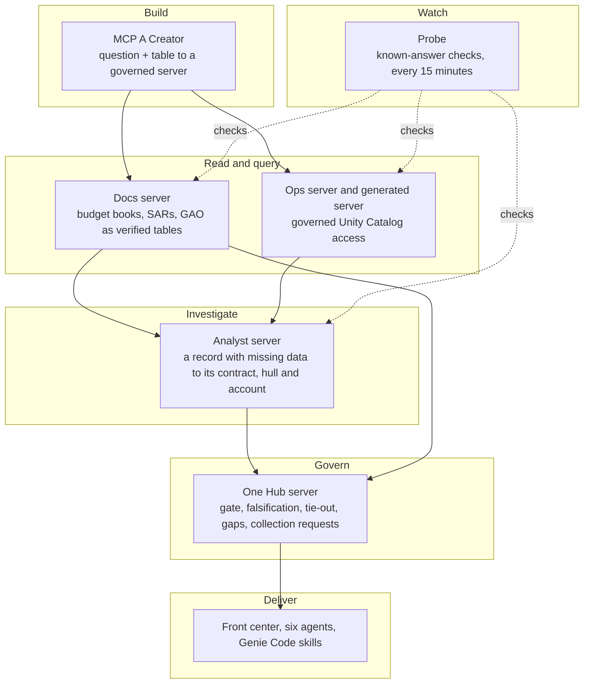
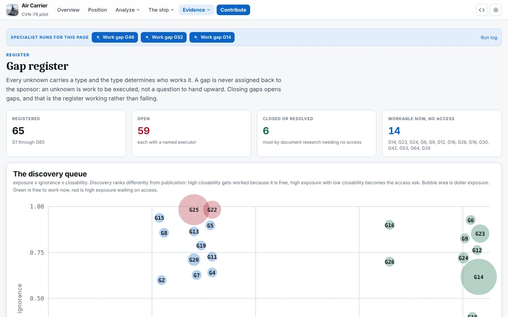
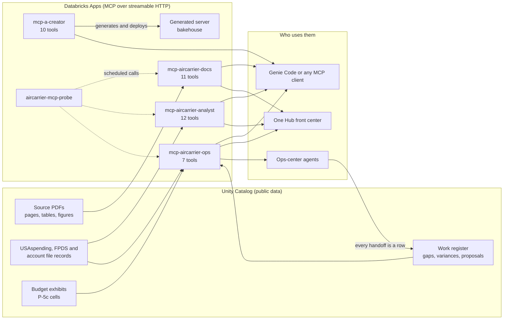

# MCP A Creator and the One Hub for CVN-79

[](https://github.com/llmlocalai/gsa-hackathon-mcp-creator-and-agent-for-cvn/actions/workflows/ci.yml)

**GSA MCP & SI Agent Government Hackathon. Track: Dataset Access Server.** The servers give
agents governed, cited access to public budget, acquisition and contract datasets; the only
writes are append-only, user-attributed leads and a gated label write.

DoD plans to spend more than $2.4 trillion on its costliest weapon programs, and it has
failed its financial statement audit eight years running. The two facts meet in one place.
No office can trace what a major weapon system costs, from the budget request through the
contracts to the asset on the balance sheet, in a form that a program office, a cost
estimator, a budget analyst and an auditor will all accept.

**MCP A Creator turns a question and a Unity Catalog table into a tested, governed MCP
server.** The One Hub is the pilot. It is three servers built the same way, and they
reconcile the four published costs of the aircraft carrier USS John F. Kennedy (CVN-79)
from public records. Every figure is cited to its page, and every unknown is named,
ranked and assigned. CVN-79 is hull one. The method, the servers and the gate are built
to run on every major defense acquisition program.

## For judges: five minutes

| GSA criterion (official wording) | Open this | What it shows |
| --- | --- | --- |
| Technical quality, C1: readability and maintainability (separate data models, tool definitions, API interactions) | [Repository map](#repository-map), e.g. `mcp-servers/mcp-aircarrier-ops/src/mcp_aircarrier_ops/` (`models.py`, `tools/`, `data/warehouse.py`) | The ops server keeps data models, one file per tool, and warehouse access in separate modules; one ruff pin across all projects |
| Technical quality, C2: performance and reliability (own evaluation setup and results, inputs, error handling, stable performance) | [Evaluation](docs/submission/EVALUATION.md), sections 1 and 2 | Five test layers with their inputs; probe latency table; 99.90% of 6,193 production checks ok |
| Technical quality, C3: MCP design (Pydantic-validated inputs, unambiguous names and descriptions, goal-shaped tools, not thin wrappers) | [Security](#security), [Evaluation](docs/submission/EVALUATION.md) section 4 | Every parameter validated and attacked (422 tests); tools return totals and summaries, not raw rows; renames made after models misread a name |
| Mission alignment (mission needs, service delivery and oversight) | [Impact page](#where-to-start) `/impact`, [who uses it](#who-uses-it-and-what-changes-for-them), [the stack](#the-stack-seven-capabilities-each-useful-on-its-own) and [from one hull to every program](#from-one-hull-to-every-major-weapon-system) | Six user groups from PEO to auditor; seven capabilities, each useful alone; one GL record traced through the stack; the path from CVN-79 to the 72 MDAPs in the FY2026 budget |
| Technical quality | [`scripts/check.sh`](scripts/check.sh) and the [CI run](https://github.com/llmlocalai/gsa-hackathon-mcp-creator-and-agent-for-cvn/actions/workflows/ci.yml) | One command runs every suite from a clean clone: 8 projects, 1,151 tests, lint, on Python 3.11 and 3.12 |
| Technical quality | [Delegation evaluation](eval/delegation/README.md) | Four held-out rounds; rounds 2 to 4 sealed by SHA-256 before the run. Round 1, 4 questions: 83.3% with the tools, 25.0% without. Round 2, 12 questions: 43.1% with, 12.5% without; 28 of 41 misses needed a tool or option that did not exist, now built. Round 3, 12 new questions after the fixes: **69.4% with, 4.2% without**. Round 4, 69 questions (45 drawn by a seeded generator, 24 reviewed by the project owner), grader v2: **Claude 88.4%, GPT-5 mini 78.7% with, 14.5% and 1.4% without** ([results](eval/delegation/round4/RESULTS.md)). Every miss is read and its cause published, grader defects included |
| Technical quality | [Evaluation](docs/submission/EVALUATION.md) (GSA's four headings), [findings and fixes](docs/submission/FINDINGS.md), [claim map](#claim-to-artifact-map) | Eight-day probe at 99.90% with 1,234 of 1,234 known answers right, independent answer keys, tie-outs to the cent; each headline number mapped to the file and command that prove it |
| Technical quality | [Security](#security) | 421 hostile calls against all 30 tools: 330 refused, none wrote, none pasted an argument into SQL; generated code fuzzed with warnings as errors |
| Innovation (creative MCP tooling, unique agent workflows) | [MCP A Creator](#mcp-a-creator) | An MCP server that builds MCP servers: same specification, byte-identical project, with its own tests and evaluation, deployed only on an approval bound to what was reviewed |
| Presentation (storytelling, demo flow, evidence of testing) | [Deck](docs/submission/mcp-a-creator-one-hub-deck.pdf), [screenshots](#screenshots), [video notes](#demo-video), [run it locally](#run-the-front-center-locally) | The live app needs a Databricks sign-in; the local copy needs two commands and no account |

## Results at a glance

| Measure | Result | What it does not show |
| --- | --- | --- |
| Tool choice by real models (Claude Sonnet 4.5, GPT-5 mini), round 1: 14 questions, 29 tools at once | 80/84 runs correct (95.2%, CI 88.4 to 98.1) vs 2/28 without tools; strict held-out 20/24 (83.3%) vs 2/8 | 14 questions, only 4 strictly held out; the interval is wide (64.1 to 93.3) |
| Sealed held-out questions, round 2, with vs without tools | 31/72 (43.1%, CI 32.3 to 54.6) vs 3/24 (12.5%) | Run on the 29-tool catalog, before the fixes it prompted. 28 of the 41 misses needed a tool or option that did not exist; 5 are a grader pattern that rejected "cannot find"; the score is reported as graded |
| Sealed held-out questions, round 3 (after the fixes), with vs without tools | 50/72 (69.4%, CI 58.0 to 78.9) vs 1/24 (4.2%) | Questions written by the same author as the fixes. 5 misses are an answer-key error of mine (G07); read by hand, 55/72. Real misses remain on counting by sign, a contamination recorded only in the dossier, and multi-source figures |
| Code suites from a clean clone | 1,151 passed, 0 failed; 6 skipped because they need a live Spark session or bandit | Unit and contract tests show the code does what it says, not that it helps a user |
| Adversarial arguments, all 30 tools | 421 calls: 330 refused by validation, 91 answered; 172 statements reached the warehouse, all read-only; 40 carried a hostile value as a bound parameter, none pasted into SQL text | Runs in-process against a recording fake warehouse, not the deployed apps |
| Creator determinism | Same specification, byte-identical files: 58 of 58 | Determinism is not correctness; the review checks meaning separately |
| Availability of the deployed servers | 99.90% of 6,193 checks in 413 probe sweeps, 2026-11-12 to 2026-11-20; 1,234 of 1,234 known-answer checks right | One workspace, eight days |
| Data integrity | $13,409.970M Total Ship Estimate closes to 0.000 on two independent axes | The exhibit ties to itself; it is a budget estimate, not an audited cost |

It holds two things that depend on each other: the product, and the proof that it works.

1. **MCP A Creator**, an MCP server whose job is building MCP servers. A person brings a
   question and a Unity Catalog table. The Creator profiles the data, designs one tool per
   question, reviews its own design, and generates a complete, tested FastMCP project
   that it deploys as that person's own Databricks App.
2. **The One Hub**, three MCP servers built the same way plus a web front center, which
   together reconcile the CVN-79 cost record. Every figure carries its document, page and
   source, and every unknown is named, owned and ranked.

| | |
| --- | --- |
| **Live front center** | <https://aircarrier-front-center-dev-7474654188777746.aws.databricksapps.com/> (Databricks sign-in required, see [below](#open-the-front-center)) |
| **Evaluation** | [docs/submission/EVALUATION.md](docs/submission/EVALUATION.md) (current; the older [evaluation-report.pdf](docs/submission/evaluation-report.pdf) predates round 3) |
| **Slide deck** | [PowerPoint](docs/submission/mcp-a-creator-one-hub-deck.pptx) · [PDF](docs/submission/mcp-a-creator-one-hub-deck.pdf) |
| **No account needed** | [Run the front center locally](#run-the-front-center-locally) in two commands, or see the [screenshots](#screenshots) |
| **Score per server** | [SCORECARD.md](SCORECARD.md): tools, tests, sweep, accuracy, probe and what is open, one row per server |
| **Defects found by testing** | [docs/submission/FINDINGS.md](docs/submission/FINDINGS.md) |
| **Deployment** | [docs/DEPLOYMENT.md](docs/DEPLOYMENT.md) |
| **Data** | The One Hub uses public records only: budget justification books, Selected Acquisition Reports, GAO and CRS reports, FPDS and USAspending. One server reads other data on purpose: `mcp-bakehouse-sales`, the Creator's second build, reads Databricks' `samples.bakehouse` table to show the Creator works on a dataset unrelated to CVN-79. It is not government data, and none of the CVN-79 evidence rests on it |

---

## Contents

- [Why this matters beyond one ship](#why-this-matters-beyond-one-ship)
- [Background: one ship, four numbers](#background-one-ship-four-numbers)
- [Open the front center](#open-the-front-center)
- [What the One Hub shows](#what-the-one-hub-shows)
- [MCP A Creator](#mcp-a-creator)
- [Architecture](#architecture)
- [How we know it works](#how-we-know-it-works)
- [Security](#security)
- [Repository map](#repository-map)
- [Run it yourself](#run-it-yourself)
- [Deploy and maintain](#deploy-and-maintain)
- [Known limitations](#known-limitations)
- [Sources](#sources)

---

## Why this matters beyond one ship

### Four ledgers that never meet

Every major weapon system's cost is recorded four times, by four communities, for four
purposes. None of the four records carries the keys needed to join it to the others.

| Ledger | Kept by | What it says | Where CVN-79 shows the break |
| --- | --- | --- | --- |
| **Budget** (J-book P-5c, P-40) | The comptroller chain: Navy FMB, NAVSEA 01, OUSD(C), and the congressional committees | What was requested and appropriated, by hull and cost category, in then-year dollars | $13,409.970M Total Ship Estimate. Each SCN year stays available for five years, so one hull is funded by many appropriation years at once |
| **Acquisition** (SAR, MSAR) | The PEO and USD(A&S) | Baseline, estimate at completion, contracts under cost reporting | The Ford-class SAR reports cost for the class, not per hull (GAO-17-575). Only seven contract numbers appear for a $13.4 billion ship. DCARC rates the program's contractor cost reporting **Red** |
| **Contract** (FPDS-NG, USAspending) | Contracting officers and SUPSHIP | Obligations by action and modification | A $54M action described as "detail design and construction CVN 79" is Nimitz defueling work. Award-level outlays reach USAspending for 0.8% of prime obligations, and account linkage covers 36.1% of the DD&C contract |
| **Accounting** (CIP, then General PP&E) | Service financial management and the auditors | The asset's cost on the balance sheet | The hull sits in construction in progress, with no decided date to relieve it. GFE installed on the hull risks being counted twice or not at all. General PP&E and Government Property in the Possession of Contractors are both open material weaknesses |

### The scale

- DoD plans to invest over **$2.4 trillion** to develop and acquire its costliest weapon
  programs ([GAO-26-108457](https://www.gao.gov/products/GAO-26-108457)).
- The FY2026 budget carries **72 active MDAPs**: 15 Army, **35 Navy**, 21 Air Force
  ([OUSD(C), Program Acquisition Cost by Weapon System, FY2026](https://comptroller.defense.gov/Portals/45/Documents/defbudget/FY2026/FY2026_Weapons.pdf)).
- FY2025 was DoD's **eighth disclaimer of opinion**, covering $4.65 trillion in reported
  assets ([CRS IF12627](https://www.everycrsreport.com/files/2026-04-28_IF12627_a0aaa98fa9bd10c7d612eaea7793e46ec9b96ed0.html)).
  The auditors reported **26 material weaknesses**, among them General PP&E, Government
  Property in the Possession of Contractors, and the Joint Strike Fighter program
  ([DoD FY2025 AFR, Other Information](https://comptroller.war.gov/Portals/45/Documents/afr/fy2025/5_Other_Information.pdf)).
- The FY2024 NDAA requires a clean opinion by **December 31, 2028**
  ([GAO-25-108052](https://www.gao.gov/assets/gao-25-108052-highlights.pdf)).
- The Navy alone carries **$503.1 billion** of General PP&E net book value, 55.9% of its
  assets, and vessels and aircraft make up over 90% of its construction in progress
  ([DON FY2025 AFR](https://www.secnav.navy.mil/fmc/FR/FY25_NavyAFR_12.8.25_FINAL.pdf)).
- For the F-35, DoD has estimated parts in contractor possession at over **$220 billion**,
  a figure GAO calls likely significantly understated
  ([GAO-23-106098](https://www.gao.gov/assets/gao-23-106098.pdf)).

A ship or an aircraft is a multi-billion dollar asset that spends a decade or more in
construction in progress, funded by many appropriation years, built under contracts
that also serve other hulls. Getting its cost right is the general PP&E problem at its
largest, and it decides whether the 2028 opinion is reachable.

### Who uses it, and what changes for them

| User | The question they ask | What the One Hub gives them | What it replaces |
| --- | --- | --- | --- |
| **Senior leaders**: ASN(FM&C), OUSD(C), the service acquisition executive, anyone briefing a ship's cost | "What does this ship cost, and can I stand behind the number?" | The four published figures side by side, each with its basis and page. A gate that will not show an unverified figure as fact: the December 2025 baseline (E-17) is shown both ways until a person confirms it | One number lifted into a briefing, with its definition lost on the way |
| **PEO and program office**: PEO Carriers and PMS 379 today, any PEO next | "Where did the money go, and why did the estimate move?" | The anchor chain from appropriation to contract to action. 17 variances where public sources disagree, each with provenance. Attribution to named contracts raised from 42.2% to 75.8% in one pass | Manual reconciliation across J-books, SARs and contract files, redone for every review |
| **CAPE and cost estimators**: CAPE, NCCA, NAVSEA 05C | "Is there a traceable actuals baseline for the next estimate?" | Actuals by cost category and by funding stream, each closing to zero. The learning-curve variance between the 18% contract man-hour target and what was realized. The per-hull cut GAO asked the class SAR to carry | GAO found the CVN-79 estimate met one of four characteristics of a reliable estimate (GAO-17-575). CAPE's independent estimate was higher, and its figure is redacted |
| **Budget analysts**: Navy FMB, NAVSEA 01, comptroller and congressional staff | "What is funded, by year, and how does it stand against the cap?" | Funding by stream from FY2007 to FY2027, the cap history under 10 U.S.C. 8692, cost to complete, and execution from the transaction record | Spreadsheets rebuilt from PDF exhibits each budget cycle |
| **Accountants and auditors**: service FM offices, IPA auditors, DoD OIG, GAO | "Can the asset's value be traced to transactions?" | Every figure to its page or row hash. Open questions the audit will ask, already registered and owned: when CIP is relieved (G14), whether GFE is counted twice (G15), and the GFP position report that answers the contractor-held property question (G16) | Sampling and tracing that starts from nothing every audit cycle |
| **Any analyst with a table**, through MCP A Creator | "Can I put a governed tool over my own data without a developer?" | A question and a Unity Catalog table become a tested MCP server, deployed as the analyst's own app after an approval that covers exactly what was reviewed | A ticket to a development team, or a model improvising SQL |

### From one hull to every major weapon system

What carries to the next program unchanged, and what each program adds:

| Carries over unchanged | Each new program supplies |
| --- | --- |
| The three servers and their 30 tools; the agents; the work register | A key set: appropriation, line item, program element, contracts, CAGE, PSC and acquisition program code. Part G of the [Ring 0 dossier](the-one-hub/ops-center/corpus/dossier/RING0_CVN79.md) is the CVN-79 template |
| The gate. Its materiality floor is a share of the subject's total, so it moves between programs ([seed/gate.yaml](the-one-hub/ops-center/seed/gate.yaml)) | A source catalog: its J-book exhibits, SAR or MSAR, contract records and GAO reports |
| The variance and gap registers, typed and ranked the same way | The subject total the reconciliation must close to |
| MCP A Creator, which builds the per-program servers from tables | Owners for its gaps |

The order we would take, each step reusing the last:

1. **CVN-80 and CVN-81.** Same class, same budget line (SCN 2001), same builder, and a
   shared contract (N00024-16-C-2116) that the hub already excludes from CVN-79.
2. **The Ford class and the carrier fleet.** The class SAR reports cost for the class,
   so the per-hull split is the product.
3. **The F-35.** The Joint Strike Fighter is its own DoD-wide material weakness, and its
   contractor-held parts are the largest instance of the property problem the hub
   already registers for CVN-79 (Ring 0, Part J).
4. **The 35 Navy MDAPs, then the 72 in the FY2026 budget.** Each adds a key set and a
   source catalog, not a new system.

Today the method has run on one hull. The steps above are a plan, not a result.

**Findings from the pilot that will recur on every program.** Each one is in the
variance or gap register with its evidence.

- A contract number is not a hull key. One EASR radar contract serves six ships, and a
  $54M action carries the wrong ship in its own description (Ring 0, N.4 and N.6a).
- USAspending obligations are usable for a weapon system. Its award-level outlays are
  not: they cover 0.8% of CVN-79's prime obligations (Ring 0, N.4).
- The class SAR does not give a per-hull cost (GAO-17-575).
- Capitalized value will never equal program cost, for three structural reasons: scope,
  timing and boundary. The $1 million Navy capitalization threshold alone expenses
  installed components (Ring 0, I.3).
- The date construction in progress is relieved is undecided between preliminary
  acceptance, delivery and commissioning, and the candidates straddle a fiscal year (G14).
- Contractor cost reporting can be formally deficient: the MSAR rates CVN-79's CSDR
  compliance Red (Ring 0, D.9).
- Assets move between hulls by memorandum, with no procurement transaction: one AAG
  engine set moved from CVN-78 to CVN-79 this way (Ring 0, J.4).

### The stack: seven capabilities, each useful on its own

Each layer below answers a problem that federal financial management and acquisition
offices carry today. They were built for CVN-79, and none of them depends on CVN-79 to
work. Stacked, each one makes the layer above it trustworthy.



| Capability | The problem it solves on its own | Who needs it beyond CVN-79 | Where it stands today |
| --- | --- | --- | --- |
| **MCP A Creator** (10 tools) | Turning a dataset into a tool an agent can use takes a developer and weeks, and an improvised server is untested and different every time. The Creator profiles the table, designs one tool per question, reviews meaning as well as shape, and generates a tested project that deploys as the requester's own app | Every office with a Unity Catalog table and a question. GSA's stated aim for this hackathon is an internal library of MCP server prototypes for the government workforce ([event page](https://www.gsa.gov/super-intelligence/si-community-of-practice/events-and-training/mcp-server-and-si-agent-government-hackathon)); the Creator is how a non-developer adds to that library | Works on any table today. It built the ops server inside this hub, and `mcp-bakehouse-sales` on an unrelated sales table to show it is not tied to the carrier |
| **Docs server** (11 tools) | Budget justification books and SARs run to hundreds of pages each, and analysts retype exhibits into spreadsheets. The docs server reads them deterministically, with no model: it maps each book by exhibit and P-1 line item, rebuilds tables with exact decimals, ties out every subtotal and total, and says whether a figure appears in an authoritative source (J-book, SAR) or only a secondary one (CRS, GAO) | Budget analysts, cost estimators, congressional and GAO staff, and auditors, on every appropriation's J-books and every program's SAR. Exhibit formats (P-40, P-5c, P-8a, P-10) are standard across DoD | The reader has no CVN-79 logic in it. 34 PDFs and 7,804 pages are loaded, GAO-26-108457 included; 814 of 818 tie-out checks pass. `docs_parse_pdf` reads any other PDF from a volume on request |
| **Analyst server** (12 tools) | The slowest work in audit remediation is researching a single record that is missing data elements: a GL line, an obligation or an invoice with no contract, no line of accounting or no hull. The analyst profiles what is missing, chases clues across FPDS, File C, sub-awards, the knowledge graph and every document, weighs the evidence, and returns ranked cases with citations, recovered data elements, a collection request for each missing one, and a human-review flag when the answer is weak | Component reconciliation teams, DFAS, FIAR teams and the auditors they support, on unsupported transactions, abnormal balances and Universe of Transactions gaps behind material weaknesses such as Fund Balance with Treasury and contractor-held property | Its skills read the two CVN-79 prime contracts today. A new program adds its contracts, File C and key set; the investigator's method does not change |
| **Ops server** (7 tools) | Agents need governed, paged, read-only access to exhibit cells, obligations on both prime contracts (sorted by date or by amount), the variance register, the knowledge graph and the work register, without raw SQL | Any team that keeps its facts in Unity Catalog | Generated by the Creator; golden set of 17 items with independent answers |
| **One Hub server**, `mcp-aircarrier-hub` (16 read-only tools) | An AI agent can put a wrong figure in a leadership brief or a financial statement in one sentence. This server is the control: `hub_check_claim` routes any candidate figure through policy and the gate and never promotes on its own; `hub_challenge_text` falsifies text against recorded error classes; `hub_tie_out` and `hub_check_anchor_chain` close totals in exact decimals without a model; `hub_rank_gaps`, `hub_plan_gap`, `hub_next_work` and `hub_collection_requirement` turn every unknown into an owned request to a named office | Any office that lets an agent draft numbers: comptrollers, audit liaisons, budget shops. The gap queue works like an auditor's request list, ranked by exposure, ignorance and closability | Runs over stdio, and ships an `app.yaml` for hosting; it is not among the eight deployed apps. The agents and the front center call the same functions directly |
| **Probe** | When a user's agent says "Failed to generate OAuth token", nobody can tell whether the server or the connector broke. The probe calls every server every 15 minutes as a non-human caller, through initialize, tools/list and one known-answer check, and logs which step failed | Any agency running MCP servers in production, as continuous monitoring evidence for an authority to operate | 413 sweeps, 2026-11-12 to 2026-11-20: 99.90% of 6,193 checks ok, 1,234 of 1,234 known answers right |
| **Delivery: front center, six agents, Genie Code skills** | Leaders and analysts need the answer, not the tools. 23 pages answer one question each; six agents hand work to each other only through the work register; three Genie Code skills let an analyst verify a figure, investigate a gap or draft a collection request in their own workspace | Program offices, comptroller staff, auditors | Live as a Databricks App; also runs locally from the bundled data with two commands |

**One record through the stack.** A GL line reads "$454,765,071.00, SCN progress CVN 79",
with no contract and no modification. This is development question Q2 in the delegation
evaluation: both models answer it in all six runs with the tools, and miss it in both runs
without them.

1. **Analyst.** `analyst_investigate_record` matches the amount in the FPDS record to
   modification P00067 on N00024-15-C-2114, and the key set confirms that contract is the
   Kennedy's detail design and construction contract. It returns the case, its evidence and
   the data elements it recovered.
2. **Docs.** The budget line and exhibit behind that contract, SCN line 2001 and the P-5c,
   come back as tied-out tables with page numbers.
3. **One Hub server.** `hub_check_claim` routes the figure: promoted only if it ties to a source
   record, otherwise held as a lead or sent to human review with the reason. If an element
   is still missing, `hub_collection_requirement` names the document, the system and the office
   that hold it.
4. **Probe.** The same hour, the probe has already confirmed that each server answered a
   known question correctly, so a wrong answer is a finding about the data, not about a
   broken transport.

Repeat that for every unsupported transaction in a component's ledger, and the result is
the audit trail that the General PP&E and contractor-held property weaknesses say is
missing.

---

## Background: one ship, four numbers

CVN-79 is the second ship of the Gerald R. Ford class, built by HII Newport News
Shipbuilding under PEO Aircraft Carriers. Its keel was laid in August 2015, it was
christened by Caroline Kennedy in December 2019, it reached preliminary acceptance on
29 September 2026, and on 13 October 2026 it recovered the first F-35C ever to land on a
Ford-class carrier. Delivery and commissioning are planned for March 2027, 141 months
after the detail design and construction award.

Ask what the ship costs and you get four answers, each current, sourced and correct for
its own purpose:

| Figure | What it is | Source |
| --- | --- | --- |
| **$11,341.4M** | A dated estimate in then-year dollars | FY2019 President's Budget |
| **$11,398.0M** | The cost limitation in law | 10 U.S.C. 8692, enacted in the FY2020 NDAA |
| **$12,936.0M** | The adjusted limit the program manages to | Secretary of the Navy notification to Congress, August 2023. The FY2027 MSAR (p.8) reports a December 2025 increase to $13,529M; it is held for human review as variance [E-17](#e-17-the-baseline-under-review) |
| **$13,409.97M** | The current request and estimate to complete | FY2027 President's Budget, SCN Exhibit P-5c |

The budget total sits **$2,011.97M (17.7%) above the statutory cap**. A product that
shows one of these as "the cost of the ship" will be wrong, and the data to reconcile
them is spread across budget books, Selected Acquisition Reports and transaction records
in different units, years and coordinate systems.

That matters beyond one hull. For a comptroller the ship is a future asset: until it is
placed in service it sits on the Navy's books as construction in progress, and general
property, plant and equipment remains a material weakness in the Department's audit.
Reconciling what was budgeted, obligated, paid and capitalized for one carrier is the
pilot for doing it across the fleet.

**What the record says, in numbers** (all from the One Hub's data bundle):

| | |
| --- | --- |
| Total Ship Estimate | $13,409.970M, closing to **zero residual on two independent axes** (cost category and funding stream) |
| Largest cost category | Basic construction, $8,463.2M (63.1%); propulsion (reactor plant) $2,041.6M (15.2%) |
| How it was funded | Advance procurement FY2007-FY2012 $3,327.1M (24.8%); full funding FY2014-FY2018 $7,504.7M (56.0%); cost to complete FY2022-FY2027 $2,087.3M (15.6%) |
| Prime contracts | N00024-09-C-2116, construction preparation, cost plus fixed fee, $4,519.3M obligated over 948 actions; N00024-15-C-2114, detail design and construction, fixed price incentive, $4,578.6M summed over 927 actions (the award record reads $4,584.5M; the hub quotes each with its basis) |
| Attribution | 75.8% of the hull attributed to a named contract, up from 42.2% in one pass by replacing an announcement-derived figure with the obligation record |
| Open questions | 65 registered gaps, 55 still open and 10 closed, resolved, narrowed or reframed, each typed and assigned to a named executor; 17 variances where public sources disagree, kept with provenance |
| Evidence base | Docs MCP server: 34 source PDFs, 7,804 pages, 20,829 chunks, including GAO-26-108457 (July 2026). Front center knowledge base: 44 catalogued artifacts, 3,537 chunks from 23 indexed documents. Every hit cited to a page |

One small example of why provenance matters: FPDS-NG reports $4,518,716,360.83 obligated
on the construction preparation contract and USAspending reports $4,519,300,323.83. The
$583,963.00 difference is 0.013%, small enough to pass any reasonableness check, so the
hub records it as variance E-16 and cites the system by name with every obligation figure.

### E-17: the baseline under review

The FY2027 MSAR says the Secretary of the Navy raised the CVN-79 Cost Limitation Baseline
from $12.936B to $13.529B in December 2025. The hub's figure gate sent that number to human
review instead of using it: it comes from an MSAR sentence rather than the notification, and
$13.529B is also CVN 80's baseline, so a search for the number alone returns both hulls. If
confirmed, the budget total sits $119.03M under the baseline rather than $473.97M over it.
Until a person confirms it under rule CAP-05, the hub shows both readings and keeps $12,936M
as the baseline in force.

---

## Open the front center

**URL:** <https://aircarrier-front-center-dev-7474654188777746.aws.databricksapps.com/>

The front center is a Databricks App. Databricks Apps are reachable only by
authenticated users of the same Databricks account, so the link opens a Databricks
sign-in, and on first visit a consent screen for the app. Visitors without an account
in this workspace can:

- run the same app locally with no workspace at all ([two commands](#run-the-front-center-locally));
- read the screenshots below, the [slide deck](docs/submission/mcp-a-creator-one-hub-deck.pdf), and the
  [evaluation report](docs/submission/evaluation-report.pdf).

### Where to start

| Menu | Page | The question it answers |
| --- | --- | --- |
| The stack | `/stack` | The seven capabilities (MCP servers, Creator, agents, probe, front center), how they fit, how they were tested and what the tests do not show |
| Impact | `/impact` | From CVN-79 to the Ford class, the F-35 and the 59 PB2027 MSAR programs: the agent workflow traced for five users, MCP A Creator's phases, eight onboarding steps and a phased build-out; 24 figures each with its document, page and quote |
| Brief | `/brief` | A guided start in four steps: pick your question (a door for each user group), check what a briefing can say today and what to hold back (the held baseline, E-17), act on the open questions and who can close them, then use the tools (Ask, Brief readiness, Detail table) |
| The ship | `/kennedy` | USS John F. Kennedy (CVN-79): identity, timeline and photographs |
| Cost | `/position`, `/cost`, `/baseline`, `/execution` | The four published figures and why they differ; cost by category and funding stream; estimate and cap history; obligations by year |
| Audit | `/gaps`, `/variances`, `/asset`, `/industrial` | Open questions ranked with who can close each; where sources disagree; the asset's accounting; who builds what, including GFE |
| Dive deeper | `/ask`, `/work`, `/mission`, `/runs`, `/explore`, `/sources`, `/method` | Cited answers; decisions waiting for a person; brief readiness with page-started agent runs; every run and action; every record, filterable; document families and the searchable corpus; the method, with links to `/rules` and `/coverage` |
| Answer a question | `/insight` | Answer one of the open questions; it is recorded as a lead with your name and how you knew it, never as a certified figure |

The app opens on The stack (`/` redirects to `/stack`). Retired pages redirect: `/dashboard` to `/brief`, `/knowledge` to `/sources`, `/program` (and `/delivery`, `/progress`) to `/stack`.

Every page that can start a specialist run shows the runs it offers at the top, scoped to
what is on the page (for example "Explain File C FY2021P03"). Each page opens with the
question it answers, who uses it and the decision it supports. Codes such as G14, E-17,
CAP-05 or P-5c are chips that show their definition on hover or focus, read from the
register row or rule they name. Run locally on the shipped extracts, the four agent pages
(`/mission`, `/work`, `/runs`, `/ask`) carry one banner saying what needs the workspace.

### Screenshots

| | |
| --- | --- |
|  |  |
| **Overview.** Four headline numbers, each with its source. | **Cost composition.** Exhibit P-5c by category and by funding stream, both closing to zero. |
|  |  |
| **Budget execution.** 1,875 prime actions on two HII contracts, from USAspending. | **Gap register.** 65 unknowns ranked on exposure x ignorance x closability. |
|  |  |
| **Variance register.** 17 places where public sources disagree. | **Knowledge base.** 43 catalogued artifacts, every search hit cited to a page. |

### Demo video

The 14:28 demo video was submitted with the entry. Two lines in its narration were
recorded before later corrections, and this README is the current record:

- Where the narration says the budget total is "+$473.97M over the adjusted limit", that
  reading holds against the $12,936M baseline in force. The FY2027 MSAR reports a December
  2025 baseline of $13,529M, under human review as [E-17](#e-17-the-baseline-under-review).
  If it is confirmed, the total sits $119.03M under the baseline.
- Where it says "43 documents", it means the front center knowledge base: 43 catalogued
  artifacts, 2,765 chunks from 22 indexed documents. The docs MCP server holds a separate
  corpus, now 34 PDFs, 7,804 pages and 20,829 chunks.

---

## What the One Hub shows

The One Hub is built from four parts.

**Three MCP servers, 30 tools, all Databricks Apps.** Any MCP client can use them,
including Genie Code, and the front center and the agents use the same ones.

| Server | Tools | What it answers |
| --- | --- | --- |
| [`mcp-aircarrier-docs`](mcp-servers/mcp-aircarrier-docs/) | 11 | Reads the source PDFs (J-books, SARs, GAO, CRS) to the page, table and figure; runs tie-outs; flags a false premise in a search before the model spends tokens on it |
| [`mcp-aircarrier-analyst`](mcp-servers/mcp-aircarrier-analyst/) | 12 | Investigates incomplete cost records, infers lines of accounting, explains File C residuals, ranks leads; one gated write that labels an outcome |
| [`mcp-aircarrier-ops`](mcp-servers/mcp-aircarrier-ops/) | 7 | Exhibit cells; obligations on both prime contracts by modification and fiscal year, largest or smallest first; the variance register (E-1 to E-17); the knowledge graph and the work register |

**The One Hub's own MCP server**, `mcp-aircarrier-hub` ([`the-one-hub/ops-center/mcp/`](the-one-hub/ops-center/mcp/)),
16 read-only `hub_` tools with Pydantic-validated inputs that expose the gate, the
falsification checks, the tie-outs and the gap queue to any agent. It runs over stdio and is
not yet deployed as an app. **A probe** calls every deployed server every 15 minutes with a known question. Their
standalone value is in [the stack](#the-stack-seven-capabilities-each-useful-on-its-own).

**A front center** ([`the-one-hub/ops-center/app/`](the-one-hub/ops-center/app/)): a
FastAPI application with server-rendered pages and charts and a JSON API, described above.

**Six agents that never call each other** ([`ops/agents/`](the-one-hub/ops-center/ops/agents/)):
investigator, reader, tie-out, challenger, attributor and briefer. Every handoff is a
state change on a row in the work register, so each agent can be replaced alone, and a
specialist harness adds cost-cap, cost-capture, earned-value and valuation specialists.

**A gate.** No figure reaches a product without passing deterministic checks that use no
model. A figure that ties to a source record is shown as verified; anything else is shown
as a lead. Proposals that would change the record wait in the work queue for a person.
The routes are in [`seed/gate.yaml`](the-one-hub/ops-center/seed/gate.yaml); the first match decides.

| Outcome | When | Example in the record |
| --- | --- | --- |
| **Promote** | Verified, unflagged, and for a material figure, tied out on both axes (R5, R6) | $13,409.970M Total Ship Estimate, closing to 0.000 by cost category and by funding stream |
| **Human review** | Any premise, method or key flag, a material interpretation, or a material figure below verified (R1, R2, R4), and any policy violation (R-1) | E-17: the $13.529B baseline comes from an MSAR sentence, and is also CVN 80's figure. Both readings are shown until a person confirms one under rule CAP-05 |
| **Gap** | The value is unknown (R0) | 65 registered gaps, such as G14, the date construction in progress is relieved |
| **Hold as a lead** | Below the materiality floor and not verified (R3, R7) | A contribution through `/insight`, recorded with its author and basis, never as a certified figure |

The rules that shape the build are written into the code:

- No provider SDK call appears above `core/ports/`. Moving to a DoD environment is an
  adapter swap and a few variables in `databricks.yml`.
- Agents never call each other.
- The front center is a self-contained transfer unit that vendors its shared core.

---

## MCP A Creator

Most teams build MCP servers by asking a model to improvise one. The result differs on
every run, the SQL is hand-written, nothing is tested, and nobody can say whether the
server helps. The Creator splits the work: **bundled skills carry the judgment** (tool
design, structured and unstructured data, security review, evaluation, deployment,
portability), and **deterministic generators carry the mechanics**, so the same
specification always produces the same project, byte for byte.

It walks a person through seven phases, each ending in something reviewable:

| Phase | Tool | Produces |
| --- | --- | --- |
| 0 Environment | `creator_check_environment` | What this workspace can run |
| 1 Discovery | `creator_start_design` | A design handle and the gaps that block it |
| 2 Profile | `creator_add_data_source` | Field roles, personal-data columns, grants, as the calling user |
| 3 Design | `creator_design_tools` | One tool per question, at most 8, and a list of what cannot be answered |
| 4 Review | `creator_review_server` | A score on 11 dimensions, including whether each tool computes what its question means |
| 5 Generate | `creator_generate_project`, `creator_write_project` | Server, tests, a Phoenix evaluation harness and a Databricks App kit |
| 6 Deploy | `creator_deploy_server` | The person's own app, after an approval bound to exactly what they reviewed |

Two more tools, `creator_list_library` and `creator_load_document`, serve the skills and
reference material, which are also exposed as MCP resources and prompts.

Design choices that matter:

- **State travels in the payload.** The MCP 2026-07-28 revision removed protocol
  sessions, so the design moves between calls as a twelve-character handle and the
  server holds no session state.
- **Every parameter is a scalar, enum or list of strings**, so any model and client can
  fill it.
- **Generated tools are typed and goal-shaped.** Column names come from an allowlist and
  are quoted; values are bound as parameters; personal-data and out-of-scope columns are
  removed at design time; every docstring states its grain and what it refuses.
- **The review checks meaning, not shape.** An early design whose tools all computed the
  wrong thing scored 4.6 of 5 on shape checks. The review now fails a tool that sums an
  identifier, groups by a column the question never names, or leaves a question
  uncovered, and caps the honesty score when it does.

The Creator works as a Genie Code connector. See
[mcp-server-creator/README.md](mcp-server-creator/README.md) for the walk-through and five
example prompts. It has built two servers in this repository, on two unrelated datasets:
[`mcp-aircarrier-ops`](mcp-servers/mcp-aircarrier-ops/) over the CVN-79 stores, and
[`mcp-bakehouse-sales`](mcp-servers/mcp-bakehouse-sales/) over Databricks'
`samples.bakehouse` sales table, chosen because every workspace has it. The second build is
the proof that the Creator is not tied to the carrier: same tool, different table, a tested
and deployed server. Both are probe targets (the bakehouse from 2026-11-21).

---

## Architecture



All eight apps run in one workspace. Tables are read as the calling user under Unity
Catalog grants, with the app's service principal as a reported fallback.

---

## How we know it works

The evaluation has four layers, one question each. Full method and results are in the
[evaluation report](docs/submission/evaluation-report.pdf).

| Layer | Question | Result |
| --- | --- | --- |
| Code suites | Does the code do what it says? | **1,151 tests pass from a clean clone** across eight projects with one command, [`scripts/check.sh`](scripts/check.sh), which CI runs on Python 3.11 and 3.12. Plus six One Hub script suites and the tie-outs that close the $13,409.970M estimate to zero residual |
| Creator end to end | Does the Creator build good servers, repeatably? | The five README prompts, three runs each, through the MCP interface: **15 of 15** generated projects passed their own tests and lint, and each server's files were byte-identical across runs. Of 14 questions, 11 got the right tool, a stated reason why not, or a review flag; 3 did not, and the report names them |
| Golden set | Does the ops server answer correctly and stay in scope? | 17 items with answers computed by independent SQL, including decoy, no-action, out-of-scope and injection cases ([eval/](mcp-servers/mcp-aircarrier-ops/eval/)) |
| Adversarial arguments | Does any tool accept a hostile argument? | Every parameter of all 30 tools gets SQL fragments, path traversal, oversized values, wrong enum members and control characters: **421 calls, 330 refused, 91 answered safely, 0 writes, 0 arguments pasted into SQL** ([test](mcp-servers/test_adversarial_arguments.py)) |
| Delegation | Given all the tools at once, do real models pick the right ones? | Claude Sonnet 4.5 and GPT-5 mini, three repeats each plus a no-tool baseline. Round 1, 14 questions: **80 of 84 (95.2%)** with 29 tools, 2 of 28 without; strict held-out 20/24 (83.3%). Round 2, 12 sealed questions: **31 of 72 (43.1%)**, 3 of 24 without. Round 3, 12 new sealed questions after the fixes, 30 tools: **50 of 72 (69.4%, CI 58.0 to 78.9)**, 1 of 24 without. Round 4, 69 sealed questions, 30 tools: **Claude Sonnet 4.5 183 of 207 (88.4%, CI 81.2 to 94.7), GPT-5 mini 163 of 207 (78.7%, CI 70.0 to 86.5)**, 10 of 69 and 1 of 69 without; intervals resample questions ([round 4 results](eval/delegation/round4/RESULTS.md)). Raw runs and the script that re-derives every number: [eval/delegation/](eval/delegation/README.md) |

Every delegation run is logged to Delta with a SHA-256 of the tool catalog, so a result
is tied to the exact tool surface it measured. Rounds 2, 3 and 4 were sealed: questions and
answer key fixed by a SHA-256 committed before any model saw them, published after the
run. Every miss is read and given a cause, and grading defects are kept in the score and
listed apart. Round 2 found that 28 of its 41 misses needed a tool or option that did not
exist (obligations on the DD&C contract, a sort by amount, a search of the variance
register); those were built, and round 3 measured them on new questions. Misses that
remain: counting deobligations by sign, a contaminated transaction that no tool exposes,
and figures that live only in the variance register. Full account:
[eval/delegation/README.md](eval/delegation/README.md).

The evaluation also found defects in the code, each fixed and pinned by a regression
test: a missing fiscal-year filter, an ambiguous word ("open"), a decoy question that
burned 255k tokens, a budget-cycle reader that missed the real J-book file names, and in
the Creator, free text that could break out of a string in a generated file. What
happened to each finding is in the
[findings and fixes](docs/submission/FINDINGS.md).

### Claim-to-artifact map

| Claim | The file that proves it | The command that re-runs it |
| --- | --- | --- |
| 1,151 tests pass from a clean clone | [`scripts/check.sh`](scripts/check.sh), CI | `scripts/check.sh` |
| Every Impact page figure is printed on its cited page | [`checks/test_impact.py`](the-one-hub/ops-center/checks/test_impact.py), [`impact.json`](the-one-hub/ops-center/app/data/curated/impact.json) | `scripts/check.sh one-hub` |
| 83.3% strict held-out with tools, 25.0% without | [`eval/delegation/runs.csv`](eval/delegation/runs.csv), [`RESULTS.md`](eval/delegation/RESULTS.md) | `python3 eval/delegation/analyze.py` (CI fails if it disagrees with RESULTS.md) |
| No tool accepts a hostile argument | [`mcp-servers/test_adversarial_arguments.py`](mcp-servers/test_adversarial_arguments.py) | `scripts/check.sh mcp-local` |
| Free text never becomes code in a generated project | [`mcp-server-creator/tests/test_injection_safety.py`](mcp-server-creator/tests/test_injection_safety.py) | `scripts/check.sh creator` |
| Byte-identical generation, 58 of 58 files | [evaluation report](docs/submission/evaluation-report.pdf), section 10 | The command in the report's section 14 |
| $13,409.970M closes to zero on two axes | [`checks/verify.py`](the-one-hub/ops-center/checks/verify.py) | `scripts/check.sh one-hub` |
| 99.90% availability over eight days | [evaluation](docs/submission/EVALUATION.md), section 2.2 | The probe app, [`aircarrier-mcp-probe`](mcp-servers/aircarrier-mcp-probe/) |
| 43.1% and 69.4% on sealed questions fixed before each run | [`eval/delegation/README.md`](eval/delegation/README.md) (the seals), [`questions_h2.json`](eval/delegation/questions_h2.json), [`questions_h3.json`](eval/delegation/questions_h3.json) | `sha256sum eval/delegation/questions_h*.json`, then `python3 eval/delegation/analyze.py` |
| Round 4: 88.4% (Claude) and 78.7% (GPT-5 mini) on 69 sealed questions | [`round4/SEAL.md`](eval/delegation/round4/SEAL.md), [`questions_h4.json`](eval/delegation/round4/questions_h4.json), [`runs_r4.csv`](eval/delegation/round4/runs_r4.csv), [`RESULTS.md`](eval/delegation/round4/RESULTS.md) | `sha256sum eval/delegation/round4/questions_h4.json`, then `python3 eval/delegation/round4/analyze_round4.py` (CI fails if it disagrees with RESULTS.md) |

---

## Security

The model fills SQL fragments, file paths and free text, and it reads untrusted
documents. The controls are in code, not in prompts:

| Risk | Control |
| --- | --- |
| SQL injection | Identifiers are allow-listed and quoted; values are bound as parameters. The One Hub's `sqlsafe.compose` refuses anything that is not a vetted fragment or identifier |
| Code injection into generated projects | Free text is made inert before it enters any generated literal, docstring, comment or constant (`utils.inert_text`, `utils.docstring_safe`). A fuzz test sends eight payloads through the purpose, user, questions, out-of-scope list and every source description, and compiles every generated Python file with warnings as errors; every TOML, JSON, YAML and XML file must parse |
| Hostile tool arguments | Every parameter of all 30 Air Carrier tools is attacked in one sweep: 421 calls, 330 refused by validation, every statement that reached the warehouse read-only, and hostile values only ever bound as parameters |
| Path traversal | Volume reads are confined to configured roots; the One Hub MCP server reads only its own data folder |
| Unwanted writes | Air Carrier tools are read-only except one gated label write that needs an authoritative document locator and a confirming office. Creator writes are dry runs by default. Deployment returns an approval token, a hash of the design, the app name, the grants and the folder's files; a deploy needs that token, so a yes covers exactly what was reviewed. It never touches another owner's app |
| Identity and grants | Per-user OAuth through Databricks Apps; tables read as the caller under Unity Catalog; no credentials in code, only `.env.example` files are committed |
| Prompt injection | Retrieved text is data, never instructions. The golden set carries a direct injection case (q17) and an indirect one (q16), a planted record in a scratch copy of the store |

---

## Repository map

| Folder | What it is | Databricks App |
| --- | --- | --- |
| [`mcp-server-creator/`](mcp-server-creator/) | MCP A Creator: profile, design, review, generate, deploy | `mcp-a-creator` |
| [`mcp-servers/mcp-aircarrier-docs/`](mcp-servers/mcp-aircarrier-docs/) | Document server over the CVN-79 source PDFs | `mcp-aircarrier-docs` |
| [`mcp-servers/mcp-aircarrier-analyst/`](mcp-servers/mcp-aircarrier-analyst/) | Analyst server: incomplete records, lines of accounting, File C residuals | `mcp-aircarrier-analyst` |
| [`mcp-servers/mcp-aircarrier-ops/`](mcp-servers/mcp-aircarrier-ops/) | Ops server: exhibit cells, obligations, knowledge graph, work register; Phoenix evaluation | `mcp-aircarrier-ops` |
| [`mcp-servers/aircarrier-mcp-probe/`](mcp-servers/aircarrier-mcp-probe/) | Scheduled probe that calls the deployed servers (not an MCP server) | `aircarrier-mcp-probe` |
| [`mcp-servers/mcp-bakehouse-sales/`](mcp-servers/mcp-bakehouse-sales/) | Server generated by MCP A Creator on a non-CVN sales table: the second-dataset demonstration | `mcp-bakehouse-sales` |
| `mcp-servers/mcp_local.py`, `CONNECTOR_RUNBOOK.md`, `Air Carrier Delegation Eval` | In-process tool harness, connector runbook, delegation evaluation notebook | - |
| [`the-one-hub/ops-center/`](the-one-hub/ops-center/) | The One Hub: front center, agents, harness, ETL, checks, bundle config, its own MCP server (16 tools) | `aircarrier-front-center-dev` |
| `the-one-hub/notebooks/` | Build notebooks: knowledge graph, PDF and source table stores, work register, tracker | - |
| `genie-code-skills/` | Genie Code skills for analysts: verify a figure, investigate a gap, draft a collection request | - |
| `eval/delegation/` | Delegation evaluation: questions for all three rounds, the seals, every logged run, hand grades, and the script that re-derives the results | - |
| `mcp-servers/test_adversarial_arguments.py` | Hostile arguments against every parameter of all 30 Air Carrier tools | - |
| `LICENSE`, `SECURITY.md` | MIT license from the GSA template; repository-wide security posture and where each control is tested | - |
| `docs/` | Deployment guide, evaluation report, findings and fixes, deck, screenshots | - |
| `scripts/` | `check.sh` (every suite, one command), `check_links.py` (no broken links) | - |
| `.github/workflows/ci.yml` | CI: `scripts/check.sh` per project on Python 3.11 and 3.12 | - |
| `tools/sync_from_workspace.py` | Refreshes this repository from the live workspace folders | - |

---

## Run it yourself

### Run the front center locally

No Databricks workspace is needed; the app reads its bundled data files.

```
cd the-one-hub/ops-center/app
pip install -r requirements.txt
uvicorn main:app --port 8000      # then open http://127.0.0.1:8000
```

### Run an MCP server locally

```
cd mcp-server-creator
uv sync
uv run mcp-a-creator              # stdio server
uv run mcp-a-creator-doctor       # will it start here, and what is missing
```

### Run the tests

One command, from a fresh clone, with [uv](https://docs.astral.sh/uv/) installed:

```
scripts/check.sh              # every project
scripts/check.sh creator      # or one: creator ops bakehouse docs analyst probe mcp-local one-hub evidence
```

Each project installs its own dependencies into its own environment. Expected (checked
2026-11-21): Creator 258 passed, 1 skipped; ops 40; bakehouse 21; docs 42;
analyst 39; probe 10; mcp_local 23 plus the adversarial sweep 422; One Hub 296 passed,
5 skipped, plus six script suites and lint. Total 1,151 passed, 6 skipped, plus the 36 round 4
grader and runner tests in the evidence step. The skips need a
live Spark session (5 in the One Hub) or bandit (1 in the Creator). Inside a Databricks
notebook, run with `env -i PATH=$PATH HOME=/tmp bash scripts/check.sh` so the notebook's Spark
variables do not turn the 4 live harness skips into failures. CI runs the same script.

The [checks README](the-one-hub/ops-center/checks/README.md) lists every One Hub suite
and how it runs. Inside a Databricks Git folder, also set `PYTHONDONTWRITEBYTECODE=1` and
pass `-p no:cacheprovider`: Git folders do not allow `__pycache__` or `.pytest_cache`, and
the run fails with `OSError: [Errno 95] Operation not supported`.

---

## Deploy and maintain

Every app deploys from this GitHub repository, branch `main`. A release is a push and one
command:

```
git push
python tools/deploy_from_github.py
```

The script redeploys only the apps whose source folder changed, waits, and checks each runs
the pushed commit. [docs/DEPLOYMENT.md](docs/DEPLOYMENT.md) has the app map, resources,
environment variables, grants and rollback.

---

## Known limitations

- **Cost model.** The cost-model specialist's model run is a placeholder, so
  estimate-at-complete ranges are not yet computed.
- **Creator review.** It catches uncovered questions and identifiers used as measures,
  but not a confident tool mapped to a different question; two of 14 questions in the
  end-to-end run showed this.
- **Small evaluation sets.** 14 delegation questions, 17 golden items and 5 Creator
  prompts, so the confidence intervals are wide (strict held-out 64.1 to 93.3). Round 2's
  12 sealed questions scored 43.1% (CI 32.3 to 54.6) before the fixes it prompted, and
  round 3's 12 new ones 69.4% (CI 58.0 to 78.9) after. Both sets were written by the
  person who built the tools, and round 3 carried one answer-key error; an independent
  author would make a stronger test. Round 4 widened the set to 69 sealed questions (CI
  for Claude 81.2 to 94.7, resampling questions), but its generator templates and the
  draft of its 24 reviewed questions are still Genie Code's. The injection cases q16 (planted record, run through a
  read-only overlay) and q17 were run on 2026-11-20: 15 of 16 correct, no run followed the
  injected instruction, and none flagged it to the user.
- **One hull.** The method has run on CVN-79 only. CVN-80, CVN-81, the F-35 and the other
  MDAPs are a plan with named inputs, not results.
- **No measured time saved.** The hub reconciles in one pass what is done by hand today;
  analyst hours before and after have not been measured.
- **The Cost Limitation Baseline is under review** (E-17). The hub keeps $12,936M in force
  until a person confirms the December 2025 figure.
- **Figures are the app's reading of the register, not a cleared position.** The front
  center says so where it shows a selection.

---

## Sources

All data is public. The main sources are:

- Department of the Navy, Shipbuilding and Conversion (SCN) budget justification books,
  FY2019 through FY2027, Exhibit P-5c
- CVN 78 class Selected Acquisition Reports and MSARs
- Congressional Research Service, *Navy Ford (CVN-78) Class Aircraft Carrier Program*, RS20643
- GAO-26-108457 and earlier GAO reviews of the program
- USAspending and FPDS-NG transaction records for N00024-09-C-2116 and N00024-15-C-2114
- 10 U.S.C. 8692, Ford-class aircraft carriers: cost limitation baselines

For the portfolio and audit context in [Why this matters](#why-this-matters-beyond-one-ship):

- GAO-26-108457, *Weapon Systems Annual Assessment*, July 2026
- OUSD(C), *Program Acquisition Cost by Weapon System*, FY2026 budget request
- DoD FY2025 Agency Financial Report, Independent Auditor's Report and Other Information
- CRS IF12627, *Defense Primer: FY2025 Department of Defense Audit Results*
- GAO-25-108052, *Insights into the Auditability of DOD's Fiscal Year 2024 Balance Sheet*
- Department of the Navy FY2025 Agency Financial Report
- GAO-23-106098, *F-35 Program: DOD Needs Better Accountability for Global Spare Parts*
- GAO-17-575, *Ford-Class Aircraft Carrier: Follow-On Ships Need More Frequent and Accurate Cost Estimates to Avoid Pitfalls of Lead Ship*

The full source list, with each document's role, is on the front center's Sources page
and in `the-one-hub/ops-center/corpus/`.

---

Built for the GSA MCP & SI Agent Government Hackathon by Peter Shang. This is a
hackathon submission, not an official Department position; its figures come from
publicly released documents.
