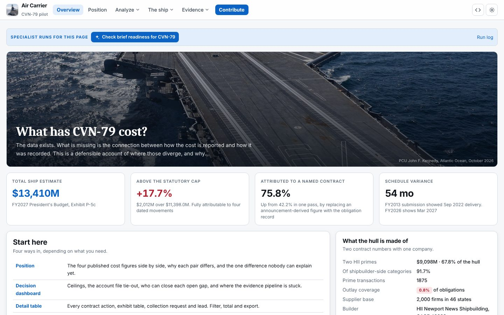
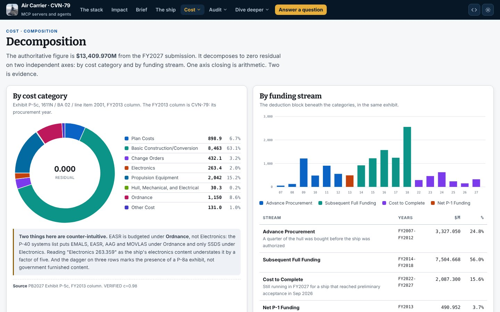
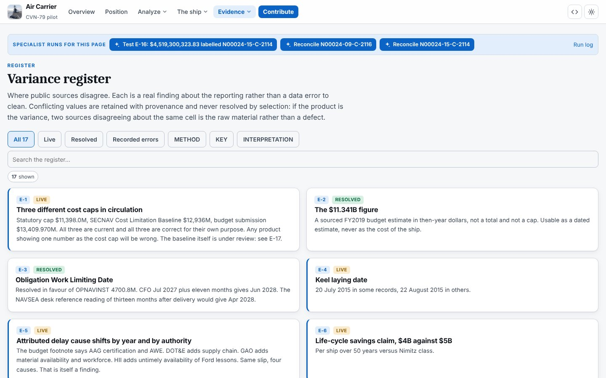
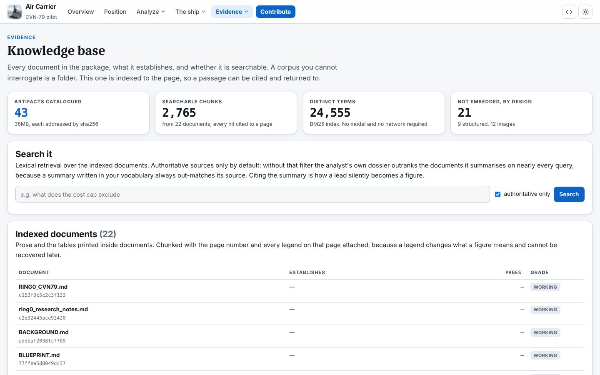
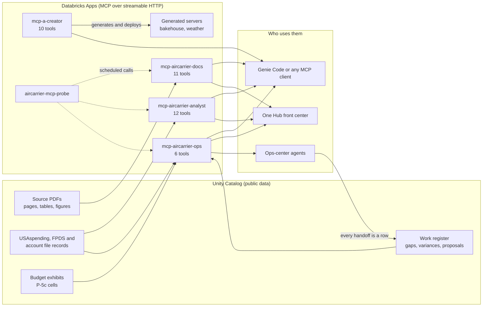

# MCP A Creator and the One Hub for CVN-79

[](https://github.com/llmlocalai/gsa-hackathon-mcp-creator-and-agent-for-cvn/actions/workflows/ci.yml)

**GSA MCP & SI Agent Government Hackathon, Data track.**

**MCP A Creator turns a question and a Unity Catalog table into a tested, governed MCP
server.** The One Hub is the proof: three MCP servers built the same way reconcile the
four published costs of the aircraft carrier USS John F. Kennedy (CVN-79) from public
records, with every figure cited to its page and every unknown named and owned.

## For judges: five minutes

| GSA criterion | Open this | What it shows |
| --- | --- | --- |
| Technical quality | [`scripts/check.sh`](scripts/check.sh) and the [CI run](https://github.com/llmlocalai/gsa-hackathon-mcp-creator-and-agent-for-cvn/actions/workflows/ci.yml) | One command runs every suite from a clean clone: 9 projects, 600 tests, lint and format, on Python 3.11 and 3.12 |
| Technical quality | [Delegation results](eval/delegation/RESULTS.md) | With all 29 tools, models answer 83.3% of strict held-out questions (95% CI 64.1 to 93.3) against 25.0% without tools; re-derived from 224 logged runs |
| Technical quality | [Evaluation report](docs/submission/evaluation-report.pdf) and [addendum](docs/submission/EVALUATION_ADDENDUM.md) | Seven-day probe at 99.83%, independent answer keys, tie-outs to the cent; every finding and what happened to it |
| Innovation | [MCP A Creator](#mcp-a-creator) | An MCP server that builds MCP servers: same specification, byte-identical project, with its own tests and evaluation |
| Mission alignment | [Background](#background-one-ship-four-numbers) | DoD's PP&E audit material weakness, made concrete for one $13.4B hull, and a pattern any agency can reuse |
| Presentation | [Deck](docs/submission/mcp-a-creator-one-hub-deck.pdf), [screenshots](#screenshots), [run it locally](#run-the-front-center-locally) | The live app needs a Databricks sign-in; the local copy needs two commands and no account |

## Results at a glance

| Measure | Result |
| --- | --- |
| Tool choice by real models (Claude Sonnet 4.5, GPT-5 mini), all 29 tools at once | 80/84 runs correct (95.2%, CI 88.4 to 98.1) vs 2/28 without tools (7.1%, CI 2.0 to 22.6) |
| Strict held-out questions, with vs without tools | 20/24 (83.3%) vs 2/8 (25.0%) |
| Code suites from a clean clone | 600 passed, 0 failed; 14 skipped because they need a live Spark session, the deployed data bundle or bandit |
| Creator determinism | Same specification, byte-identical files: 58 of 58 |
| Availability of the deployed servers | 99.83% of 3,568 checks in 238 hourly probe sweeps over seven days; 709 of 709 known-answer checks right |
| Data integrity | $13,409.970M Total Ship Estimate closes to 0.000 on two independent axes |

It holds two things that depend on each other: the product, and the proof that it works.

1. **MCP A Creator**, an MCP server whose job is building MCP servers. A person brings a
   question and a Unity Catalog table. The Creator profiles the data, designs one tool per
   question, reviews its own design, and generates a complete, tested FastMCP project
   that it deploys as that person's own Databricks App.
2. **The One Hub**, three MCP servers built the same way plus a web front center, which
   together reconcile the CVN-79 cost record. Every figure carries its document, page and
   source, and every unknown is named, owned and ranked.

| | |
| --- | --- |
| **Live front center** | <https://aircarrier-front-center-dev-7474654188777746.aws.databricksapps.com/> (Databricks sign-in required, see [below](#open-the-front-center)) |
| **Evaluation report** | [docs/submission/evaluation-report.pdf](docs/submission/evaluation-report.pdf) |
| **Slide deck** | [PowerPoint](docs/submission/mcp-a-creator-one-hub-deck.pptx) · [PDF](docs/submission/mcp-a-creator-one-hub-deck.pdf) |
| **No account needed** | [Run the front center locally](#run-the-front-center-locally) in two commands, or see the [screenshots](#screenshots) |
| **Defects found by testing** | [docs/REVIEW-2026-11-18.md](docs/REVIEW-2026-11-18.md) |
| **Deployment** | [docs/DEPLOYMENT.md](docs/DEPLOYMENT.md) |
| **Data** | The One Hub uses public records only: budget justification books, Selected Acquisition Reports, GAO and CRS reports, FPDS and USAspending. The generator demo `mcp-bakehouse-sales` reads Databricks' `samples.bakehouse` sample table, which is not government data |

---

## Contents

- [Background: one ship, four numbers](#background-one-ship-four-numbers)
- [Open the front center](#open-the-front-center)
- [What the One Hub shows](#what-the-one-hub-shows)
- [MCP A Creator](#mcp-a-creator)
- [Architecture](#architecture)
- [How we know it works](#how-we-know-it-works)
- [Security](#security)
- [Repository map](#repository-map)
- [Run it yourself](#run-it-yourself)
- [Deploy and maintain](#deploy-and-maintain)
- [Known limitations](#known-limitations)
- [Sources](#sources)

---

## Background: one ship, four numbers

CVN-79 is the second ship of the Gerald R. Ford class, built by HII Newport News
Shipbuilding under PEO Aircraft Carriers. Its keel was laid in August 2015, it was
christened by Caroline Kennedy in December 2019, it reached preliminary acceptance on
29 September 2026, and on 13 October 2026 it recovered the first F-35C ever to land on a
Ford-class carrier. Delivery and commissioning are planned for March 2027, 141 months
after the detail design and construction award.

Ask what the ship costs and you get four answers, each current, sourced and correct for
its own purpose:

| Figure | What it is | Source |
| --- | --- | --- |
| **$11,341.4M** | A dated estimate in then-year dollars | FY2019 President's Budget |
| **$11,398.0M** | The cost limitation in law | 10 U.S.C. 8692, enacted in the FY2020 NDAA |
| **$12,936.0M** | The adjusted limit the program manages to | Secretary of the Navy notification to Congress, August 2023. The FY2027 MSAR (p.8) reports a December 2025 increase to $13,529M; it is held for human review as variance [E-17](#e-17-the-baseline-under-review) |
| **$13,409.97M** | The current request and estimate to complete | FY2027 President's Budget, SCN Exhibit P-5c |

The budget total sits **$2,011.97M (17.7%) above the statutory cap**. A product that
shows one of these as "the cost of the ship" will be wrong, and the data to reconcile
them is spread across budget books, Selected Acquisition Reports and transaction records
in different units, years and coordinate systems.

That matters beyond one hull. For a comptroller the ship is a future asset: until it is
placed in service it sits on the Navy's books as construction in progress, and general
property, plant and equipment remains a material weakness in the Department's audit.
Reconciling what was budgeted, obligated, paid and capitalized for one carrier is the
pilot for doing it across the fleet.

**What the record says, in numbers** (all from the One Hub's data bundle):

| | |
| --- | --- |
| Total Ship Estimate | $13,409.970M, closing to **zero residual on two independent axes** (cost category and funding stream) |
| Largest cost category | Basic construction, $8,463.2M (63.1%); propulsion (reactor plant) $2,041.6M (15.2%) |
| How it was funded | Advance procurement FY2007-FY2012 $3,327.1M (24.8%); full funding FY2014-FY2018 $7,504.7M (56.0%); cost to complete FY2022-FY2027 $2,087.3M (15.6%) |
| Prime contracts | N00024-09-C-2116, construction preparation, cost plus fixed fee, $4,519.3M obligated over 948 actions; N00024-15-C-2114, detail design and construction, fixed price incentive, $4,578.6M summed over 927 actions (the award record reads $4,584.5M; the hub quotes each with its basis) |
| Attribution | 75.8% of the hull attributed to a named contract, up from 42.2% in one pass by replacing an announcement-derived figure with the obligation record |
| Open questions | 65 registered gaps, 59 still open and 6 closed or resolved, each typed and assigned to a named executor; 17 variances where public sources disagree, kept with provenance |
| Evidence base | Docs MCP server: 33 source PDFs, 7,555 pages, 19,917 chunks. Front center knowledge base: 43 catalogued artifacts, 2,765 chunks from 22 indexed documents. Every hit cited to a page |

One small example of why provenance matters: FPDS-NG reports $4,518,716,360.83 obligated
on the construction preparation contract and USAspending reports $4,519,300,323.83. The
$583,963.00 difference is 0.013%, small enough to pass any reasonableness check, so the
hub records it as variance E-16 and cites the system by name with every obligation figure.

### E-17: the baseline under review

The FY2027 MSAR says the Secretary of the Navy raised the CVN-79 Cost Limitation Baseline
from $12.936B to $13.529B in December 2025. The hub's figure gate sent that number to human
review instead of using it: it comes from an MSAR sentence rather than the notification, and
$13.529B is also CVN 80's baseline, so a search for the number alone returns both hulls. If
confirmed, the budget total sits $119.03M under the baseline rather than $473.97M over it.
Until a person confirms it under rule CAP-05, the hub shows both readings and keeps $12,936M
as the baseline in force.

---

## Open the front center

**URL:** <https://aircarrier-front-center-dev-7474654188777746.aws.databricksapps.com/>

The front center is a Databricks App. Databricks Apps are reachable only by
authenticated users of the same Databricks account, so the link opens a Databricks
sign-in, and on first visit a consent screen for the app. Visitors without an account
in this workspace can:

- run the same app locally with no workspace at all ([two commands](#run-the-front-center-locally));
- read the screenshots below, the [slide deck](docs/submission/mcp-a-creator-one-hub-deck.pdf), and the
  [evaluation report](docs/submission/evaluation-report.pdf).

### Where to start

| Menu | Page | The question it answers |
| --- | --- | --- |
| Overview | `/` | What has CVN-79 cost, in four headline numbers with their sources |
| Position | `/position` | The four published figures side by side, what kind of number each is, and why each pair differs |
| Analyze | Kennedy picture `/mission` | Can we stand behind the number at the brief, and which records could not be read |
| | Decision dashboard `/dashboard` | Ceilings, the account file tie-out, and who can close each open gap |
| | Work queue `/work` | Proposals from the agents waiting for a person to confirm or reject |
| | Detail table `/explore` | Every contract action, exhibit table, collection request and lead; filter, total, export |
| | Ask the evidence `/ask` | A question in plain language, answered from the same records with citations |
| | Run log `/runs` | Every specialist run, its inputs and its result |
| The ship | `/kennedy`, `/cost`, `/execution`, `/baseline`, `/asset`, `/industrial` | The hull, its cost composition, budget execution, caps and baselines, its accounting as an asset, and its supplier base (2,000 firms in 46 states) |
| Evidence | `/variances`, `/gaps`, `/knowledge`, `/sources`, `/coverage`, `/method`, `/rules`, `/program` | The variance and gap registers, the document store, source list, coverage map, method, rule codes and build progress |
| Contribute | `/insight` | Answer one of the open questions; it is recorded as a lead with your name and how you knew it, never as a certified figure |

Every page that can start a specialist run shows the runs it offers at the top, scoped to
what is on the page (for example "Explain File C FY2021P03").

### Screenshots

| | |
| --- | --- |
|  |  |
| **Overview.** Four headline numbers, each with its source. | **Cost composition.** Exhibit P-5c by category and by funding stream, both closing to zero. |
|  |  |
| **Budget execution.** 1,875 prime actions on two HII contracts, from USAspending. | **Gap register.** 65 unknowns ranked on exposure x ignorance x closability. |
|  |  |
| **Variance register.** 17 places where public sources disagree. | **Knowledge base.** 43 catalogued artifacts, every search hit cited to a page. |

---

## What the One Hub shows

The One Hub is built from four parts.

**Three MCP servers, 29 tools, all Databricks Apps.** Any MCP client can use them,
including Genie Code, and the front center and the agents use the same ones.

| Server | Tools | What it answers |
| --- | --- | --- |
| [`mcp-aircarrier-docs`](mcp-servers/mcp-aircarrier-docs/) | 11 | Reads the source PDFs (J-books, SARs, GAO, CRS) to the page, table and figure; runs tie-outs; flags a false premise in a search before the model spends tokens on it |
| [`mcp-aircarrier-analyst`](mcp-servers/mcp-aircarrier-analyst/) | 12 | Investigates incomplete cost records, infers lines of accounting, explains File C residuals, ranks leads; one gated write that labels an outcome |
| [`mcp-aircarrier-ops`](mcp-servers/mcp-aircarrier-ops/) | 6 | Exhibit cells, contract obligations by modification and fiscal year, the knowledge graph and the work register |

**A front center** ([`the-one-hub/ops-center/app/`](the-one-hub/ops-center/app/)): a
FastAPI application with server-rendered pages and charts and a JSON API, described above.

**Six agents that never call each other** ([`ops/agents/`](the-one-hub/ops-center/ops/agents/)):
investigator, reader, tie-out, challenger, attributor and briefer. Every handoff is a
state change on a row in the work register, so each agent can be replaced alone, and a
specialist harness adds cost-cap, cost-capture, earned-value and valuation specialists.

**A gate.** No figure reaches a product without passing deterministic checks that use no
model. A figure that ties to a source record is shown as verified; anything else is shown
as a lead. Proposals that would change the record wait in the work queue for a person.

The rules that shape the build are written into the code:

- No provider SDK call appears above `core/ports/`. Moving to a DoD environment is an
  adapter swap and a few variables in `databricks.yml`.
- Agents never call each other.
- The front center is a self-contained transfer unit that vendors its shared core.

---

## MCP A Creator

Most teams build MCP servers by asking a model to improvise one. The result differs on
every run, the SQL is hand-written, nothing is tested, and nobody can say whether the
server helps. The Creator splits the work: **bundled skills carry the judgment** (tool
design, structured and unstructured data, security review, evaluation, deployment,
portability), and **deterministic generators carry the mechanics**, so the same
specification always produces the same project, byte for byte.

It walks a person through seven phases, each ending in something reviewable:

| Phase | Tool | Produces |
| --- | --- | --- |
| 0 Environment | `creator_check_environment` | What this workspace can run |
| 1 Discovery | `creator_start_design` | A design handle and the gaps that block it |
| 2 Profile | `creator_add_data_source` | Field roles, personal-data columns, grants, as the calling user |
| 3 Design | `creator_design_tools` | One tool per question, at most 8, and a list of what cannot be answered |
| 4 Review | `creator_review_server` | A score on 11 dimensions, including whether each tool computes what its question means |
| 5 Generate | `creator_generate_project`, `creator_write_project` | Server, tests, a Phoenix evaluation harness and a Databricks App kit |
| 6 Deploy | `creator_deploy_server` | The person's own app, after their approval |

Two more tools, `creator_list_library` and `creator_load_document`, serve the skills and
reference material, which are also exposed as MCP resources and prompts.

Design choices that matter:

- **State travels in the payload.** The MCP 2026-07-28 revision removed protocol
  sessions, so the design moves between calls as a twelve-character handle and the
  server holds no session state.
- **Every parameter is a scalar, enum or list of strings**, so any model and client can
  fill it.
- **Generated tools are typed and goal-shaped.** Column names come from an allowlist and
  are quoted; values are bound as parameters; personal-data and out-of-scope columns are
  removed at design time; every docstring states its grain and what it refuses.
- **The review checks meaning, not shape.** An early design whose tools all computed the
  wrong thing scored 4.6 of 5 on shape checks. The review now fails a tool that sums an
  identifier, groups by a column the question never names, or leaves a question
  uncovered, and caps the honesty score when it does.

The Creator works as a Genie Code connector. See
[mcp-server-creator/README.md](mcp-server-creator/README.md) for the walk-through and five
example prompts. Two servers it generated, [`mcp-bakehouse-sales`](mcp-servers/mcp-bakehouse-sales/)
and [`weather-mcp`](mcp-servers/weather-mcp/), are in this repository and deployed. They show
the generator on two source kinds: a Unity Catalog table (Databricks' `samples.bakehouse`
sample data, chosen because every workspace has it) and a public REST API (the National
Weather Service).

---

## Architecture



All eight apps run in one workspace. Tables are read as the calling user under Unity
Catalog grants, with the app's service principal as a reported fallback.

---

## How we know it works

The evaluation has four layers, one question each. Full method and results are in the
[evaluation report](docs/submission/evaluation-report.pdf).

| Layer | Question | Result |
| --- | --- | --- |
| Code suites | Does the code do what it says? | **600 tests pass from a clean clone** across nine projects with one command, [`scripts/check.sh`](scripts/check.sh), which CI runs on Python 3.11 and 3.12. Plus six One Hub script suites and the tie-outs that close the $13,409.970M estimate to zero residual |
| Creator end to end | Does the Creator build good servers, repeatably? | The five README prompts, three runs each, through the MCP interface: **15 of 15** generated projects passed their own tests and lint, and each server's files were byte-identical across runs. Of 14 questions, 11 got the right tool, a stated reason why not, or a review flag; 3 did not, and the report names them |
| Golden set | Does the ops server answer correctly and stay in scope? | 17 items with answers computed by independent SQL, including decoy, no-action, out-of-scope and injection cases ([eval/](mcp-servers/mcp-aircarrier-ops/eval/)) |
| Delegation | Given all 29 tools at once, do real models pick the right ones? | Claude Sonnet 4.5 and GPT-5 mini, 14 questions (9 development, 5 held out), three repeats each: **80 of 84 runs correct with the servers (95.2%, 95% CI 88.4 to 98.1), 2 of 28 with no tools (7.1%)**. Strict held-out: 20/24 (83.3%, CI 64.1 to 93.3). With each server's instructions in the prompt, 28 of 28. Raw runs and the script that re-derives every number: [eval/delegation/](eval/delegation/) |

Every delegation run is logged to Delta with a SHA-256 of the tool catalog, so a result
is tied to the exact tool surface it measured. The evaluation also found defects, each
fixed and pinned by a regression test: a missing fiscal-year filter, an ambiguous word
("open"), a decoy question that burned 255k tokens, and in the Creator, free text that
could break out of a string in a generated evaluation file. They are listed in
[docs/REVIEW-2026-11-18.md](docs/REVIEW-2026-11-18.md) and the report's Appendix B. What
happened to each of the report's twelve findings is in the
[evaluation addendum](docs/submission/EVALUATION_ADDENDUM.md).

---

## Security

The model fills SQL fragments, file paths and free text, and it reads untrusted
documents. The controls are in code, not in prompts:

| Risk | Control |
| --- | --- |
| SQL injection | Identifiers are allow-listed and quoted; values are bound as parameters. The One Hub's `sqlsafe.compose` refuses anything that is not a vetted fragment or identifier |
| Code injection into generated projects | Free text is made inert before it enters any generated literal (`utils.inert_text`); a fuzz test with eight payloads checks every generated Python, TOML, JSON, YAML and XML file |
| Path traversal | Volume reads are confined to configured roots; the One Hub MCP server reads only its own data folder |
| Unwanted writes | Air Carrier tools are read-only except one gated label write that needs an authoritative document locator and a confirming office. Creator writes are dry runs by default; deployment asks for approval and never touches another owner's app |
| Identity and grants | Per-user OAuth through Databricks Apps; tables read as the caller under Unity Catalog; no credentials in code, only `.env.example` files are committed |
| Prompt injection | Retrieved text is data, never instructions; the golden set carries a direct injection case |

---

## Repository map

| Folder | What it is | Databricks App |
| --- | --- | --- |
| [`mcp-server-creator/`](mcp-server-creator/) | MCP A Creator: profile, design, review, generate, deploy | `mcp-a-creator` |
| [`mcp-servers/mcp-aircarrier-docs/`](mcp-servers/mcp-aircarrier-docs/) | Document server over the CVN-79 source PDFs | `mcp-aircarrier-docs` |
| [`mcp-servers/mcp-aircarrier-analyst/`](mcp-servers/mcp-aircarrier-analyst/) | Analyst server: incomplete records, lines of accounting, File C residuals | `mcp-aircarrier-analyst` |
| [`mcp-servers/mcp-aircarrier-ops/`](mcp-servers/mcp-aircarrier-ops/) | Ops server: exhibit cells, obligations, knowledge graph, work register; Phoenix evaluation | `mcp-aircarrier-ops` |
| [`mcp-servers/aircarrier-mcp-probe/`](mcp-servers/aircarrier-mcp-probe/) | Scheduled probe that calls the deployed servers (not an MCP server) | `aircarrier-mcp-probe` |
| [`mcp-servers/mcp-bakehouse-sales/`](mcp-servers/mcp-bakehouse-sales/), [`mcp-servers/weather-mcp/`](mcp-servers/weather-mcp/) | Servers generated by MCP A Creator | `mcp-bakehouse-sales`, `mcp-weather` |
| `mcp-servers/mcp_local.py`, `CONNECTOR_RUNBOOK.md`, `Air Carrier Delegation Eval` | In-process tool harness, connector runbook, delegation evaluation notebook | - |
| [`the-one-hub/ops-center/`](the-one-hub/ops-center/) | The One Hub: front center, agents, harness, ETL, checks, bundle config, its own MCP server (16 tools) | `aircarrier-front-center-dev` |
| `the-one-hub/notebooks/` | Build notebooks: knowledge graph, PDF and source table stores, work register, tracker | - |
| `genie-code-skills/` | Genie Code skills for analysts: verify a figure, investigate a gap, draft a collection request | - |
| `eval/delegation/` | Delegation evaluation: questions, 224 logged runs, analysis with confidence intervals | - |
| `docs/` | Deployment guide, review, evaluation report and addendum, deck, screenshots | - |
| `scripts/` | `check.sh` (every suite, one command), `check_links.py` (no broken links) | - |
| `.github/workflows/ci.yml` | CI: `scripts/check.sh` per project on Python 3.11 and 3.12 | - |
| `tools/sync_from_workspace.py` | Refreshes this repository from the live workspace folders | - |

---

## Run it yourself

### Run the front center locally

No Databricks workspace is needed; the app reads its bundled data files.

```
cd the-one-hub/ops-center/app
pip install -r requirements.txt
uvicorn main:app --port 8000      # then open http://127.0.0.1:8000
```

### Run an MCP server locally

```
cd mcp-server-creator
uv sync
uv run mcp-a-creator              # stdio server
uv run mcp-a-creator-doctor       # will it start here, and what is missing
```

### Run the tests

One command, from a fresh clone, with [uv](https://docs.astral.sh/uv/) installed:

```
scripts/check.sh              # every project
scripts/check.sh creator      # or one: creator ops bakehouse weather docs analyst probe mcp-local one-hub evidence
```

Each project installs its own dependencies into its own environment. Expected (checked
2026-11-19): Creator 247 passed, 1 skipped; ops 36; bakehouse 21; weather 19; docs 27;
analyst 31 passed, 8 skipped; probe 9; mcp_local 23; One Hub 187 passed, 5 skipped, plus six
script suites. The skips need a live Spark session (5 in the One Hub), the deployed data bundle (8 in analyst) or bandit (1 in the Creator). CI runs the same script.

The [checks README](the-one-hub/ops-center/checks/README.md) lists every One Hub suite
and how it runs. Inside a Databricks Git folder, also set `PYTHONDONTWRITEBYTECODE=1` and
pass `-p no:cacheprovider`: Git folders do not allow `__pycache__` or `.pytest_cache`, and
the run fails with `OSError: [Errno 95] Operation not supported`.

---

## Deploy and maintain

The apps deploy by hand from their original workspace folders; this repository is the
version-controlled copy. [docs/DEPLOYMENT.md](docs/DEPLOYMENT.md) has the app map,
resources, environment variables and grants.

1. Change code in the workspace folder and deploy as usual.
2. Run `tools/sync_from_workspace.py` (see its docstring) to copy the change here.
3. Review and commit in the Databricks Git folder, then push.

Run the sync only after the workspace folders hold the latest code: it copies workspace
to repository, so it would overwrite newer edits made here.

---

## Known limitations

- **Cost model.** The cost-model specialist's model run is a placeholder, so
  estimate-at-complete ranges are not yet computed.
- **Creator review.** It catches uncovered questions and identifiers used as measures,
  but not a confident tool mapped to a different question; two of 14 questions in the
  end-to-end run showed this.
- **Small evaluation sets.** 14 delegation questions, 17 golden items and 5 Creator
  prompts, so the confidence intervals are wide (strict held-out 64.1 to 93.3). The
  planted-record injection case (q16) needs a data change and is still open.
- **The Cost Limitation Baseline is under review** (E-17). The hub keeps $12,936M in force
  until a person confirms the December 2025 figure.
- **Figures are the app's reading of the register, not a cleared position.** The front
  center says so where it shows a selection.

---

## Sources

All data is public. The main sources are:

- Department of the Navy, Shipbuilding and Conversion (SCN) budget justification books,
  FY2019 through FY2027, Exhibit P-5c
- CVN 78 class Selected Acquisition Reports and MSARs
- Congressional Research Service, *Navy Ford (CVN-78) Class Aircraft Carrier Program*, RS20643
- GAO-26-108457 and earlier GAO reviews of the program
- USAspending and FPDS-NG transaction records for N00024-09-C-2116 and N00024-15-C-2114
- 10 U.S.C. 8692, Ford-class aircraft carriers: cost limitation baselines

The full source list, with each document's role, is on the front center's Sources page
and in `the-one-hub/ops-center/corpus/`.

---

Built for the GSA MCP & SI Agent Government Hackathon by Peter Shang. This is a
hackathon submission, not an official Department position, and its figures are not
cleared for use outside it.
