# MCP A Creator and the One Hub for CVN-79

[](https://github.com/llmlocalai/gsa-hackathon-mcp-creator-and-agent-for-cvn/actions/workflows/ci.yml)

**GSA MCP & SI Agent Government Hackathon.** Tracks: Dataset Access Server · Service "Read" Integration · Service "Write" Integration (sandbox). [Which part serves which track](#one-solution-three-tracks).

DoD plans to spend more than $2.4 trillion on its costliest weapon programs and has failed its
financial statement audit nine years running. No office can trace what a weapon system costs
from the budget request through the contracts to the asset, in a form a program office, a cost
estimator, a budget analyst and an auditor will all accept.

We built a reusable solution for that problem and proved it on one ship, the aircraft carrier
USS John F. Kennedy (CVN-79), whose four published costs ($11,341.4M, $11,398.0M, $12,936M and
$13,409.970M) do not agree.

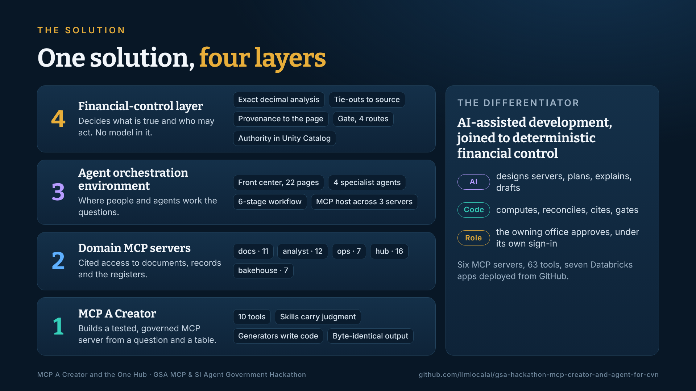

It is one solution with four layers. Each row below is a part of it, and none is the whole.

| Layer | What it is | Size |
| --- | --- | --- |
| 1 **MCP server creator** | [MCP A Creator](#mcp-a-creator) turns a question and a Unity Catalog table into a tested, governed MCP server | 10 tools |
| 2 **Domain MCP servers** | [Five servers](#the-mcp-servers) give cited access to budget documents, contract records, the work registers and the gate | 53 tools |
| 3 **Agent orchestration environment** | [The front center](#agents-propose-the-owning-role-decides): four specialist agents, a six-stage workflow, an MCP host across three servers | 22 pages |
| 4 **Financial-control layer** | [Exact-decimal analysis, reconciliation to source, provenance to the page, a gate with no model, authority in Unity Catalog](#the-financial-control-layer) | 7,743 of 7,746 tie-outs |

**What sets it apart:** AI-assisted development joined to deterministic financial control. Models
design servers, plan, explain and draft. Code computes, reconciles, cites and gates every figure.
Only the owning role, checked in Unity Catalog under the user's own sign-in, approves a change.

## Demo

[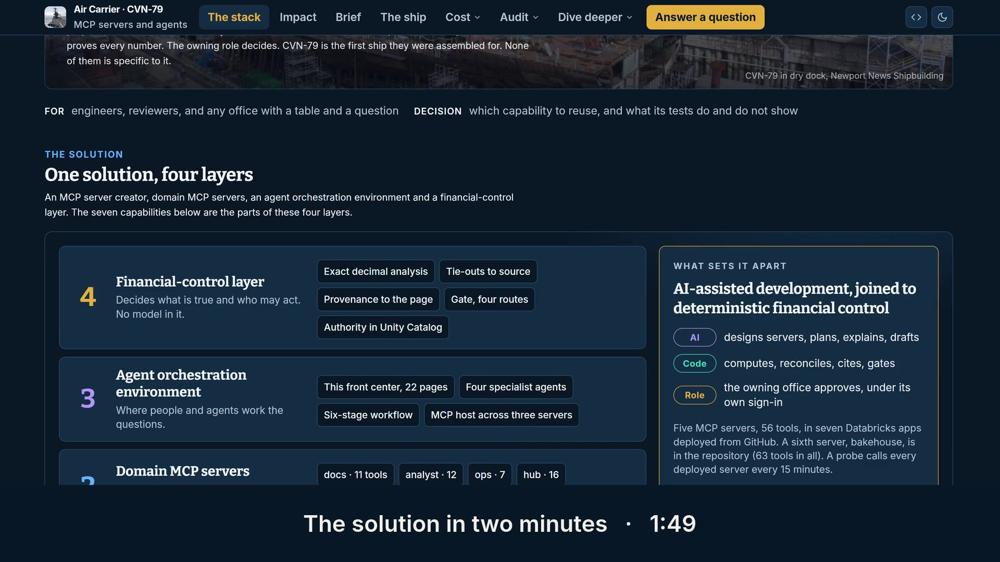](https://llmlocalai.github.io/gsa-hackathon-mcp-creator-and-agent-for-cvn/demo/)

| Video | Length | Watch |
| --- | --- | --- |
| **The solution in two minutes.** Impact and scope, then the apps, the MCP servers, the front center, a live agent run with a role check, and orchestration across servers | 2:09 | [Play in the browser](https://llmlocalai.github.io/gsa-hackathon-mcp-creator-and-agent-for-cvn/demo/) · [file](docs/demo/air-carrier-two-minute-demo.mp4) |
| **The full walkthrough.** Every layer and every page, with live agent runs on the deployed apps | 14:45 | [Play with chapters](https://llmlocalai.github.io/gsa-hackathon-mcp-creator-and-agent-for-cvn/demo/) · [file](docs/demo/air-carrier-full-walkthrough.mp4) |

Both are 1080p, narrated and captioned
([two-minute .srt](docs/demo/air-carrier-two-minute-demo.srt), [walkthrough .srt](docs/demo/air-carrier-full-walkthrough.srt)).

<details>
<summary>Full walkthrough chapters (14:45)</summary>

| Time | Chapter |
| --- | --- |
| 0:00 | The problem and one solution in four layers |
| 2:25 | Seven apps, six MCP servers, MCP A Creator |
| 4:30 | The financial-control layer |
| 5:01 | The front center: the stack, impact, the brief, the ship, position |
| 7:14 | Agentic workflow, live: a specialist run and role-based approval |
| 8:48 | Cost, execution, the gap register and a Gap Investigator run |
| 10:10 | Agentic orchestration: Ask as an MCP host, the work queue, a reconciler run |
| 11:45 | Records, sources, method, rules, coverage, and the experts |
| 13:10 | How we know it works, security, close |

Live agent runs were recorded on the deployed apps on 2026-11-21, with waits cut. The other pages
are the same app run from this repository. Narration is synthesized speech.
</details>

## Try it

| Way in | Account needed | Link |
| --- | --- | --- |
| Read-only site, every page | No | <https://llmlocalai.github.io/gsa-hackathon-mcp-creator-and-agent-for-cvn/site/stack/> |
| Live front center | Databricks sign-in | <https://aircarrier-front-center-dev-7474654188777746.aws.databricksapps.com/> |
| Run it on your laptop | No | [Two commands](#run-it-yourself) |
| Demo videos with chapters | No | <https://llmlocalai.github.io/gsa-hackathon-mcp-creator-and-agent-for-cvn/demo/> |
| Rater's map | No | [GSA criteria: where to look](#gsa-criteria-where-to-look) |
| Deck and evaluation report | No | [Deck PDF](docs/submission/mcp-a-creator-one-hub-deck.pdf) · [Report PDF](docs/submission/evaluation-report.pdf) · [Word](docs/submission/evaluation-report.docx) · [PowerPoint](docs/submission/mcp-a-creator-one-hub-deck.pptx) |

The read-only site cannot run agents, so it links to a [gallery of live screens](https://llmlocalai.github.io/gsa-hackathon-mcp-creator-and-agent-for-cvn/site/live/).

## Why it matters, at a glance

| | What is true today | Evidence |
| --- | --- | --- |
| **Technology** | 6 MCP servers, 63 tools, FastMCP over streamable HTTP on Databricks Apps. Pydantic-validated inputs, bound SQL parameters, `isError` with a hint. Authority decided in Unity Catalog under the user's own token | [Servers](#the-mcp-servers), [Security](#security) |
| **Testing** | 1,770 tests pass from a clean clone. 421 hostile calls on the read tools wrote nothing; 403 on the Creator escaped nothing. Five held-out rounds of real-model questions | [How we know it works](#how-we-know-it-works) |
| **Outside checks** | An external evaluator's questions: Claude 25/30 (83.3%), 1/10 without tools. A blind outside reviewer would rely on 9 of 10 vs 0 of 10 answers | [Round 5](eval/delegation/round5/RESULTS.md), [Blind review](eval/delegation/sme_review/BLIND_RESULTS.md) |
| **Maturity** | Seven apps deploy from GitHub with one command. A probe calls every server every 15 minutes: 99.90% of 6,193 checks, 1,234 of 1,234 known answers right. Creator release `v1.0.0-rc3` with changelog and SBOM. CI on Python 3.11 and 3.12 with pip-audit and bandit | [Deploy](#run-it-yourself), [Scorecard](SCORECARD.md) |
| **Impact** | CVN-79 reconciled across four ledgers. 7,743 of 7,746 budget tie-outs pass. 59 open questions ranked, each with the office that can close it | [Impact](docs/IMPACT.md) |
| **Adoptability** | A new program supplies data, not software. The Creator built the ops server and a second server over unrelated data; 15 of 15 generated projects pass their own tests | [Plug and play](#plug-and-play-what-a-new-program-reuses) |

## Architecture

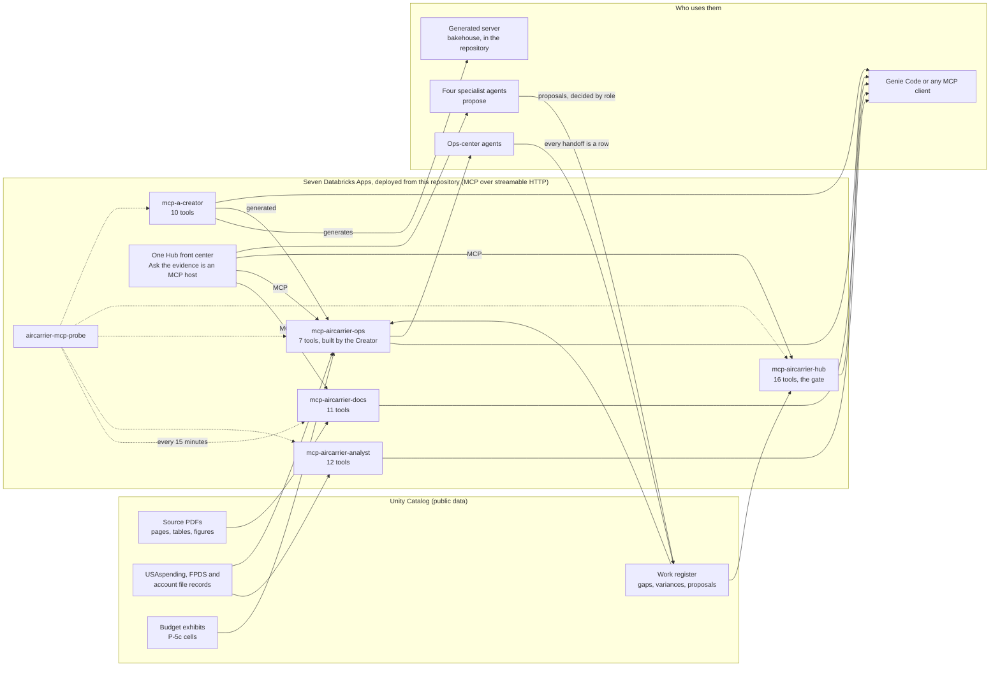

Six parts, each useful on its own: **build** (Creator), **read** (docs, ops), **investigate**
(analyst), **govern** (One Hub server and gate), **deliver** (front center), **watch** (probe).
Tables are read as the calling user; decisions run under the signed-in user's token.

## One solution, three tracks

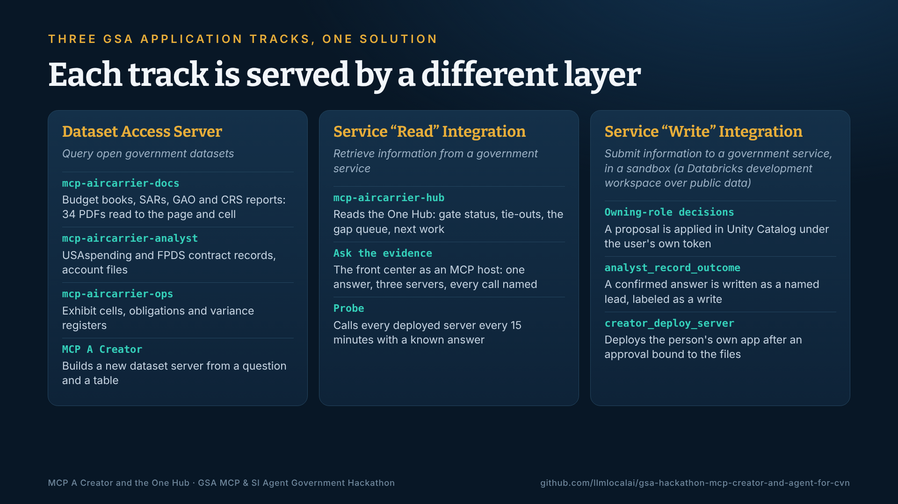

| GSA track | Served by | Open this |
| --- | --- | --- |
| **Dataset Access Server**: query open government datasets | Docs, analyst and ops servers over budget books, SARs, GAO and CRS reports, USAspending and FPDS records. The Creator builds the next one | [Servers](#the-mcp-servers), [Creator](#mcp-a-creator) |
| **Service "Read" Integration**: retrieve information from a government service | The hub server reads the One Hub's gate, tie-outs and gap queue. Ask the evidence is an MCP host across three servers. The probe reads every server every 15 minutes | [`mcp-aircarrier-hub`](the-one-hub/ops-center/mcp/), [probe](mcp-servers/aircarrier-mcp-probe/) |
| **Service "Write" Integration**: submit information to a government service, in a sandbox | Owning-role decisions applied in Unity Catalog under the user's token, `analyst_record_outcome`, `creator_deploy_server` behind an approval token | [Role approval](#agents-propose-the-owning-role-decides), [Security](#security) |

The sandbox is a Databricks development workspace over public data. Every write is labeled
`readOnlyHint: false`, needs a signed-in user, and leaves a row in a register.

## The financial-control layer

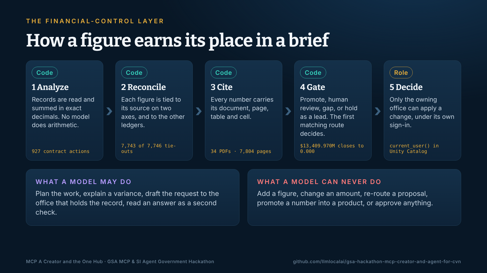

| Control | How it is enforced | Proof |
| --- | --- | --- |
| Deterministic analysis | Code reads the records and sums them in `Decimal`. No model does arithmetic | 927 contract actions, 8 of 8 checks, in the live Obligation Reconciler run |
| Reconciliation | Every budget figure is tied to its exhibit on two axes, and the four ledgers to each other | 7,743 of 7,746 tie-outs; $13,409.970M closes to 0.000 two ways |
| Provenance | Each number carries its document, page, table and cell | 34 PDFs, 7,804 pages; [sources](docs/BACKGROUND.md) |
| Gate | [`gate.yaml`](the-one-hub/ops-center/seed/gate.yaml): promote, human review, gap, or hold as a lead. No model in it | [Gate routes](#the-mcp-servers) |
| Human and system authority | The owning office approves under its own sign-in. Unity Catalog decides, not the page | [`harness_sql.py`](the-one-hub/ops-center/app/api/harness_sql.py) |

## Plug and play: what a new program reuses

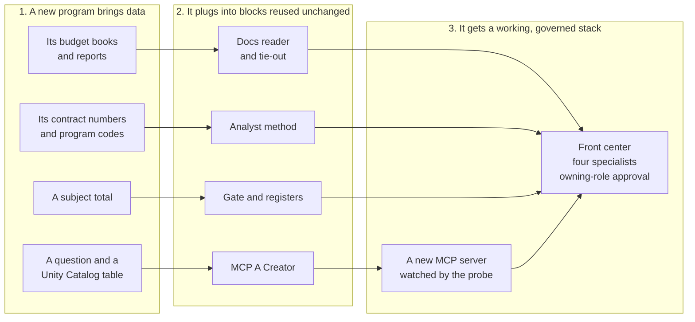

| Block | Reused as it is | What a new program adds |
| --- | --- | --- |
| MCP A Creator | Ten tools, skills, generators, review, deploy gate | A question and a table |
| Docs and analyst servers | Reader, tie-out, investigation method | Its PDFs, contract numbers and codes |
| Gate and registers | Promote, review, gap and lead routes | A subject total; the floor scales with it |
| Agents and probe | Hand-offs, checks, known-answer monitoring | The subject name; one known answer per server |

**Inside DoD:** CVN-79, then the Ford class (four hulls already loaded), 29 Navy ship lines, the
F-35 (lots in place of hulls) and the 59 programs with a PB2027 MSAR.
**Across government:** any agency with budget justifications, contract or grant records on
USAspending and FPDS, and open audit findings: major construction, grants, IT investments,
audit remediation. Change the documents, the identifiers and the role map.
Full case: [docs/IMPACT.md](docs/IMPACT.md).

## Agents propose, the owning role decides

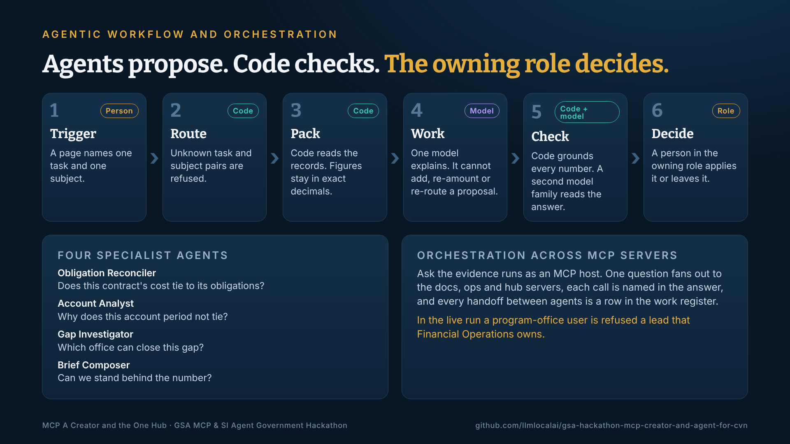

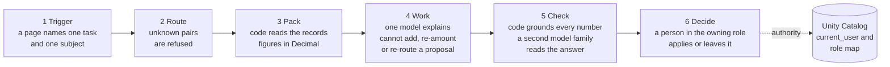

| Specialist | Started from | The question it answers |
| --- | --- | --- |
| Obligation Reconciler | `/mission`, `/variances`, `/position` | Does this contract's cost tie to its recorded obligations? |
| Account Analyst | `/mission`, `/position`, `/execution` | Why does this File C period not tie to the transactions? |
| Gap Investigator | `/mission`, `/gaps` | Which office can close this gap, and what do we ask for? |
| Brief Composer | `/mission`, `/brief` | Can we stand behind the number at the brief? |

**Role-based approval.** The decision runs inside Unity Catalog under the user's on-behalf-of
token, checking `current_user()` and `is_account_group_member()` against a dated role map
([`harness_sql.py`](the-one-hub/ops-center/app/api/harness_sql.py)). In the live demo a PMS 379
user is refused the lead owned by the Office of Financial Operations and applies the request
PMS 379 owns. No role travels in a page or a cookie.

**Headquarters and field experts.** Answer a question (`/insight`) opens the 59 open questions to
the people who hold the records: the program office, Financial Operations, the supervisor of
shipbuilding, the finance center. An answer enters as a lead with its author, is routed to its
gap and the owning office's queue, and is never a certified figure until someone ties it to source.

## The MCP servers

| Server | Tools | What it does | Evidence |
| --- | --- | --- | --- |
| [MCP A Creator](mcp-server-creator/) | 10 | Builds governed MCP servers from a question and a table | 805 tests; 403 hostile calls |
| [`mcp-aircarrier-docs`](mcp-servers/mcp-aircarrier-docs/) | 11 | Reads 34 PDFs, 7,804 pages, to the page and table; tie-outs; no model | 7,743 of 7,746 tie-outs; p50 1.18 s |
| [`mcp-aircarrier-analyst`](mcp-servers/mcp-aircarrier-analyst/) | 12 | Investigates incomplete cost records; explains File C residuals; ranks leads | 39 tests |
| [`mcp-aircarrier-ops`](mcp-servers/mcp-aircarrier-ops/) (built by the Creator) | 7 | Exhibit cells, obligations, variance and work registers | 40 tests; golden set of 17 |
| [`mcp-aircarrier-hub`](the-one-hub/ops-center/mcp/) | 16 | The gate, falsification checks, exact tie-outs, the gap queue; read-only | 33 tests; p50 54 ms |
| [`mcp-bakehouse-sales`](mcp-servers/mcp-bakehouse-sales/) (built by the Creator) | 7 | A sales table unrelated to CVN-79: the second-dataset proof | 21 tests; in the repository |

Five are deployed (56 tools). The bakehouse app gave its slot to the hub; the shared workspace
is capped at 100 apps. Per-server detail: [SCORECARD.md](SCORECARD.md).

**The gate** ([`seed/gate.yaml`](the-one-hub/ops-center/seed/gate.yaml)) uses no model; the first matching route decides.

| Outcome | When | Example |
| --- | --- | --- |
| Promote | Verified and tied out on both axes | $13,409.970M Total Ship Estimate closes to 0.000 two ways |
| Human review | A flag, a material interpretation or a policy issue | E-17: the $13.529B baseline is also CVN-80's; both readings shown |
| Gap | The value is unknown | G14: when construction in progress is relieved |
| Hold as a lead | Below the floor and not verified | An expert's answer through `/insight` |

## MCP A Creator

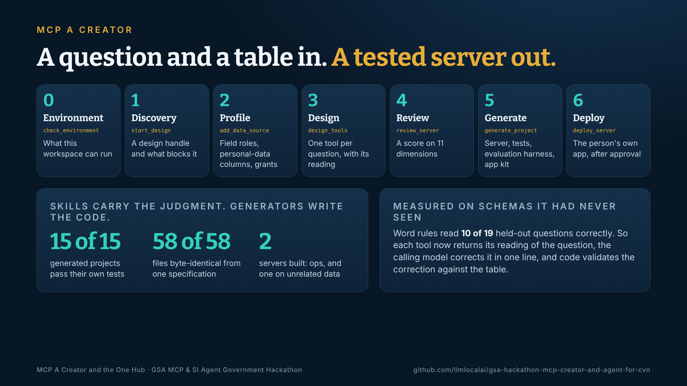

Most MCP servers are improvised by a model: different every run, untested. The Creator splits
the work. **Skills carry the judgment; deterministic generators write the code**, so one
specification always yields the same project, byte for byte.

| Phase | Tool | Produces |
| --- | --- | --- |
| 0 Environment | `creator_check_environment` | What this workspace can run |
| 1 Discovery | `creator_start_design` | A design handle and what blocks it |
| 2 Profile | `creator_add_data_source` | Field roles, personal-data columns, grants |
| 3 Design | `creator_design_tools` | One tool per question, with its reading for the caller to correct |
| 4 Review | `creator_review_server` | A score on 11 dimensions |
| 5 Generate | `creator_generate_project`, `creator_write_project` | Server, tests, evaluation harness, app kit |
| 6 Deploy | `creator_deploy_server` | The person's own app, after an approval bound to the files |

- **Proven:** 15 of 15 generated projects pass their own tests; 58 of 58 files byte-identical.
- **Correctable:** the calling model checks each tool's reading of its question and sends a fix; code validates it against the table. On schemas it had never seen the word rules alone read 10 of 19 questions, which is why the reading is shown ([EVALUATION.md 2.8](docs/submission/EVALUATION.md#28-mcp-a-creator-on-schemas-it-had-not-seen)).
- **Upgradable:** each project carries a provenance lock; `mcp-a-creator-upgrade` regenerates without overwriting the owner's edits.
- **Install without a clone:**

```
uvx --from "git+https://github.com/llmlocalai/gsa-hackathon-mcp-creator-and-agent-for-cvn@v1.0.0-rc3#subdirectory=mcp-server-creator" mcp-a-creator --version
```

## Screens

**Live** screens come from the deployed apps; the rest from the app run locally. Every page is in
the [read-only site](https://llmlocalai.github.io/gsa-hackathon-mcp-creator-and-agent-for-cvn/site/stack/).

| | |
| --- | --- |
|  | 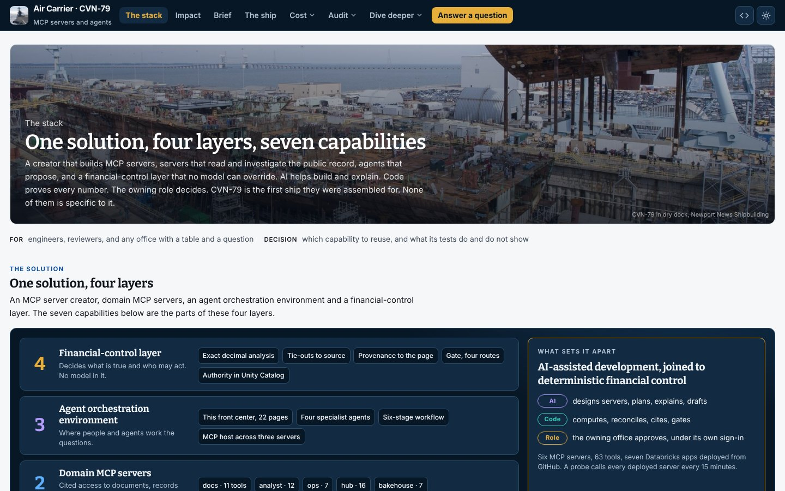 |
| **1. Seven apps, live.** Five MCP servers, the probe and the front center. | **2. The stack.** Each capability, how it was tested, what the tests do not show. |
|  | 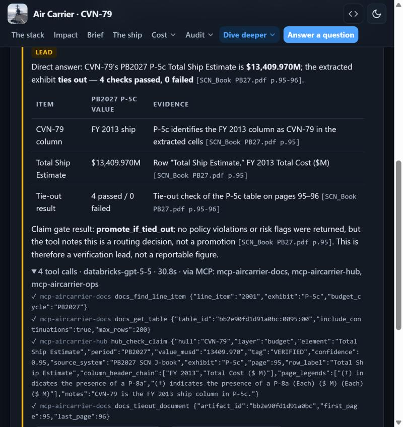 |
| **3. MCP A Creator.** A question and a table in, a tested server out. | **4. Ask the evidence, live, as an MCP host.** Four tool calls across three servers, each named. |
| 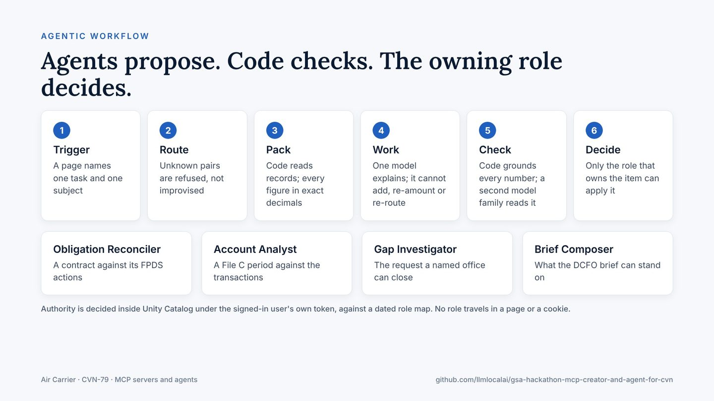 | 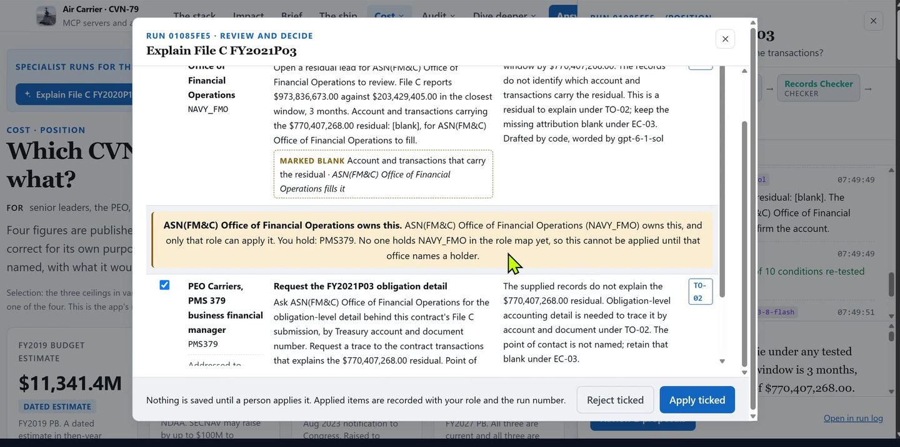 |
| **5. Agents propose, the owning role decides.** | **6. Role check, live.** PMS 379 cannot apply a Financial Operations proposal. |
| 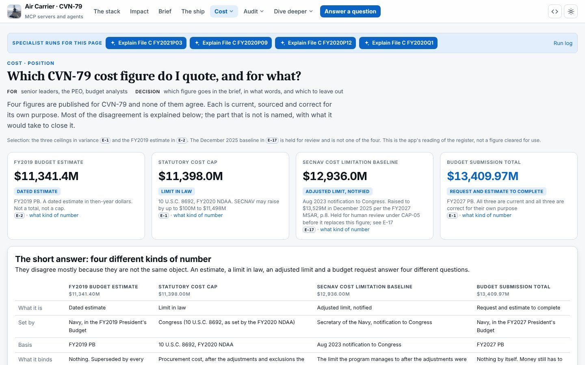 |  |
| **7. Which figure to quote.** The four published costs and what each is. | **8. Gap register.** 59 open questions, each with the office that can close it. |
| 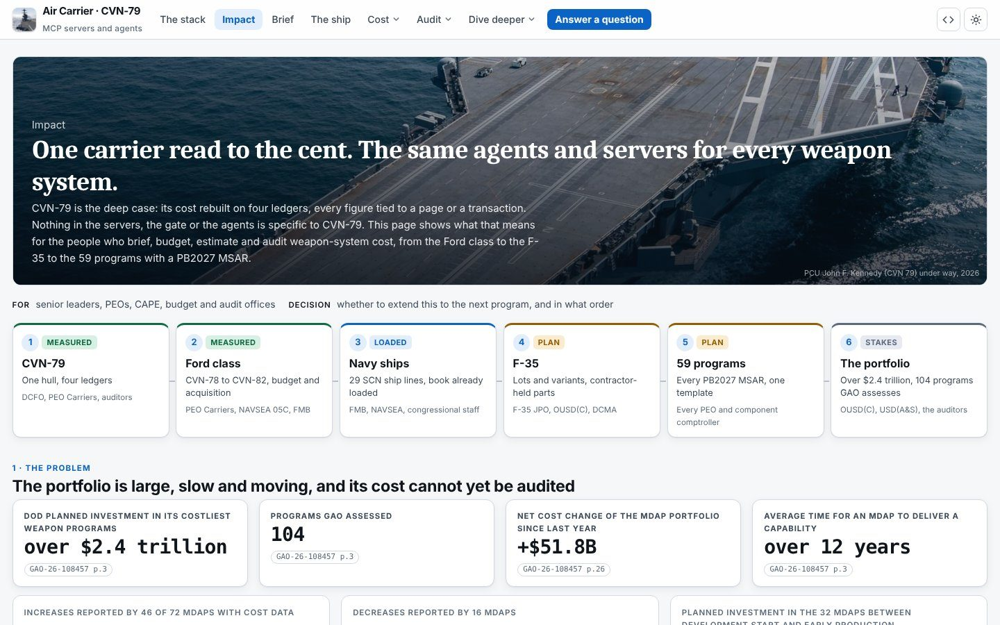 | 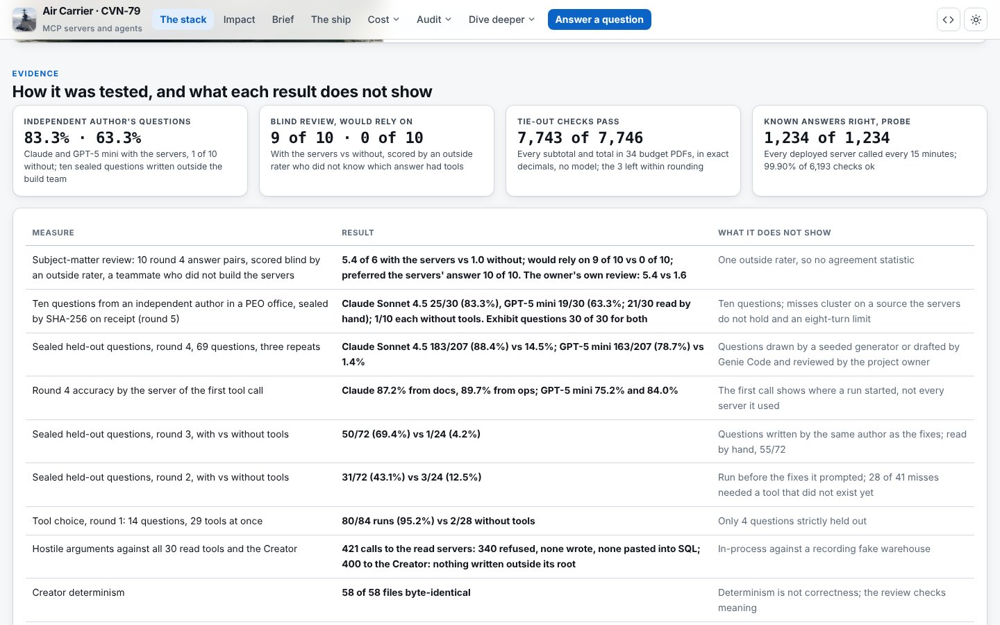 |
| **9. Impact.** From CVN-79 to the 59 PB2027 MSAR programs. | **10. Evidence.** Outside questions, blind review, tie-outs, probe. |
| 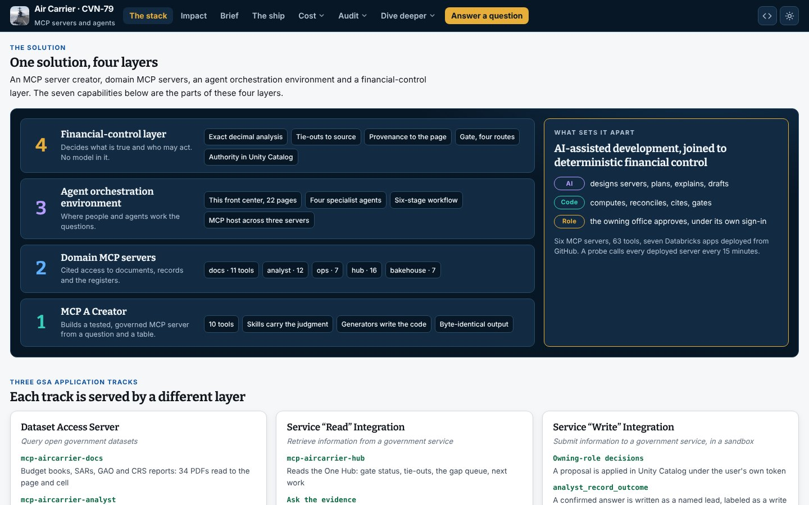 | 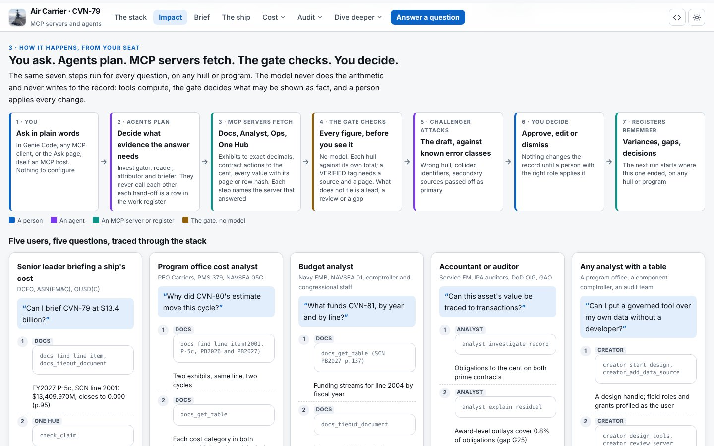 |
| **11. How the parts fit.** Build, read, investigate, govern, deliver, watch. | **12. Orchestration.** You ask, agents plan, servers fetch, the gate checks, you decide. |
|  | 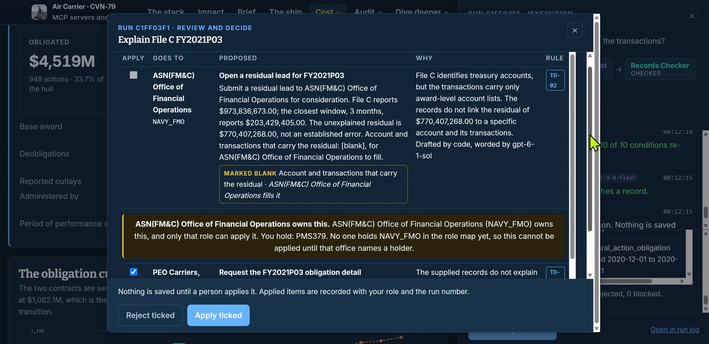 |
| **13. A specialist run, live.** Each step labeled code or model. | **14. Review and decide, live.** Only the owning role can apply. |
|  | 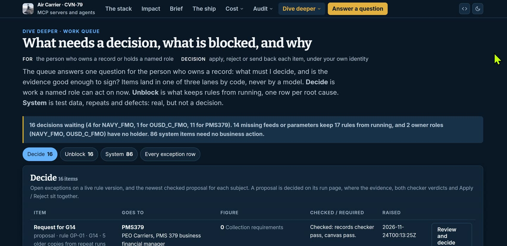 |
| **15. Obligation Reconciler, live.** 927 actions in exact decimals; 8 of 8 checks. | **16. Work queue, live.** Decide, unblock or system. |
|  |  |
| **17. Brief readiness, live.** What the brief can stand on. | **18. Answer a question.** Experts answer; each answer is a named lead. |
| 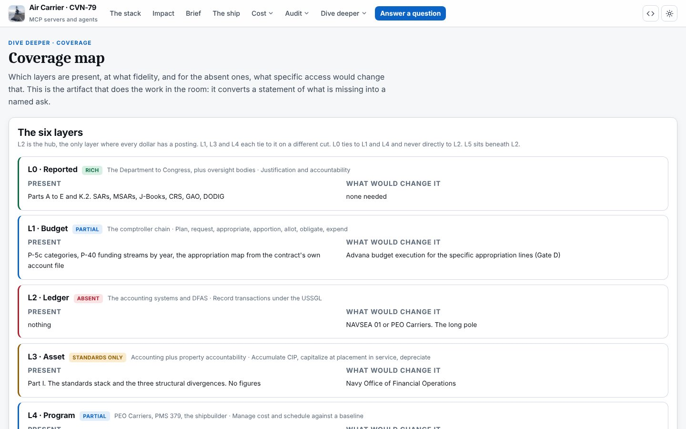 | 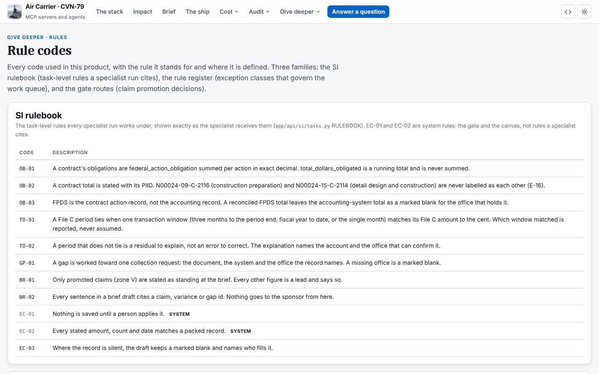 |
| **19. Coverage map.** Six layers of cost and the access that would close each. | **20. Rule codes.** The rulebook, rule register and gate routes. |

<details>
<summary>Front center page map</summary>

| Menu | Pages | Question answered |
| --- | --- | --- |
| The stack | `/stack` | What each capability does and how it was tested |
| Impact | `/impact` | How the build carries from CVN-79 to every program |
| Brief | `/brief` | What can we say about the cost today? |
| The ship | `/kennedy` | Identity, timeline, photographs |
| Cost | `/position`, `/cost`, `/baseline`, `/execution` | Which figure, what it is made of, how it grew, how it was obligated |
| Audit | `/gaps`, `/variances`, `/asset`, `/industrial` | What is open, where sources disagree, the asset's accounting, who builds what |
| Dive deeper | `/ask`, `/work`, `/mission`, `/runs`, `/explore`, `/sources`, `/method`, `/rules`, `/coverage` | Cited answers, decisions, readiness, run log, records, corpus, method |
| Answer a question | `/insight` | Experts answer an open question |
</details>

## How we know it works

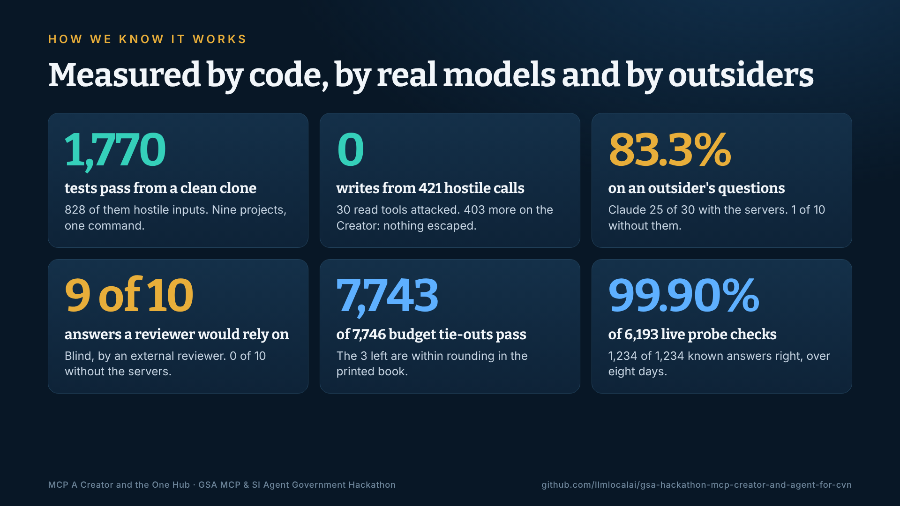

| Question | Result | Reproduce |
| --- | --- | --- |
| Does the code do what it says? | **1,770 tests pass** from a clean clone, 828 of them hostile inputs; 5 skipped (need Spark) | `scripts/check.sh` |
| Does any tool accept a hostile argument? | **421 hostile calls** on 30 read tools: 344 refused, 0 writes, 0 pasted into SQL. 403 on the Creator: nothing escaped its root | [read servers](mcp-servers/adversarial_summary.json), [Creator](mcp-server-creator/tests/adversarial_summary.json) |
| Do real models answer with the tools? | **Five held-out rounds**, sealed by SHA-256 before the run. Round 4, 69 questions: Claude Sonnet 4.5 **88.4%** vs 14.5% without tools; GPT-5 mini **78.7%** vs 1.4% | [round 4](eval/delegation/round4/RESULTS.md), [all rounds](eval/delegation/README.md) |
| On questions we did not write? | Round 5, an external evaluator: Claude **25/30 (83.3%)**, GPT-5 mini 19/30 (63.3%), 1/10 each without tools | [round 5](eval/delegation/round5/RESULTS.md) |
| Would a financial manager rely on the answers? | Blind, by a separate external reviewer: **5.4 vs 1.0** of 6, would rely on **9 of 10 vs 0 of 10**, preferred the servers 10 of 10. Owner's own score: 5.4 vs 1.6 | [blind](eval/delegation/sme_review/BLIND_RESULTS.md), [owner](eval/delegation/sme_review/RESULTS.md) |
| Do deployed servers keep answering? | **99.90% of 6,193** probe checks, 2026-11-12 to 2026-11-20; **1,234 of 1,234** known answers right | [probe](mcp-servers/aircarrier-mcp-probe/) |
| Do the numbers tie to source? | **7,743 of 7,746** tie-outs on the deployed store (3 within rounding); $13,409.970M closes to zero two ways | [evidence](docs/submission/evidence/tieout_store_2026-11-22.json), [`verify.py`](the-one-hub/ops-center/checks/verify.py) |
| Does the Creator build good servers, repeatably? | **15 of 15** generated projects pass; **58 of 58** files byte-identical | `scripts/check.sh creator` |

**Who ran the outside checks.** The Round 5 questions were written by an external evaluator who
is not a member of the project development team. The blind review was scored by a separate
external reviewer, also outside the team. Neither built the servers or prepared the answers
([round 5 seal](eval/delegation/round5/SEAL.md), [blind seal](eval/delegation/sme_review/SEAL_BLIND.md)).

Every miss is read by hand and published with its cause. Defects found by testing:
[FINDINGS.md](docs/submission/FINDINGS.md). Full method: [EVALUATION.md](docs/submission/EVALUATION.md).

### GSA criteria: where to look

| Criterion | Open this |
| --- | --- |
| C1 Readability and maintainability | [`mcp-aircarrier-ops/src/`](mcp-servers/mcp-aircarrier-ops/src/mcp_aircarrier_ops/): models, one file per tool, warehouse access, kept apart |
| C2 Performance and reliability | [EVALUATION.md](docs/submission/EVALUATION.md) sections 1 and 2, including the Creator on schemas it had not seen (2.8); probe and latency results above |
| C3 MCP design | [Security](#security); goal-shaped tools that return totals with their basis |
| Mission alignment | [docs/IMPACT.md](docs/IMPACT.md); the `/impact` page |
| Innovation | [MCP A Creator](#mcp-a-creator), an MCP server that builds MCP servers, joined to a [financial-control layer](#the-financial-control-layer) where no model promotes a figure |
| Tracks | [One solution, three tracks](#one-solution-three-tracks) |
| Presentation | [Demo](#demo), [screens](#screens), [deck](docs/submission/mcp-a-creator-one-hub-deck.pdf) |

## Security

| Risk | Control |
| --- | --- |
| SQL injection | Identifiers allow-listed and quoted; values bound as parameters |
| Hostile arguments | Pydantic models and enums on every parameter, length caps on free text; attacked in one sweep |
| Code injection into generated projects | Free text made inert; every generated file compiled or parsed in a fuzz test |
| Unwanted writes | Read-only by default; analyst lead writes labeled `readOnlyHint: false`; Creator deploys need an approval token bound to the files |
| Identity | Workspace sign-in on every app; tables read as the caller; decisions under the user's token |
| Prompt injection | Retrieved text is data; text aimed at a model carries a source notice |
| Supply chain | pip-audit and bandit in CI and in every generated project; FastMCP 3.4 closes two CVEs |

Detail: [SECURITY.md](SECURITY.md).

## Run it yourself

```
# Front center, no workspace needed
cd the-one-hub/ops-center/app && pip install -r requirements.txt && uvicorn main:app --port 8000

# Two MCP servers that answer offline (One Hub and the Creator)
uv run --project mcp-server-creator python tools/try_offline.py

# Every test suite, from a fresh clone
scripts/check.sh

# Deploy: push, then redeploy only the apps that changed
git push && python tools/deploy_from_github.py
```

Setup, grants and rollback: [docs/DEPLOYMENT.md](docs/DEPLOYMENT.md). Suite list:
[checks README](the-one-hub/ops-center/checks/README.md).

## Repository map

| Folder | What it is |
| --- | --- |
| [`mcp-server-creator/`](mcp-server-creator/) | MCP A Creator |
| [`mcp-servers/`](mcp-servers/) | Docs, analyst, ops, bakehouse servers; the probe; the hostile-input sweep |
| [`the-one-hub/ops-center/`](the-one-hub/ops-center/) | Front center, agents, gate, checks and the hub MCP server |
| [`eval/delegation/`](eval/delegation/README.md) | Sealed questions, every logged run, the scripts that re-derive the results |
| [`docs/`](docs/) | Impact, deployment, evaluation, findings, deck, diagrams, screenshots, read-only site |
| [`scripts/`](scripts/) | `check.sh` (all suites), `check_links.py` |

## Scope and sources

- **One hull reconciled in full.** Other programs' published figures are readable today; reconciling them is the next step ([IMPACT.md](docs/IMPACT.md#from-one-hull-to-every-major-weapon-system)).
- **Public records only:** SCN budget books FY2019 to FY2027, CVN 78 class SARs and MSARs, CRS RS20643, GAO-26-108457, FPDS and USAspending for N00024-09-C-2116 and N00024-15-C-2114, 10 U.S.C. 8692. The bakehouse server reads Databricks sample data, not government data.
- Background on the ship and the four figures: [docs/BACKGROUND.md](docs/BACKGROUND.md).

---

Built for the GSA MCP & SI Agent Government Hackathon by Peter Shang. A hackathon submission, not
an official Department position; its figures come from publicly released documents.
