# MCP A Creator and the One Hub for CVN-79

[](https://github.com/llmlocalai/gsa-hackathon-mcp-creator-and-agent-for-cvn/actions/workflows/ci.yml)

**GSA MCP & SI Agent Government Hackathon. Track: Dataset Access Server.** The servers give
agents governed, cited access to public budget, acquisition and contract datasets; the only
writes are append-only, user-attributed leads and a gated label write.

DoD plans to spend more than $2.4 trillion on its costliest weapon programs, and it has
failed its financial statement audit eight years running. The two facts meet in one place.
No office can trace what a major weapon system costs, from the budget request through the
contracts to the asset on the balance sheet, in a form that a program office, a cost
estimator, a budget analyst and an auditor will all accept.

We built a reusable architecture for that problem, and proved it on one ship:

- **[MCP A Creator](#mcp-a-creator)** turns a question and a Unity Catalog table into a
  tested, governed MCP server, deployed as a Databricks App. Its bundled skills carry the
  design judgment; deterministic generators write the code.
- **[Six MCP servers, 63 tools](#what-the-one-hub-shows)** give agents cited access to
  documents, operations data and analytical investigation. The Creator generated two of
  them.
- **[A front center with four specialist agent workflows](#agents-propose-the-owning-role-decides)**
  where people use the stack. Its Ask the evidence agent is an MCP host: it calls the docs,
  ops and One Hub servers and names the server behind every step. The specialists read the
  stores with SQL and check figures with the same gate code the One Hub server exposes.
  Agents propose; only the role that owns an item can approve it.
- **[A deterministic gate](#what-the-one-hub-shows)** separates what a model recommends
  from what is decided. No model promotes a figure.
- **Unity Catalog decides authority** under the signed-in user's own identity, against a
  dated role map. No role travels in a page or a cookie.
- **Every figure ties to its source document**, page and record, and is reconciled through
  explicit checks. Every unknown is named, ranked and assigned to an office.

The pilot reconciles the four published costs of the aircraft carrier USS John F. Kennedy
(CVN-79) from public records. CVN-79 is hull one; the servers, the gate and the agents are
built to run on every major defense acquisition program.

## Two-minute demo

[](docs/demo/air-carrier-two-minute-demo.mp4)

1:55, 1080p, narrated and subtitled: the seven apps on Databricks, the six MCP servers, MCP A
Creator, the stack, Impact, Ask the evidence, a specialist run with role-based approval, the
work queue, Answer a question and the evaluation. The full 15:21 walkthrough is described
under [Demo video](#demo-video).

## Click through the front center

The deployed apps sit behind Databricks sign-in, so the front center is also published as a
read-only snapshot: **<https://llmlocalai.github.io/gsa-hackathon-mcp-creator-and-agent-for-cvn/>**.
Every page renders from the extracts in this repository, and the 59 gap briefs open in place.
Ask the evidence, specialist runs, decisions and Answer a question need a signed-in user, so
the snapshot points them to a [live gallery](docs/site/live/index.html) of screens from the
deployed app. Rebuild it from `the-one-hub/ops-center` with
`uv run --with beautifulsoup4 python ../../tools/export_static_site.py`.

## For judges: five minutes

| GSA criterion (official wording) | Open this | What it shows |
| --- | --- | --- |
| Technical quality, C1: readability and maintainability (separate data models, tool definitions, API interactions) | [Repository map](#repository-map), e.g. `mcp-servers/mcp-aircarrier-ops/src/mcp_aircarrier_ops/` (`models.py`, `tools/`, `data/warehouse.py`) | The ops server keeps data models, one file per tool, and warehouse access in separate modules; one ruff pin across all projects |
| Technical quality, C2: performance and reliability (own evaluation setup and results, inputs, error handling, stable performance) | [Evaluation](docs/submission/EVALUATION.md), sections 1 and 2 | Five test layers with their inputs; probe latency table; 99.90% of 6,193 production checks ok |
| Technical quality, C3: MCP design (Pydantic-validated inputs, unambiguous names and descriptions, goal-shaped tools, not thin wrappers) | [Security](#security), [Evaluation](docs/submission/EVALUATION.md) section 4 | Every parameter validated and attacked (825 hostile-input cases over 40 tools); tools return totals and summaries, not raw rows; renames made after models misread a name |
| Mission alignment (mission needs, service delivery and oversight) | [Impact page](#where-to-start) `/impact`, [who uses it](docs/IMPACT.md#who-uses-it-and-what-changes-for-them), [the stack](docs/IMPACT.md#the-stack-seven-capabilities-each-useful-on-its-own) and [from one hull to every program](docs/IMPACT.md#from-one-hull-to-every-major-weapon-system) | Six user groups from PEO to auditor; seven capabilities, each useful alone; one GL record traced through the stack; the path from CVN-79 to the 72 MDAPs in the FY2026 budget; a [subject-matter review](eval/delegation/sme_review/RESULTS.md) by a DoD financial manager: 5.4 of 6 with the servers, 1.6 without |
| Technical quality | [`scripts/check.sh`](scripts/check.sh), the [CI run](https://github.com/llmlocalai/gsa-hackathon-mcp-creator-and-agent-for-cvn/actions/workflows/ci.yml) and the [JUnit XML of a clean-clone run](docs/submission/evidence/junit/README.md) | One command runs every suite from a clean clone: 9 projects, 1,641 tests, lint, a portability scan and a figures check, on Python 3.11 and 3.12 |
| Technical quality | [Delegation evaluation](eval/delegation/README.md) | Four held-out rounds; rounds 2 to 4 sealed by SHA-256 before the run. Round 1, 4 questions: 83.3% with the tools, 25.0% without. Round 2, 12 questions: 43.1% with, 12.5% without; 28 of 41 misses needed a tool or option that did not exist, now built. Round 3, 12 new questions after the fixes: **69.4% with, 4.2% without**. Round 4, 69 questions (45 drawn by a seeded generator, 24 reviewed by the project owner), grader v2: **Claude 88.4%, GPT-5 mini 78.7% with, 14.5% and 1.4% without** ([results](eval/delegation/round4/RESULTS.md)). Every miss is read and its cause published, grader defects included |
| Technical quality | [Evaluation](docs/submission/EVALUATION.md) (GSA's four headings), [findings and fixes](docs/submission/FINDINGS.md), [claim map](#claim-to-artifact-map) | Eight-day probe at 99.90% with 1,234 of 1,234 known answers right, independent answer keys, tie-outs to the cent; each headline number mapped to the file and command that prove it |
| Technical quality | [Security](#security) | 421 hostile calls against all 30 read tools: 340 refused, none wrote, none pasted an argument into SQL; 400 more against the Creator's 10 tools with writing on: nothing escaped, nothing written outside its root; counts generated by the sweeps ([read servers](mcp-servers/adversarial_summary.json), [Creator](mcp-server-creator/tests/adversarial_summary.json)) |
| Innovation (creative MCP tooling, unique agent workflows) | [MCP A Creator](#mcp-a-creator) | An MCP server that builds MCP servers: same specification, byte-identical project, with its own tests and evaluation, deployed only on an approval bound to what was reviewed |
| Presentation (storytelling, demo flow, evidence of testing) | [Two-minute demo](#two-minute-demo), [read-only site](#click-through-the-front-center), [deck](docs/submission/mcp-a-creator-one-hub-deck.pdf), [screenshots](#screenshots), [full video chapters](#demo-video), [run it locally](#run-the-front-center-locally) | The live app needs a Databricks sign-in; the local copy needs two commands and no account |

## Results at a glance

| Measure | Result | What it does not show |
| --- | --- | --- |
| Subject-matter review: 10 round 4 answer pairs scored by a GS-15 DoD financial manager on correct, cited and usable | With the servers 5.4 of 6, without tools 1.6; would rely on 9 of 10 vs 1 of 10 ([results](eval/delegation/sme_review/RESULTS.md)) | One reviewer, the project owner, not blind |
| Sealed held-out questions, round 4: 69 questions, 30 tools at once, three repeats | Claude Sonnet 4.5 183/207 (88.4%, CI 81.2 to 94.7) vs 14.5% without tools; GPT-5 mini 163/207 (78.7%) vs 1.4% | Questions written on the builder's side; an [independent set](eval/delegation/independent/README.md) is ready for an outside author |
| Tool choice by real models (Claude Sonnet 4.5, GPT-5 mini), round 1: 14 questions, 29 tools at once | 80/84 runs correct (95.2%, CI 88.4 to 98.1) vs 2/28 without tools; strict held-out 20/24 (83.3%) vs 2/8 | 14 questions, only 4 strictly held out; the interval is wide (64.1 to 93.3) |
| Sealed held-out questions, round 2, with vs without tools | 31/72 (43.1%, CI 32.3 to 54.6) vs 3/24 (12.5%) | Run on the 29-tool catalog, before the fixes it prompted. 28 of the 41 misses needed a tool or option that did not exist; 5 are a grader pattern that rejected "cannot find"; the score is reported as graded |
| Sealed held-out questions, round 3 (after the fixes), with vs without tools | 50/72 (69.4%, CI 58.0 to 78.9) vs 1/24 (4.2%) | Questions written by the same author as the fixes. 5 misses are an answer-key error of mine (G07); read by hand, 55/72. Real misses remain on counting by sign, a contamination recorded only in the dossier, and multi-source figures |
| Code suites from a clean clone | 1,641 passed, 0 failed (825 of them hostile-input cases); 5 skipped because they need a live Spark session | They are unit, contract, server, generator and adversarial tests: they show the code does what it says, not that an agent answers well. That is measured by the delegation rounds and the subject-matter review |
| Adversarial arguments, all 30 read tools and the Creator | 421 calls to the read servers: 340 refused, 81 answered; 169 statements reached the warehouse, all read-only; 124 carried a hostile value as a bound parameter, none pasted into SQL text. 400 calls to the Creator: 364 refused, 36 answered, nothing written outside its root, no workspace reached | Runs in-process against a recording fake warehouse, not the deployed apps |
| Creator determinism | Same specification, byte-identical files: 58 of 58 | Determinism is not correctness; the review checks meaning separately |
| Availability of the deployed servers | 99.90% of 6,193 checks in 413 probe sweeps, 2026-11-12 to 2026-11-20; 1,234 of 1,234 known-answer checks right | One workspace, eight days |
| Data integrity | $13,409.970M Total Ship Estimate closes to 0.000 on two independent axes | The exhibit ties to itself; it is a budget estimate, not an audited cost |

The repository holds the product and the proof that it works: MCP A Creator, the One Hub
that it supports (servers, front center, agents and gate), and the evaluation behind every
number above.

| | |
| --- | --- |
| **Live front center** | <https://aircarrier-front-center-dev-7474654188777746.aws.databricksapps.com/> (Databricks sign-in required, see [below](#open-the-front-center)) |
| **Evaluation** | [docs/submission/EVALUATION.md](docs/submission/EVALUATION.md), and the same results on the GSA template: [evaluation report (Word)](docs/submission/evaluation-report.docx) · [PDF](docs/submission/evaluation-report.pdf) |
| **Slide deck** | [PowerPoint](docs/submission/mcp-a-creator-one-hub-deck.pptx) · [PDF](docs/submission/mcp-a-creator-one-hub-deck.pdf) |
| **No account needed** | The [read-only site](#click-through-the-front-center), [run the front center locally](#run-the-front-center-locally) in two commands, or the [screenshots](#screenshots) |
| **Score per server** | [SCORECARD.md](SCORECARD.md): tools, tests, sweep, accuracy, probe and what is open, one row per server |
| **Defects found by testing** | [docs/submission/FINDINGS.md](docs/submission/FINDINGS.md) |
| **Deployment** | [docs/DEPLOYMENT.md](docs/DEPLOYMENT.md) |
| **Data** | The One Hub uses public records only: budget justification books, Selected Acquisition Reports, GAO and CRS reports, FPDS and USAspending. One server reads other data on purpose: `mcp-bakehouse-sales`, the Creator's second build, reads Databricks' `samples.bakehouse` table to show the Creator works on a dataset unrelated to CVN-79. It is not government data, and none of the CVN-79 evidence rests on it. Its code and 21 tests stay in the repository; its app was deleted on 2026-11-21 so the One Hub server could take the slot in the shared workspace, which is capped at 100 apps |

---

## Contents

- [Why it matters, in brief](#why-it-matters-in-brief)
- [Open the front center](#open-the-front-center)
- [What the One Hub shows](#what-the-one-hub-shows)
- [Agents propose, the owning role decides](#agents-propose-the-owning-role-decides)
- [MCP A Creator](#mcp-a-creator)
- [Architecture](#architecture)
- [How we know it works](#how-we-know-it-works)
- [Security](#security)
- [Repository map](#repository-map)
- [Run it yourself](#run-it-yourself)
- [Deploy and maintain](#deploy-and-maintain)
- [Scope](#scope)
- [Known limitations](#known-limitations)
- [Sources](#sources)

---

## Why it matters, in brief

- **Four ledgers that never meet.** Budget, acquisition, contract and accounting records each
  describe the same ship, and none carries the keys to join the others. CVN-79 shows every
  break: a $13,409.970M budget total, a class-level SAR, award outlays that reach USAspending
  for 0.8% of prime obligations, and a hull still in construction in progress.
- **Four published costs.** $11,341.4M (FY2019 estimate), $11,398.0M (statutory cap),
  $12,936M (SECNAV baseline) and $13,409.970M (FY2027 budget). A $13,529M baseline printed in
  the FY2027 MSAR is held for review and shown both ways (E-17).
- **The scale.** DoD plans over $2.4 trillion for its costliest programs. The same servers,
  gate and agents carry from CVN-79 to the Ford class, 29 Navy ship lines, the F-35 and the
  59 programs with a PB2027 MSAR.

The full case, with the users, the stack and the path from one hull to every program, is in
[docs/IMPACT.md](docs/IMPACT.md). The ship's record, the four figures and E-17 are in
[docs/BACKGROUND.md](docs/BACKGROUND.md).

---

## Open the front center

**URL:** <https://aircarrier-front-center-dev-7474654188777746.aws.databricksapps.com/>

The front center is a Databricks App. Databricks Apps are reachable only by
authenticated users of the same Databricks account, so the link opens a Databricks
sign-in, and on first visit a consent screen for the app. Visitors without an account
in this workspace can:

- click through the [read-only site](#click-through-the-front-center), no account needed;
- run the same app locally with no workspace at all ([two commands](#run-the-front-center-locally));
- read the screenshots below, the [slide deck](docs/submission/mcp-a-creator-one-hub-deck.pdf), and the
  [evaluation report](docs/submission/evaluation-report.pdf).

### Where to start

| Menu | Page | The question it answers |
| --- | --- | --- |
| The stack | `/stack` | The seven capabilities (MCP servers, Creator, agents, probe, front center), how they fit, how they were tested and what the tests do not show |
| Impact | `/impact` | From CVN-79 to the Ford class, the F-35 and the 59 PB2027 MSAR programs: the agent workflow traced for five users, MCP A Creator's phases, eight onboarding steps and a phased build-out; 24 figures each with its document, page and quote |
| Brief | `/brief` | A guided start in four steps: pick your question (a door for each user group), check what a briefing can say today and what to hold back (the held baseline, E-17), act on the open questions and who can close them, then use the tools (Ask, Brief readiness, Detail table) |
| The ship | `/kennedy` | USS John F. Kennedy (CVN-79): identity, timeline and photographs |
| Cost | `/position`, `/cost`, `/baseline`, `/execution` | The four published figures and why they differ; cost by category and funding stream; estimate and cap history; obligations by year |
| Audit | `/gaps`, `/variances`, `/asset`, `/industrial` | Open questions ranked with who can close each; where sources disagree; the asset's accounting; who builds what, including GFE |
| Dive deeper | `/ask`, `/work`, `/mission`, `/runs`, `/explore`, `/sources`, `/method` | Cited answers; decisions waiting for a person; brief readiness with page-started agent runs; every run and action; every record, filterable; document families and the searchable corpus; the method, with links to `/rules` and `/coverage` |
| Answer a question | `/insight` | Answer one of the open questions; it is recorded as a lead with your name and how you knew it, never as a certified figure |

The app opens on The stack (`/` redirects to `/stack`). Retired pages redirect: `/dashboard` to `/brief`, `/knowledge` to `/sources`, `/program` (and `/delivery`, `/progress`) to `/stack`.

Every page that can start a specialist run shows the runs it offers at the top, scoped to
what is on the page (for example "Explain File C FY2021P03"). Each page opens with the
question it answers, who uses it and the decision it supports. Codes such as G14, E-17,
CAP-05 or P-5c are chips that show their definition on hover or focus, read from the
register row or rule they name. Run locally on the shipped extracts, the four agent pages
(`/mission`, `/work`, `/runs`, `/ask`) carry one banner saying what needs the workspace.

### Screenshots

Taken on 2026-11-21. Pages marked **live** are from the deployed apps in the Databricks
workspace; the rest are from the app run locally on the shipped extracts.

#### MCP servers

| | |
| --- | --- |
| 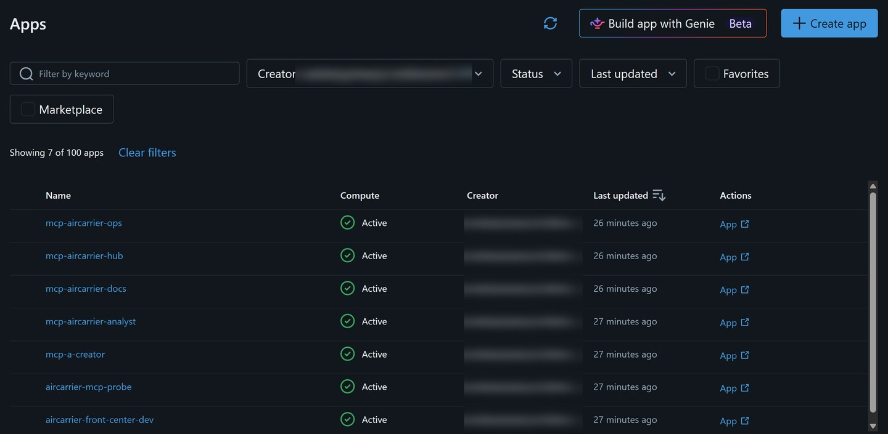 | 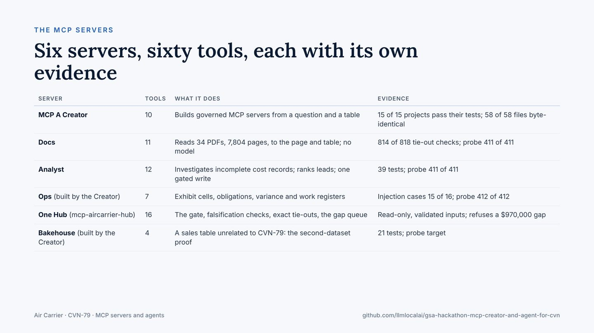 |
| **Seven apps, live.** The probe, the front center and five MCP servers, each deployed from this repository. | **Six servers, sixty tools.** What each server does and the evidence behind it. |
| 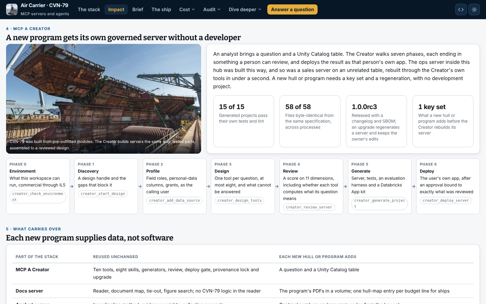 | 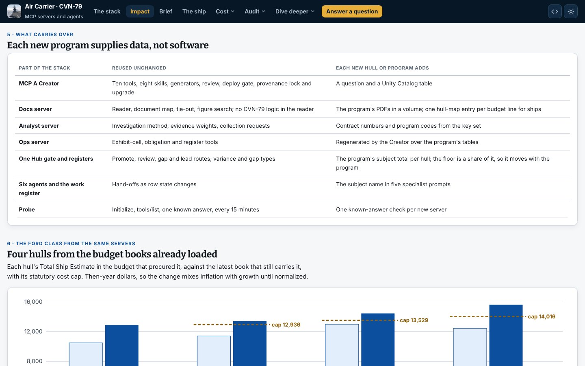 |
| **MCP A Creator.** Profile, design, review, generate, deploy; 15 of 15 projects pass, 58 of 58 files byte-identical. | **The next program.** What is reused as it is, and what a new program adds. |

#### Agentic workflow and role-based decisions

| | |
| --- | --- |
|  | 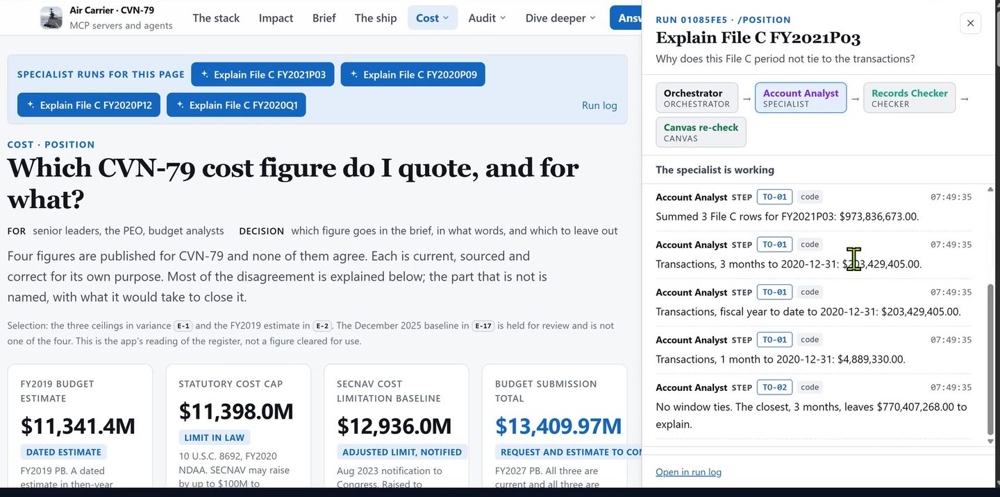 |
| **Six stages.** Agents propose, code checks every number, a second model family reads it, the owning role decides. | **Specialist run, live.** The Account Analyst works a File C period; each step is labeled code or model. |
|  |  |
| **Role check, live.** The user holds PMS 379; the residual lead belongs to the Office of Financial Operations, so the app refuses to apply it. | **Review and decide, live.** The Gap Investigator's requests for gap G52, each addressed to the office that holds the records. Nothing is saved until a person applies it. |
| 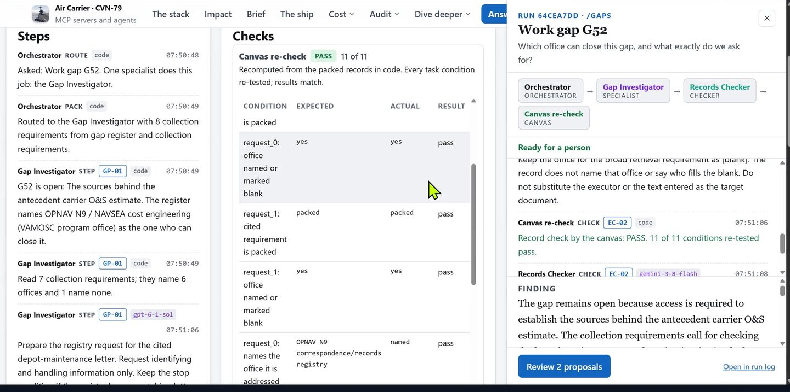 | 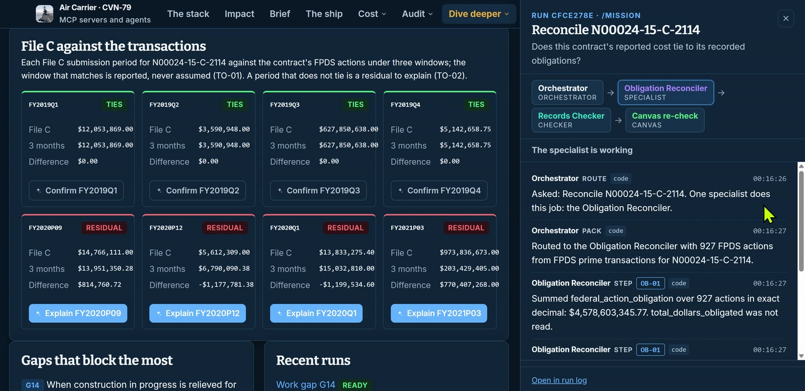 |
| **Checks, live.** Code re-tests every condition of the run: 11 of 11. | **Obligation Reconciler, live.** 927 actions summed in exact decimals; 8 of 8 conditions re-tested. |
|  | 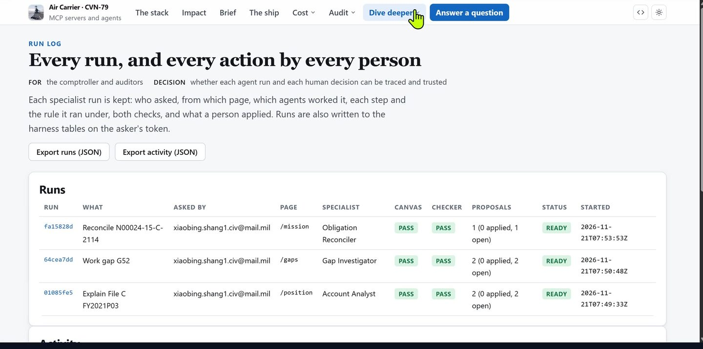 |
| **Work queue, live.** Every item in one lane by code: decide, unblock or system. | **Run log, live.** Every agent run and every action by every person, exportable. |
| 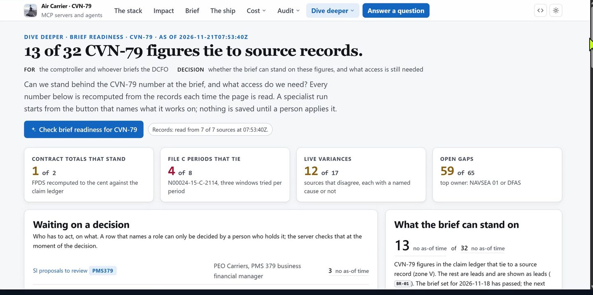 | 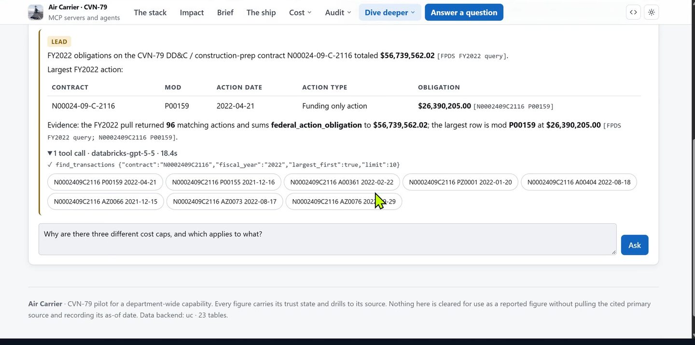 |
| **Brief readiness, live.** 13 of 32 CVN-79 figures tie to source records today. | **Ask the evidence, live.** One tool call, the total, the largest action and every modification it rests on. |

#### Pages

| | |
| --- | --- |
|  |  |
| **The stack.** The seven capabilities, how they fit, how each was tested and what the tests do not show. | **Impact.** From CVN-79 to the Ford class, 29 Navy ship lines, the F-35 and the 59 PB2027 MSAR programs. |
| 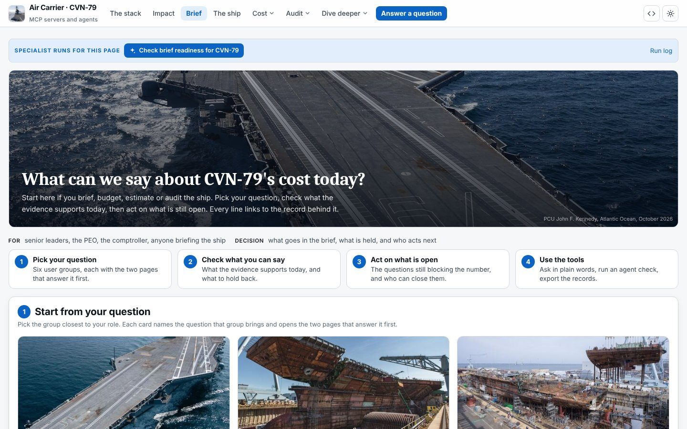 |  |
| **Brief.** Four steps: pick your question, check what the evidence supports, act on what is open, use the tools. | **Position.** The four published figures, what kind of number each is, and what not to call it. |
|  | 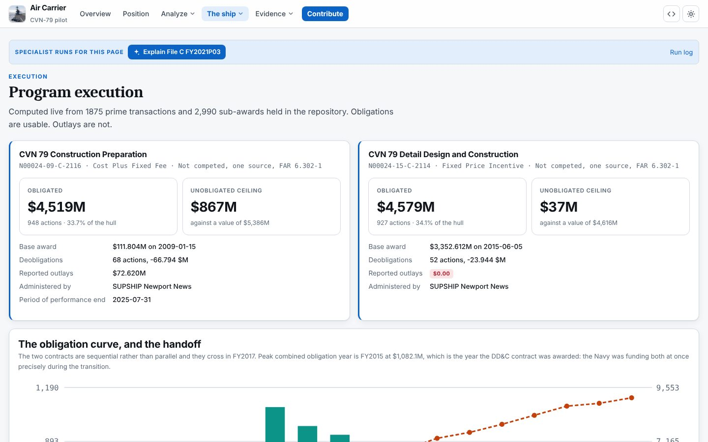 |
| **Cost composition.** Exhibit P-5c by category and by funding stream, both closing to zero. | **Budget execution.** 1,875 prime actions on two HII contracts, from USAspending. |
|  |  |
| **Gap register.** 59 open questions ranked, each with the office that can close it. | **Variance register.** 17 places where public sources disagree, and why. |
| 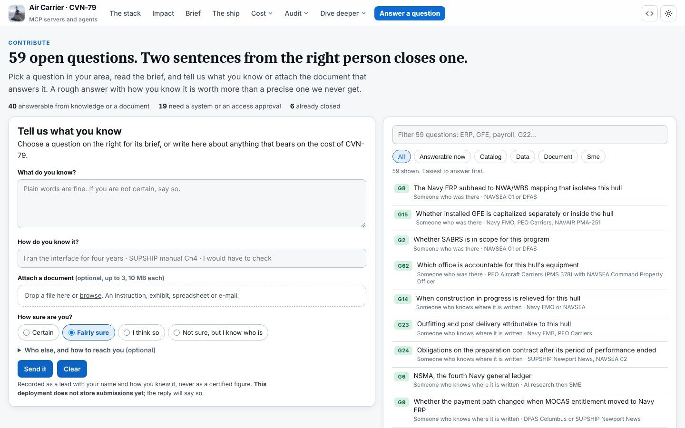 | 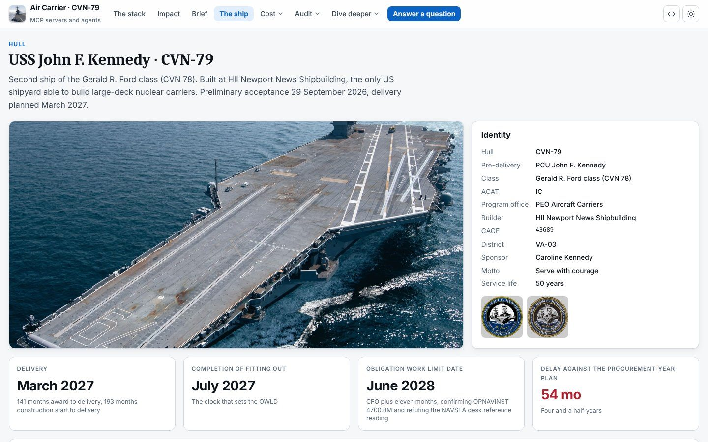 |
| **Answer a question.** Experts at headquarters and in the field record what they know; it enters as a lead with their name. | **The ship.** Identity, key dates and construction photographs. |
| 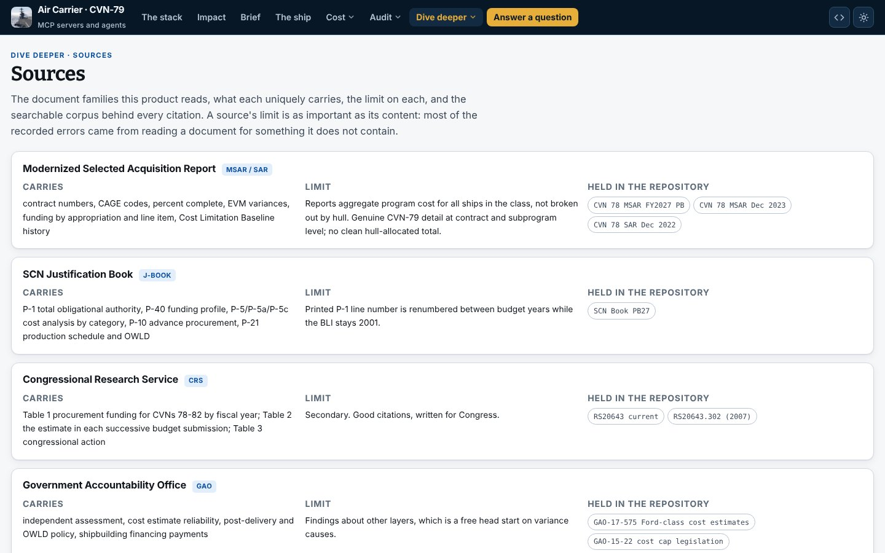 | 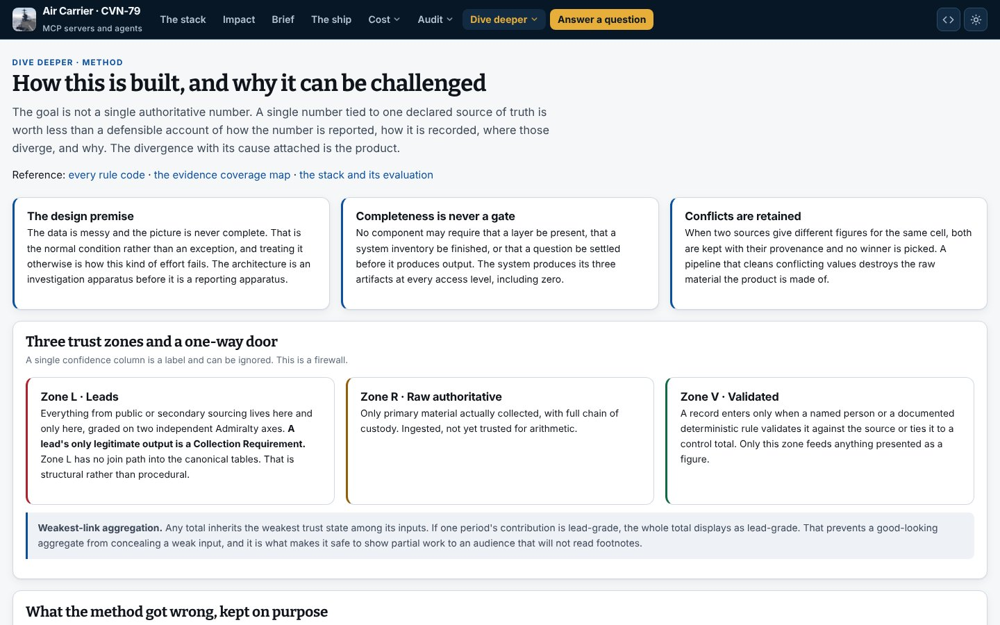 |
| **Sources.** Each document family, what it covers and its limits. | **Method.** The trust zones and the one rule: no model promotes a figure. |

### Demo video

The 15:21 demo video (1080p, narrated, subtitled) was recorded on 2026-11-21 from the deployed
apps and submitted with the entry. Waiting time while an agent works is cut and marked on screen.
Subtitles: [air-carrier-cvn79-demo.srt](docs/submission/demo/air-carrier-cvn79-demo.srt).

| Time | Chapter |
| --- | --- |
| 0:00 | The problem, the five layers, the seven apps on Databricks deployed from GitHub |
| 2:39 | Six servers (63 tools today; the video predates the bakehouse rebuild); MCP A Creator; the evaluation |
| 5:04 | The stack and Impact; carrying the build to the next program |
| 6:37 | Brief, Ask the evidence, the ship, Position |
| 7:54 | The agent workflow, and role-based approval in a live specialist run |
| 9:46 | Cost, estimate history, budget execution, the gap register and a Gap Investigator run |
| 10:59 | Variance, asset valuation, industrial base |
| 11:27 | Ask the evidence, the work queue, brief readiness and an Obligation Reconciler run |
| 12:32 | Run log, detail table, sources and method |
| 12:56 | Answer a question: experts at headquarters and in the field |
| 13:30 | Community expertise, beyond DoD, production posture, close |

---

## What the One Hub shows

The One Hub is built from four parts.

**Three MCP servers, 30 tools, all Databricks Apps.** Any MCP client can use them,
including Genie Code, and the front center and the agents use the same ones.

| Server | Tools | What it answers |
| --- | --- | --- |
| [`mcp-aircarrier-docs`](mcp-servers/mcp-aircarrier-docs/) | 11 | Reads the source PDFs (J-books, SARs, GAO, CRS) to the page, table and figure; runs tie-outs; flags a false premise in a search before the model spends tokens on it |
| [`mcp-aircarrier-analyst`](mcp-servers/mcp-aircarrier-analyst/) | 12 | Investigates incomplete cost records, infers lines of accounting, explains File C residuals, ranks leads; one gated write that labels an outcome |
| [`mcp-aircarrier-ops`](mcp-servers/mcp-aircarrier-ops/) | 7 | Exhibit cells; obligations on both prime contracts by modification and fiscal year, largest or smallest first; the variance register (E-1 to E-17); the knowledge graph and the work register |

**The One Hub's own MCP server**, `mcp-aircarrier-hub` ([`the-one-hub/ops-center/mcp/`](the-one-hub/ops-center/mcp/)),
16 read-only `hub_` tools with Pydantic-validated inputs that expose the gate, the
falsification checks, the tie-outs and the gap queue to any agent. It runs over stdio for a
local agent and as the Databricks App `mcp-aircarrier-hub` (stateless HTTP), deployed on
2026-11-21 and watched by the probe. With [MCP A Creator](#mcp-a-creator) (10 tools) and the
bakehouse server it generated (7 tools since it was regenerated on 2026-11-21, in the
repository; its app slot now runs the hub), that makes six servers and 63 tools;
[SCORECARD.md](SCORECARD.md) has one row per server. **A probe** calls every deployed server
every 15 minutes with a known question. Their standalone value is in
[the stack](docs/IMPACT.md#the-stack-seven-capabilities-each-useful-on-its-own).

**A front center** ([`the-one-hub/ops-center/app/`](the-one-hub/ops-center/app/)): a
FastAPI application with server-rendered pages and charts and a JSON API, described above.

**Six agents that never call each other** ([`ops/agents/`](the-one-hub/ops-center/ops/agents/)):
investigator, reader, tie-out, challenger, attributor and briefer. Every handoff is a
state change on a row in the work register, so each agent can be replaced alone, and a
specialist harness adds cost-cap, cost-capture, earned-value and valuation specialists.

**A gate.** No figure reaches a product without passing deterministic checks that use no
model. A figure that ties to a source record is shown as verified; anything else is shown
as a lead. Proposals that would change the record wait in the work queue for a person.
The routes are in [`seed/gate.yaml`](the-one-hub/ops-center/seed/gate.yaml); the first match decides.

| Outcome | When | Example in the record |
| --- | --- | --- |
| **Promote** | Verified, unflagged, and for a material figure, tied out on both axes (R5, R6) | $13,409.970M Total Ship Estimate, closing to 0.000 by cost category and by funding stream |
| **Human review** | Any premise, method or key flag, a material interpretation, or a material figure below verified (R1, R2, R4), and any policy violation (R-1) | E-17: the $13.529B baseline comes from an MSAR sentence, and is also CVN 80's figure. Both readings are shown until a person confirms one under rule CAP-05 |
| **Gap** | The value is unknown (R0) | 65 registered gaps, such as G14, the date construction in progress is relieved |
| **Hold as a lead** | Below the materiality floor and not verified (R3, R7) | A contribution through `/insight`, recorded with its author and basis, never as a certified figure |

The rules that shape the build are written into the code:

- No provider SDK call appears above `core/ports/`. Moving to a DoD environment is an
  adapter swap and a few variables in `databricks.yml`.
- Agents never call each other.
- The front center is a self-contained transfer unit that vendors its shared core.

---

## Agents propose, the owning role decides

Any page in the front center can start a specialist run on what it shows. Four specialists
cover the questions a cost record keeps raising
([`app/api/si/tasks.py`](the-one-hub/ops-center/app/api/si/tasks.py)):

| Specialist | Run it from | The question it answers |
| --- | --- | --- |
| Obligation Reconciler | `/mission`, `/variances`, `/position` | Does this contract's reported cost tie to its recorded obligations? |
| Account Analyst | `/mission`, `/position`, `/execution` | Why does this File C period not tie to the transactions? |
| Gap Investigator | `/mission`, `/gaps` | Which office can close this gap, and what exactly do we ask for? |
| Brief Composer | `/mission`, `/brief` | Can we stand behind the CVN-79 number at the brief, and what access do we need? |

Every run has the same six stages
([`app/api/si/sdk.py`](the-one-hub/ops-center/app/api/si/sdk.py)), built so that no stage
leaves room for a model to invent something:

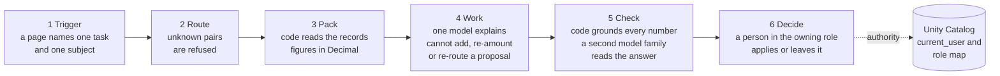

Authority is decided inside Unity Catalog. The decision statement runs under the signed-in
user's on-behalf-of token and checks `current_user()` and `is_account_group_member()`
against a dated role map ([`app/api/harness_sql.py`](the-one-hub/ops-center/app/api/harness_sql.py)).
In the demo, a user holding PMS 379 is refused the residual lead owned by the Office of
Financial Operations, and applies the request for obligation detail that PMS 379 owns; the
action is recorded with the role and the run number. The work queue sorts every item into
one lane by code: decide, unblock or system. Contributions from experts through
`/insight` enter the same way, as leads with their author, never as certified figures.
Screens from the deployed app: [agentic workflow screenshots](#agentic-workflow-and-role-based-decisions).

---

## MCP A Creator

Most teams build MCP servers by asking a model to improvise one. The result differs on
every run, the SQL is hand-written, nothing is tested, and nobody can say whether the
server helps. The Creator splits the work: **bundled skills carry the judgment** (tool
design, structured and unstructured data, security review, evaluation, deployment,
portability), and **deterministic generators carry the mechanics**, so the same
specification always produces the same project, byte for byte.

It walks a person through seven phases, each ending in something reviewable:

| Phase | Tool | Produces |
| --- | --- | --- |
| 0 Environment | `creator_check_environment` | What this workspace can run |
| 1 Discovery | `creator_start_design` | A design handle and the gaps that block it |
| 2 Profile | `creator_add_data_source` | Field roles, personal-data columns, grants, as the calling user |
| 3 Design | `creator_design_tools` | One tool per question, at most 8, and a list of what cannot be answered |
| 4 Review | `creator_review_server` | A score on 11 dimensions, including whether each tool computes what its question means |
| 5 Generate | `creator_generate_project`, `creator_write_project` | Server, tests, a Phoenix evaluation harness and a Databricks App kit |
| 6 Deploy | `creator_deploy_server` | The person's own app, after an approval bound to exactly what they reviewed |

Two more tools, `creator_list_library` and `creator_load_document`, serve the skills and
reference material, which are also exposed as MCP resources and prompts.

Design choices that matter:

- **State travels in the payload.** The MCP 2026-07-28 revision removed protocol
  sessions, so the design moves between calls as a twelve-character handle and the
  server holds no session state.
- **Every parameter is a scalar, enum or list of strings**, so any model and client can
  fill it.
- **Generated tools are typed and goal-shaped.** Column names come from an allowlist and
  are quoted; values are bound as parameters; personal-data and out-of-scope columns are
  removed at design time; every docstring states its grain and what it refuses.
- **The review checks meaning, not shape.** An early design whose tools all computed the
  wrong thing scored 4.6 of 5 on shape checks. The review now fails a tool that sums an
  identifier, groups by a column the question never names, or leaves a question
  uncovered, and caps the honesty score when it does.

The Creator works as a Genie Code connector. See
[mcp-server-creator/README.md](mcp-server-creator/README.md) for the walk-through and five
example prompts. It has built two servers in this repository, on two unrelated datasets:
[`mcp-aircarrier-ops`](mcp-servers/mcp-aircarrier-ops/) over the CVN-79 stores, and
[`mcp-bakehouse-sales`](mcp-servers/mcp-bakehouse-sales/) over Databricks'
`samples.bakehouse` sales table, chosen because every workspace has it. The second build is
the proof that the Creator is not tied to the carrier: same tool, different table, a tested
server. On 2026-11-21 the bakehouse server was rebuilt by today's Creator from the same
purpose and questions, through its own tools, in 0.38 s
([`eval/rebuild_bakehouse.py`](mcp-server-creator/eval/rebuild_bakehouse.py)): 7 tools
instead of 4, every recorded question answered, review "Sound design", and a
`.mcp-creator/` lock with its spec, the Creator version and every file's hash. The rebuild
also exposed three Creator defects, now fixed (finding 24), and a determinism gap across
processes (finding 25). Ops is deployed and probed. The bakehouse app ran until
2026-11-21, when it was deleted so the One Hub server could take its slot (the shared
workspace is capped at 100 apps); it redeploys from `mcp-servers/mcp-bakehouse-sales/`
whenever a slot is free.

---

## Architecture

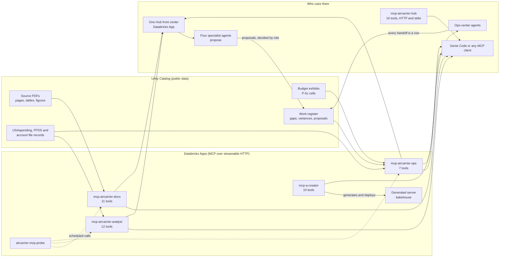

All seven apps run in one workspace and deploy from this repository. Tables are read as the
calling user under Unity Catalog grants, with the app's service principal as a reported
fallback; decisions run under the signed-in user's own token.

---

## How we know it works

The evaluation has four layers, one question each. Full method and results are in the
[evaluation report](docs/submission/evaluation-report.pdf).

| Layer | Question | Result |
| --- | --- | --- |
| Code suites | Does the code do what it says? | **1,641 tests pass from a clean clone** across nine projects with one command, [`scripts/check.sh`](scripts/check.sh), which CI runs on Python 3.11 and 3.12. Plus six One Hub script suites and the tie-outs that close the $13,409.970M estimate to zero residual |
| Creator end to end | Does the Creator build good servers, repeatably? | The five README prompts, three runs each, through the MCP interface: **15 of 15** generated projects passed their own tests and lint, and each server's files were byte-identical across runs. Of 14 questions, 11 got the right tool, a stated reason why not, or a review flag; 3 did not, and the report names them. Two of the three were confident tools for a different question; the review's new `tool_computes_its_question` check flags both when the same prompts are designed offline with the tables' columns |
| Golden set | Does the ops server answer correctly and stay in scope? | 17 items with answers computed by independent SQL, including decoy, no-action, out-of-scope and injection cases ([eval/](mcp-servers/mcp-aircarrier-ops/eval/)) |
| Adversarial arguments | Does any tool accept a hostile argument? | Every parameter of all 30 read tools gets SQL fragments, path traversal, oversized values, wrong enum members and control characters: **421 hostile calls, 340 refused, 81 answered safely, 0 writes, 0 arguments pasted into SQL** ([test](mcp-servers/test_adversarial_arguments.py)); the same values against the Creator's 10 tools: **400 calls, nothing escaped or written outside its root** ([test](mcp-server-creator/tests/test_adversarial_arguments.py)) |
| Delegation | Given all the tools at once, do real models pick the right ones? | Claude Sonnet 4.5 and GPT-5 mini, three repeats each plus a no-tool baseline. Round 1, 14 questions: **80 of 84 (95.2%)** with 29 tools, 2 of 28 without; strict held-out 20/24 (83.3%). Round 2, 12 sealed questions: **31 of 72 (43.1%)**, 3 of 24 without. Round 3, 12 new sealed questions after the fixes, 30 tools: **50 of 72 (69.4%, CI 58.0 to 78.9)**, 1 of 24 without. Round 4, 69 sealed questions, 30 tools: **Claude Sonnet 4.5 183 of 207 (88.4%, CI 81.2 to 94.7), GPT-5 mini 163 of 207 (78.7%, CI 70.0 to 86.5)**, 10 of 69 and 1 of 69 without; intervals resample questions ([round 4 results](eval/delegation/round4/RESULTS.md)). Raw runs and the script that re-derives every number: [eval/delegation/](eval/delegation/README.md) |

Every delegation run is logged to Delta with a SHA-256 of the tool catalog, so a result
is tied to the exact tool surface it measured. Rounds 2, 3 and 4 were sealed: questions and
answer key fixed by a SHA-256 committed before any model saw them, published after the
run. Every miss is read and given a cause, and grading defects are kept in the score and
listed apart. Round 2 found that 28 of its 41 misses needed a tool or option that did not
exist (obligations on the DD&C contract, a sort by amount, a search of the variance
register); those were built, and round 3 measured them on new questions. Misses that
remain: counting deobligations by sign, a contaminated transaction that no tool exposes,
and figures that live only in the variance register. Full account:
[eval/delegation/README.md](eval/delegation/README.md).

The evaluation also found defects in the code, each fixed and pinned by a regression
test: a missing fiscal-year filter, an ambiguous word ("open"), a decoy question that
burned 255k tokens, a budget-cycle reader that missed the real J-book file names, and in
the Creator, free text that could break out of a string in a generated file. What
happened to each finding is in the
[findings and fixes](docs/submission/FINDINGS.md).

### Claim-to-artifact map

| Claim | The file that proves it | The command that re-runs it |
| --- | --- | --- |
| 1,641 tests pass from a clean clone | [`scripts/check.sh`](scripts/check.sh), CI | `scripts/check.sh` |
| Every Impact page figure is printed on its cited page | [`checks/test_impact.py`](the-one-hub/ops-center/checks/test_impact.py), [`impact.json`](the-one-hub/ops-center/app/data/curated/impact.json) | `scripts/check.sh one-hub` |
| 83.3% strict held-out with tools, 25.0% without | [`eval/delegation/runs.csv`](eval/delegation/runs.csv), [`RESULTS.md`](eval/delegation/RESULTS.md) | `python3 eval/delegation/analyze.py` (CI fails if it disagrees with RESULTS.md) |
| No tool accepts a hostile argument | [`mcp-servers/test_adversarial_arguments.py`](mcp-servers/test_adversarial_arguments.py) | `scripts/check.sh mcp-local` |
| Free text never becomes code in a generated project | [`mcp-server-creator/tests/test_injection_safety.py`](mcp-server-creator/tests/test_injection_safety.py) | `scripts/check.sh creator` |
| Byte-identical generation, 58 of 58 files | [evaluation](docs/submission/EVALUATION.md), section 2.5 | `scripts/check.sh creator` |
| $13,409.970M closes to zero on two axes | [`checks/verify.py`](the-one-hub/ops-center/checks/verify.py) | `scripts/check.sh one-hub` |
| 99.90% availability over eight days | [evaluation](docs/submission/EVALUATION.md), section 2.2 | The probe app, [`aircarrier-mcp-probe`](mcp-servers/aircarrier-mcp-probe/) |
| 43.1% and 69.4% on sealed questions fixed before each run | [`eval/delegation/README.md`](eval/delegation/README.md) (the seals), [`questions_h2.json`](eval/delegation/questions_h2.json), [`questions_h3.json`](eval/delegation/questions_h3.json) | `sha256sum eval/delegation/questions_h*.json`, then `python3 eval/delegation/analyze.py` |
| Round 4: 88.4% (Claude) and 78.7% (GPT-5 mini) on 69 sealed questions | [`round4/SEAL.md`](eval/delegation/round4/SEAL.md), [`questions_h4.json`](eval/delegation/round4/questions_h4.json), [`runs_r4.csv`](eval/delegation/round4/runs_r4.csv), [`RESULTS.md`](eval/delegation/round4/RESULTS.md) | `sha256sum eval/delegation/round4/questions_h4.json`, then `python3 eval/delegation/round4/analyze_round4.py` (CI fails if it disagrees with RESULTS.md) |

---

## Security

The model fills SQL fragments, file paths and free text, and it reads untrusted
documents. The controls are in code, not in prompts:

| Risk | Control |
| --- | --- |
| SQL injection | Identifiers are allow-listed and quoted; values are bound as parameters. The One Hub's `sqlsafe.compose` refuses anything that is not a vetted fragment or identifier |
| Code injection into generated projects | Free text is made inert before it enters any generated literal, docstring, comment or constant (`utils.inert_text`, `utils.docstring_safe`). A fuzz test sends eight payloads through the purpose, user, questions, out-of-scope list and every source description, and compiles every generated Python file with warnings as errors; every TOML, JSON, YAML and XML file must parse |
| Hostile tool arguments | Every parameter of all 30 Air Carrier tools is attacked in one sweep: 421 calls, 340 refused, every statement that reached the warehouse read-only, and hostile values only ever bound as parameters |
| Path traversal | Volume reads are confined to configured roots; the One Hub MCP server reads only its own data folder |
| Unwanted writes | Air Carrier tools never change source data. Four analyst tools append their answer to the analyst's own leads log and are annotated `readOnlyHint: false`; the one other write is a gated label write that needs an authoritative document locator and a confirming office. Creator writes are dry runs by default. Deployment returns an approval token, a hash of the design, the app name, the grants and the folder's files; a deploy needs that token, so a yes covers exactly what was reviewed. It never touches another owner's app |
| Identity and grants | Per-user OAuth through Databricks Apps; tables read as the caller under Unity Catalog; no credentials in code, only `.env.example` files are committed |
| Prompt injection | Retrieved text is data, never instructions. The golden set carries a direct injection case (q17) and an indirect one (q16), a planted record in a scratch copy of the store |

---

## Repository map

| Folder | What it is | Databricks App |
| --- | --- | --- |
| [`mcp-server-creator/`](mcp-server-creator/) | MCP A Creator: profile, design, review, generate, deploy | `mcp-a-creator` |
| [`mcp-servers/mcp-aircarrier-docs/`](mcp-servers/mcp-aircarrier-docs/) | Document server over the CVN-79 source PDFs | `mcp-aircarrier-docs` |
| [`mcp-servers/mcp-aircarrier-analyst/`](mcp-servers/mcp-aircarrier-analyst/) | Analyst server: incomplete records, lines of accounting, File C residuals | `mcp-aircarrier-analyst` |
| [`mcp-servers/mcp-aircarrier-ops/`](mcp-servers/mcp-aircarrier-ops/) | Ops server: exhibit cells, obligations, knowledge graph, work register; Phoenix evaluation | `mcp-aircarrier-ops` |
| [`mcp-servers/aircarrier-mcp-probe/`](mcp-servers/aircarrier-mcp-probe/) | Scheduled probe that calls the deployed servers (not an MCP server) | `aircarrier-mcp-probe` |
| [`mcp-servers/mcp-bakehouse-sales/`](mcp-servers/mcp-bakehouse-sales/) | Server generated by MCP A Creator on a non-CVN sales table: the second-dataset demonstration | `mcp-bakehouse-sales` |
| `mcp-servers/mcp_local.py`, `CONNECTOR_RUNBOOK.md`, `Air Carrier Delegation Eval` | In-process tool harness, connector runbook, delegation evaluation notebook | - |
| [`the-one-hub/ops-center/`](the-one-hub/ops-center/) | The One Hub: front center, agents, harness, ETL, checks, bundle config, its own MCP server (16 tools) | `aircarrier-front-center-dev` |
| `the-one-hub/notebooks/` | Build notebooks: knowledge graph, PDF and source table stores, work register, tracker | - |
| `genie-code-skills/` | Genie Code skills for analysts: verify a figure, investigate a gap, draft a collection request | - |
| `eval/delegation/` | Delegation evaluation: questions for all three rounds, the seals, every logged run, hand grades, and the script that re-derives the results | - |
| `mcp-servers/test_adversarial_arguments.py` | Hostile arguments against every parameter of all 30 Air Carrier tools | - |
| `LICENSE`, `SECURITY.md` | MIT license from the GSA template; repository-wide security posture and where each control is tested | - |
| `docs/` | Deployment guide, evaluation report, findings and fixes, deck, screenshots | - |
| `scripts/` | `check.sh` (every suite, one command), `check_links.py` (no broken links) | - |
| `.github/workflows/ci.yml` | CI: `scripts/check.sh` per project on Python 3.11 and 3.12 | - |
| `tools/sync_from_workspace.py` | Copies the Genie Code skills from `~/.assistant/skills`, where Genie Code reads them, into this repository for review; everything else deploys from here | - |

---

## Run it yourself

### Run the front center locally

No Databricks workspace is needed; the app reads its bundled data files.

```
cd the-one-hub/ops-center/app
pip install -r requirements.txt
uvicorn main:app --port 8000      # then open http://127.0.0.1:8000
```

### Run an MCP server locally

```
cd mcp-server-creator
uv sync
uv run mcp-a-creator              # stdio server
uv run mcp-a-creator-doctor       # will it start here, and what is missing
```

### Run the tests

One command, from a fresh clone, with [uv](https://docs.astral.sh/uv/) installed:

```
scripts/check.sh              # every project
scripts/check.sh creator      # or one: creator ops bakehouse docs analyst probe mcp-local one-hub evidence
JUNIT_DIR=out scripts/check.sh  # also write JUnit XML, as in docs/submission/evidence/junit
```

Each project installs its own dependencies into its own environment. Expected (checked
2026-11-21, round 10): Creator 677 passed (402 of them its hostile-input sweep); ops 40;
bakehouse 21; docs 55; analyst 39; probe 11; mcp_local 23, the source-notice suite 23, the
error-contract suite 9 and the shared adversarial sweep 423; One Hub 320 passed, 5 skipped,
plus six script suites and lint. Total 1,641 passed, 5 skipped, plus the 36 round 4 grader
and runner tests, the link check, the portability scan and the figures check in the
evidence step.

What the count is: 509 unit, contract and server tests for the servers, the probe and the
One Hub; 275 Creator tests, among them generator tests that build a project and run its own
tests and lint; 825 adversarial-argument cases (423 for the read servers, 402 for the
Creator); 23 source-notice checks and 9 error-contract checks. A parametrized
test counts once per input. None of them measures whether an agent answers well; the
[delegation rounds](eval/delegation/README.md) and the
[subject-matter review](eval/delegation/sme_review/RESULTS.md) do. The skips need a
live Spark session (5 in the One Hub). Inside a Databricks
notebook, run with `env -i PATH=$PATH HOME=/tmp bash scripts/check.sh` so the notebook's Spark
variables do not turn the 4 live harness skips into failures. CI runs the same script.

The [checks README](the-one-hub/ops-center/checks/README.md) lists every One Hub suite
and how it runs. Inside a Databricks Git folder, also set `PYTHONDONTWRITEBYTECODE=1` and
pass `-p no:cacheprovider`: Git folders do not allow `__pycache__` or `.pytest_cache`, and
the run fails with `OSError: [Errno 95] Operation not supported`.

---

## Deploy and maintain

Every app deploys from this GitHub repository, branch `main`. A release is a push and one
command:

```
git push
python tools/deploy_from_github.py
```

The script redeploys only the apps whose source folder changed, waits, and checks each runs
the pushed commit. [docs/DEPLOYMENT.md](docs/DEPLOYMENT.md) has the app map, resources,
environment variables, grants and rollback.

The read-only site is served by GitHub Pages from `main`, folder `/docs` (repository
Settings, Pages). After a change to the front center, rebuild it with the command under
[Click through the front center](#click-through-the-front-center) and push.

---

## Scope

- **One hull, reconciled in full.** The complete reconciliation runs on CVN-79. For CVN-80,
  CVN-81, the F-35 and the other MDAPs, the servers already read each program's published
  budget and acquisition figures; reconciling them is the next step, with the inputs named
  ([from one hull to every program](docs/IMPACT.md#from-one-hull-to-every-major-weapon-system)).
- **Public records only.** Budget books, SARs and MSARs, GAO and CRS reports, FPDS and
  USAspending. Contract performance data (IPMDAR, CCDR) and the accounting system are not
  public; the tools that need them return `blocked_no_source` and say what would close it.

---

## Known limitations

- **The cost model is top-down until earned value data is loaded.** The cost-model
  specialist now runs a deterministic model (`ops/harness/cost_model.py`, `eac/v1`). With
  public data it computes an estimate-at-complete range from the program's own budget
  revisions since FY2013: for CVN-79, as of 2026-11-21 to the June 2028 work limit date,
  **$13,356M to $13,965M, mid $13,761M**, against the $13,409.970M PB2027 total. The whole
  range is above the $12,936M baseline in force. Five revisions make it a bracket, not a
  confidence interval. The earned value method (ACWP plus remaining work at CPI = 1, CPI and
  CPI x SPI) is built and tested, and runs once IPMDAR figures are supplied.
- **The Creator review reads words, not intent.** It now also catches a confident tool
  mapped to a different question (`tool_computes_its_question`): a sum where the question
  asks how many, an average where it asks for a ratio, a count that ignores the question's
  qualifier, a trend at the wrong time step. On the four README prompts that use sample
  tables it flags both such cases from the end-to-end run ("average fare per mile", "most
  negative reviews") and none of the correct tools. A question phrased so that none of these cues appear can still pass.
- **Injected instructions are now reported, by a fixed rule.** Every server adds a
  `source_notice` to any result holding text addressed to an AI assistant, and its
  instructions tell the model to report it; the q16 planted record comes back with the
  notice through the real ops server (`mcp-servers/test_source_notice.py`). The patterns
  match nothing in the 4.3 million characters of the corpus. Two limits: a phrasing outside
  the patterns is not flagged, and the delegation rounds have not been re-run to measure how
  often models pass the notice on.
- **Results depend on the model.** Round 4 with tools: Claude Sonnet 4.5 88.4%, GPT-5 mini
  78.7% (difference +9.7 points, CI +1.4 to +17.9). The gap is in premise traps (100% vs
  70%) and multi-source arithmetic (100% vs 58%); GPT-5 mini did better on decoys (92% vs
  50%). The gate, the tie-outs and the grounding checks are code and do not change with the
  model; the wording of an answer does.
- **Time saved is estimated, not measured.** From the scope of one CVN-79 pass (7,712
  tie-out checks, 1,875 contract actions, 17 variances, 259 collection requirements) the
  hand work is about **194 to 390 analyst hours, 5 to 10 weeks**, at stated minutes per item
  ([docs/TIME_ESTIMATE.md](docs/TIME_ESTIMATE.md)). No analyst has been timed; the document
  says how to measure it.
- **3 budget-table checks still do not tie out, all within rounding.** The store measurement
  on 2026-11-21 over all 34 documents gave 7,703 of 7,712. Reading the nine failing pages
  found four causes: a number the PDF prints with a stray space ("5 .2", PB2006 p.167); a row
  whose wrapped label swallowed its $119.746M at the foot of a page (PB2022 p.376); pages
  never linked because the extractor split the same columns 26 and 21 ways (PB2022, PB2023);
  and rounding. It also found two defects nobody had seen: P-5 pages that open with a
  Resource Summary block had no unit, so their cost elements were never checked, and the
  joined-page retry could report a failure as passing under another row's figure. All
  fixed. Re-extracting the 22 SCN books with the docs server's own extractor:
  **7,690 of 7,693 checks pass**, and the 3 left (PB2008 p.122, PB2007 p.66) differ by $0.2M to $0.5M,
  inside the rounding bound of the printed figures; they are reported as
  `within_rounding_bound` and still count as failures. No check that passed before fails now
  ([evidence](docs/submission/evidence/tieout_rerun_2026-11-21.json)). The store figure is
  re-measured after the docs server is redeployed.
- **The docs server's slow mode is gone.** It reloaded its 7,804-page corpus inside the
  request once the 30-minute cache expired (p50 12.6 s, max 20.2 s); it now refreshes in the
  background and loads at startup. After that deploy the probe measured 11 known-answer
  checks, all right, p50 1.19 s, max 1.24 s. Eleven checks are a short window.
- **The One Hub server was deployed on 2026-11-21, so its probe history is short:** 9 of 9
  known answers right, p50 54 ms, on the first evening. Its
  HTTP form had refused every request behind the Apps proxy (421 Invalid Host header, the
  SDK's localhost guard); that is fixed and tested. It runs from `the-one-hub/ops-center`
  (`app.yaml`), and the probe's known answer is the held $13,529M baseline routed to human
  review. The shared workspace is capped at 100 apps, so it took the slot of the bakehouse
  demo, whose code and tests stay in the repository. Its 16 tools take 193 hostile
  arguments in its own suite: 131 refused, 62 answered, none leaked.
- **The Cost Limitation Baseline is under review** (E-17). $12,936M is the baseline the
  Secretary of the Navy notified to Congress in August 2023. It is the $11,398.0M statutory
  cap (10 U.S.C. 8692, FY2020 NDAA), plus the $1,300M the Navy added in August 2021 for
  contract overruns (GAO, quoted by CRS), plus $238M when post-shakedown availability work
  moved into construction in 2023 (derived as the difference; anchor chain in
  `app/data/anchor_chain.json`). The FY2027 MSAR (p. 8) says a
  December 2025 notification raised it to $13,529M. The hub keeps $12,936M in force until a
  person confirms the new figure under CAP-05, for two reasons: the figure comes from one
  MSAR sentence, not the notification, and $13,529M is also CVN-80's baseline since August
  2023, so a hull mix-up has to be ruled out. If confirmed, the $13,409.970M FY2027 budget
  is $119.03M under the baseline instead of $473.97M over.
- **Figures are the app's reading of the register, not a cleared position.** A cleared
  position is a figure the owning office (the program office, ASN(FM&C) or OUSD(C)) has
  approved for release as the Department's number. The app decides which of the four
  published figures to quote for which purpose, from the variance register (E-1, E-2,
  E-17). That is analysis to brief from, not the Navy's position. The front center says so
  where it shows a selection.

---

## Sources

All data is public. The main sources are:

- Department of the Navy, Shipbuilding and Conversion (SCN) budget justification books,
  FY2019 through FY2027, Exhibit P-5c
- CVN 78 class Selected Acquisition Reports and MSARs
- Congressional Research Service, *Navy Ford (CVN-78) Class Aircraft Carrier Program*, RS20643
- GAO-26-108457 and earlier GAO reviews of the program
- USAspending and FPDS-NG transaction records for N00024-09-C-2116 and N00024-15-C-2114
- 10 U.S.C. 8692, Ford-class aircraft carriers: cost limitation baselines

For the portfolio and audit context in [Why this matters](#why-it-matters-in-brief):

- GAO-26-108457, *Weapon Systems Annual Assessment*, July 2026
- OUSD(C), *Program Acquisition Cost by Weapon System*, FY2026 budget request
- DoD FY2025 Agency Financial Report, Independent Auditor's Report and Other Information
- CRS IF12627, *Defense Primer: FY2025 Department of Defense Audit Results*
- GAO-25-108052, *Insights into the Auditability of DOD's Fiscal Year 2024 Balance Sheet*
- Department of the Navy FY2025 Agency Financial Report
- GAO-23-106098, *F-35 Program: DOD Needs Better Accountability for Global Spare Parts*
- GAO-17-575, *Ford-Class Aircraft Carrier: Follow-On Ships Need More Frequent and Accurate Cost Estimates to Avoid Pitfalls of Lead Ship*

The full source list, with each document's role, is on the front center's Sources page
and in `the-one-hub/ops-center/corpus/`.

---

Built for the GSA MCP & SI Agent Government Hackathon by Peter Shang. This is a
hackathon submission, not an official Department position; its figures come from
publicly released documents.
