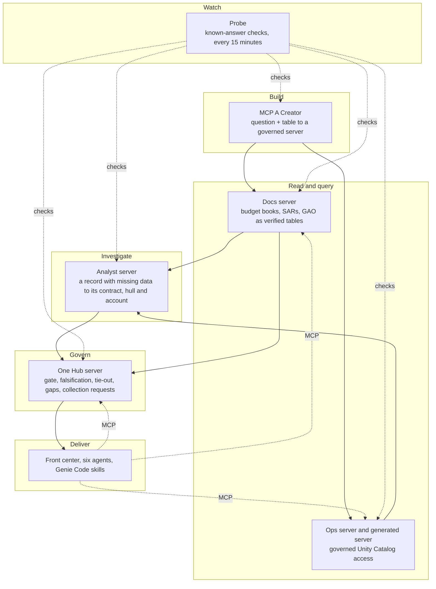

# Why this matters beyond one ship

Moved from the README on 2026-11-21 so the README stays short. [Back to the README](../README.md).

### Four ledgers that never meet

Every major weapon system's cost is recorded four times, by four communities, for four
purposes. None of the four records carries the keys needed to join it to the others.

| Ledger | Kept by | What it says | Where CVN-79 shows the break |
| --- | --- | --- | --- |
| **Budget** (J-book P-5c, P-40) | The comptroller chain: Navy FMB, NAVSEA 01, OUSD(C), and the congressional committees | What was requested and appropriated, by hull and cost category, in then-year dollars | $13,409.970M Total Ship Estimate. Each SCN year stays available for five years, so one hull is funded by many appropriation years at once |
| **Acquisition** (SAR, MSAR) | The PEO and USD(A&S) | Baseline, estimate at completion, contracts under cost reporting | The Ford-class SAR reports cost for the class, not per hull (GAO-17-575). Only seven contract numbers appear for a $13.4 billion ship. DCARC rates the program's contractor cost reporting **Red** |
| **Contract** (FPDS-NG, USAspending) | Contracting officers and SUPSHIP | Obligations by action and modification | A $54M action described as "detail design and construction CVN 79" is Nimitz defueling work. Award-level outlays reach USAspending for 0.8% of prime obligations, and account linkage covers 36.1% of the DD&C contract |
| **Accounting** (CIP, then General PP&E) | Service financial management and the auditors | The asset's cost on the balance sheet | The hull sits in construction in progress, with no decided date to relieve it. GFE installed on the hull risks being counted twice or not at all. General PP&E and Government Property in the Possession of Contractors are both open material weaknesses |

### The scale

- DoD plans to invest over **$2.4 trillion** to develop and acquire its costliest weapon
  programs ([GAO-26-108457](https://www.gao.gov/products/GAO-26-108457)).
- The FY2026 budget carries **72 active MDAPs**: 15 Army, **35 Navy**, 21 Air Force
  ([OUSD(C), Program Acquisition Cost by Weapon System, FY2026](https://comptroller.defense.gov/Portals/45/Documents/defbudget/FY2026/FY2026_Weapons.pdf)).
- FY2025 was DoD's **eighth disclaimer of opinion**, covering $4.65 trillion in reported
  assets ([CRS IF12627](https://www.everycrsreport.com/files/2026-04-28_IF12627_a0aaa98fa9bd10c7d612eaea7793e46ec9b96ed0.html)).
  The auditors reported **26 material weaknesses**, among them General PP&E, Government
  Property in the Possession of Contractors, and the Joint Strike Fighter program
  ([DoD FY2025 AFR, Other Information](https://comptroller.war.gov/Portals/45/Documents/afr/fy2025/5_Other_Information.pdf)).
- The FY2024 NDAA requires a clean opinion by **December 31, 2028**
  ([GAO-25-108052](https://www.gao.gov/assets/gao-25-108052-highlights.pdf)).
- The Navy alone carries **$503.1 billion** of General PP&E net book value, 55.9% of its
  assets, and vessels and aircraft make up over 90% of its construction in progress
  ([DON FY2025 AFR](https://www.secnav.navy.mil/fmc/FR/FY25_NavyAFR_12.8.25_FINAL.pdf)).
- For the F-35, DoD has estimated parts in contractor possession at over **$220 billion**,
  a figure GAO calls likely significantly understated
  ([GAO-23-106098](https://www.gao.gov/assets/gao-23-106098.pdf)).

A ship or an aircraft is a multi-billion dollar asset that spends a decade or more in
construction in progress, funded by many appropriation years, built under contracts
that also serve other hulls. Getting its cost right is the general PP&E problem at its
largest, and it decides whether the 2028 opinion is reachable.

### Who uses it, and what changes for them

| User | The question they ask | What the One Hub gives them | What it replaces |
| --- | --- | --- | --- |
| **Senior leaders**: ASN(FM&C), OUSD(C), the service acquisition executive, anyone briefing a ship's cost | "What does this ship cost, and can I stand behind the number?" | The four published figures side by side, each with its basis and page. A gate that will not show an unverified figure as fact: the December 2025 baseline (E-17) is shown both ways until a person confirms it | One number lifted into a briefing, with its definition lost on the way |
| **PEO and program office**: PEO Carriers and PMS 379 today, any PEO next | "Where did the money go, and why did the estimate move?" | The anchor chain from appropriation to contract to action. 17 variances where public sources disagree, each with provenance. Attribution to named contracts raised from 42.2% to 75.8% in one pass | Manual reconciliation across J-books, SARs and contract files, redone for every review |
| **CAPE and cost estimators**: CAPE, NCCA, NAVSEA 05C | "Is there a traceable actuals baseline for the next estimate?" | Actuals by cost category and by funding stream, each closing to zero. The learning-curve variance between the 18% contract man-hour target and what was realized. The per-hull cut GAO asked the class SAR to carry | GAO found the CVN-79 estimate met one of four characteristics of a reliable estimate (GAO-17-575). CAPE's independent estimate was higher, and its figure is redacted |
| **Budget analysts**: Navy FMB, NAVSEA 01, comptroller and congressional staff | "What is funded, by year, and how does it stand against the cap?" | Funding by stream from FY2007 to FY2027, the cap history under 10 U.S.C. 8692, cost to complete, and execution from the transaction record | Spreadsheets rebuilt from PDF exhibits each budget cycle |
| **Accountants and auditors**: service FM offices, IPA auditors, DoD OIG, GAO | "Can the asset's value be traced to transactions?" | Every figure to its page or row hash. Open questions the audit will ask, already registered and owned: when CIP is relieved (G14), whether GFE is counted twice (G15), and the GFP position report that answers the contractor-held property question (G16) | Sampling and tracing that starts from nothing every audit cycle |
| **Any analyst with a table**, through MCP A Creator | "Can I put a governed tool over my own data without a developer?" | A question and a Unity Catalog table become a tested MCP server, deployed as the analyst's own app after an approval that covers exactly what was reviewed | A ticket to a development team, or a model improvising SQL |

### From one hull to every major weapon system

What carries to the next program unchanged, and what each program adds:

| Carries over unchanged | Each new program supplies |
| --- | --- |
| The four servers and their 46 tools (docs, analyst, ops and the One Hub); the agents; the work register | A key set: appropriation, line item, program element, contracts, CAGE, PSC and acquisition program code. Part G of the [Ring 0 dossier](../the-one-hub/ops-center/corpus/dossier/RING0_CVN79.md) is the CVN-79 template |
| The gate. Its materiality floor is a share of the subject's total, so it moves between programs ([seed/gate.yaml](../the-one-hub/ops-center/seed/gate.yaml)) | A source catalog: its J-book exhibits, SAR or MSAR, contract records and GAO reports |
| The variance and gap registers, typed and ranked the same way | The subject total the reconciliation must close to |
| MCP A Creator, which builds the per-program servers from tables | Owners for its gaps |

The order we would take, each step reusing the last:

1. **CVN-80 and CVN-81.** Same class, same budget line (SCN 2001), same builder, and a
   shared contract (N00024-16-C-2116) that the hub already excludes from CVN-79.
2. **The Ford class and the carrier fleet.** The class SAR reports cost for the class,
   so the per-hull split is the product.
3. **The F-35.** The Joint Strike Fighter is its own DoD-wide material weakness, and its
   contractor-held parts are the largest instance of the property problem the hub
   already registers for CVN-79 (Ring 0, Part J).
4. **The 35 Navy MDAPs, then the 72 in the FY2026 budget.** Each adds a key set and a
   source catalog, not a new system.

Today the method has run on one hull. The steps above are a plan, not a result.

**Findings from the pilot that will recur on every program.** Each one is in the
variance or gap register with its evidence.

- A contract number is not a hull key. One EASR radar contract serves six ships, and a
  $54M action carries the wrong ship in its own description (Ring 0, N.4 and N.6a).
- USAspending obligations are usable for a weapon system. Its award-level outlays are
  not: they cover 0.8% of CVN-79's prime obligations (Ring 0, N.4).
- The class SAR does not give a per-hull cost (GAO-17-575).
- Capitalized value will never equal program cost, for three structural reasons: scope,
  timing and boundary. The $1 million Navy capitalization threshold alone expenses
  installed components (Ring 0, I.3).
- The date construction in progress is relieved is undecided between preliminary
  acceptance, delivery and commissioning, and the candidates straddle a fiscal year (G14).
- Contractor cost reporting can be formally deficient: the MSAR rates CVN-79's CSDR
  compliance Red (Ring 0, D.9).
- Assets move between hulls by memorandum, with no procurement transaction: one AAG
  engine set moved from CVN-78 to CVN-79 this way (Ring 0, J.4).

### The stack: seven capabilities, each useful on its own

Each layer below answers a problem that federal financial management and acquisition
offices carry today. They were built for CVN-79, and none of them depends on CVN-79 to
work. Stacked, each one makes the layer above it trustworthy.

| Capability | The problem it solves on its own | Who needs it beyond CVN-79 | Where it stands today |
| --- | --- | --- | --- |
| **MCP A Creator** (10 tools) | Turning a dataset into a tool an agent can use takes a developer and weeks, and an improvised server is untested and different every time. The Creator profiles the table, designs one tool per question, reviews meaning as well as shape, and generates a tested project that deploys as the requester's own app | Every office with a Unity Catalog table and a question. GSA's stated aim for this hackathon is an internal library of MCP server prototypes for the government workforce ([event page](https://www.gsa.gov/super-intelligence/si-community-of-practice/events-and-training/mcp-server-and-si-agent-government-hackathon)); the Creator is how a non-developer adds to that library | Works on any table today. It built the ops server inside this hub, and `mcp-bakehouse-sales` on an unrelated sales table to show it is not tied to the carrier, rebuilt through its own tools on 2026-11-21. Released as `v1.0.0-rc1`, installable with `uvx`; every project records its spec, Creator version and file hashes, and `mcp-a-creator-upgrade` regenerates it without overwriting the owner's edits |
| **Docs server** (11 tools) | Budget justification books and SARs run to hundreds of pages each, and analysts retype exhibits into spreadsheets. The docs server reads them deterministically, with no model: it maps each book by exhibit and P-1 line item, rebuilds tables with exact decimals, ties out every subtotal and total, and says whether a figure appears in an authoritative source (J-book, SAR) or only a secondary one (CRS, GAO) | Budget analysts, cost estimators, congressional and GAO staff, and auditors, on every appropriation's J-books and every program's SAR. Exhibit formats (P-40, P-5c, P-8a, P-10) are standard across DoD | The reader has no CVN-79 logic in it. 34 PDFs and 7,804 pages are loaded, GAO-26-108457 included; on the 22 SCN books, 7,690 of 7,693 tie-out checks pass, and on the deployed store over all 34 PDFs 7,743 of 7,746; the 3 left are within rounding. Known answers come back at p50 1.18 s since the cache fix. `docs_parse_pdf` reads any other PDF from a volume on request |
| **Analyst server** (12 tools) | The slowest work in audit remediation is researching a single record that is missing data elements: a GL line, an obligation or an invoice with no contract, no line of accounting or no hull. The analyst profiles what is missing, chases clues across FPDS, File C, sub-awards, the knowledge graph and every document, weighs the evidence, and returns ranked cases with citations, recovered data elements, a collection request for each missing one, and a human-review flag when the answer is weak | Component reconciliation teams, DFAS, FIAR teams and the auditors they support, on unsupported transactions, abnormal balances and Universe of Transactions gaps behind material weaknesses such as Fund Balance with Treasury and contractor-held property | Its skills read the two CVN-79 prime contracts today. A new program adds its contracts, File C and key set; the investigator's method does not change |
| **Ops server** (7 tools) | Agents need governed, paged, read-only access to exhibit cells, obligations on both prime contracts (sorted by date or by amount), the variance register, the knowledge graph and the work register, without raw SQL | Any team that keeps its facts in Unity Catalog | Generated by the Creator; golden set of 17 items with independent answers |
| **One Hub server**, `mcp-aircarrier-hub` (16 read-only tools) | An AI agent can put a wrong figure in a leadership brief or a financial statement in one sentence. This server is the control: `hub_check_claim` routes any candidate figure through policy and the gate and never promotes on its own; `hub_challenge_text` falsifies text against recorded error classes; `hub_tie_out` and `hub_check_anchor_chain` close totals in exact decimals without a model; `hub_rank_gaps`, `hub_plan_gap`, `hub_next_work` and `hub_collection_requirement` turn every unknown into an owned request to a named office | Any office that lets an agent draft numbers: comptrollers, audit liaisons, budget shops. The gap queue works like an auditor's request list, ranked by exposure, ignorance and closability | Deployed as the Databricks App `mcp-aircarrier-hub` on 2026-11-21 and watched by the probe (23 of 23 known answers right, p50 54 ms); also runs over stdio. Each hull is measured against its own total, a hull with no total is a gap (R9), and a VERIFIED tag without a source and a page goes to a person. The front center's Ask the evidence calls it over MCP; the agents call the same functions in process |
| **Probe** | When a user's agent says "Failed to generate OAuth token", nobody can tell whether the server or the connector broke. The probe calls every server every 15 minutes as a non-human caller, through initialize, tools/list and one known-answer check, and logs which step failed | Any agency running MCP servers in production, as continuous monitoring evidence for an authority to operate | 413 sweeps, 2026-11-12 to 2026-11-20: 99.90% of 6,193 checks ok, 1,234 of 1,234 known answers right |
| **Delivery: front center, six agents, Genie Code skills** | Leaders and analysts need the answer, not the tools. 23 pages answer one question each; six agents hand work to each other only through the work register; three Genie Code skills let an analyst verify a figure, investigate a gap or draft a collection request in their own workspace | Program offices, comptroller staff, auditors | Live as a Databricks App. Ask the evidence is an MCP host over the docs, ops and One Hub servers and names the server behind every step; a live run answered one question with four calls across three servers. Also runs locally from the bundled data with two commands |

**One record through the stack.** A GL line reads "$454,765,071.00, SCN progress CVN 79",
with no contract and no modification. This is development question Q2 in the delegation
evaluation: both models answer it in all six runs with the tools, and miss it in both runs
without them.

1. **Analyst.** `analyst_investigate_record` matches the amount in the FPDS record to
   modification P00067 on N00024-15-C-2114, and the key set confirms that contract is the
   Kennedy's detail design and construction contract. It returns the case, its evidence and
   the data elements it recovered.
2. **Docs.** The budget line and exhibit behind that contract, SCN line 2001 and the P-5c,
   come back as tied-out tables with page numbers.
3. **One Hub server.** `hub_check_claim` routes the figure: promoted only if it ties to a source
   record, otherwise held as a lead or sent to human review with the reason. If an element
   is still missing, `hub_collection_requirement` names the document, the system and the office
   that hold it.
4. **Probe.** The same hour, the probe has already confirmed that each server answered a
   known question correctly, so a wrong answer is a finding about the data, not about a
   broken transport.

Repeat that for every unsupported transaction in a component's ledger, and the result is
the audit trail that the General PP&E and contractor-held property weaknesses say is
missing.
